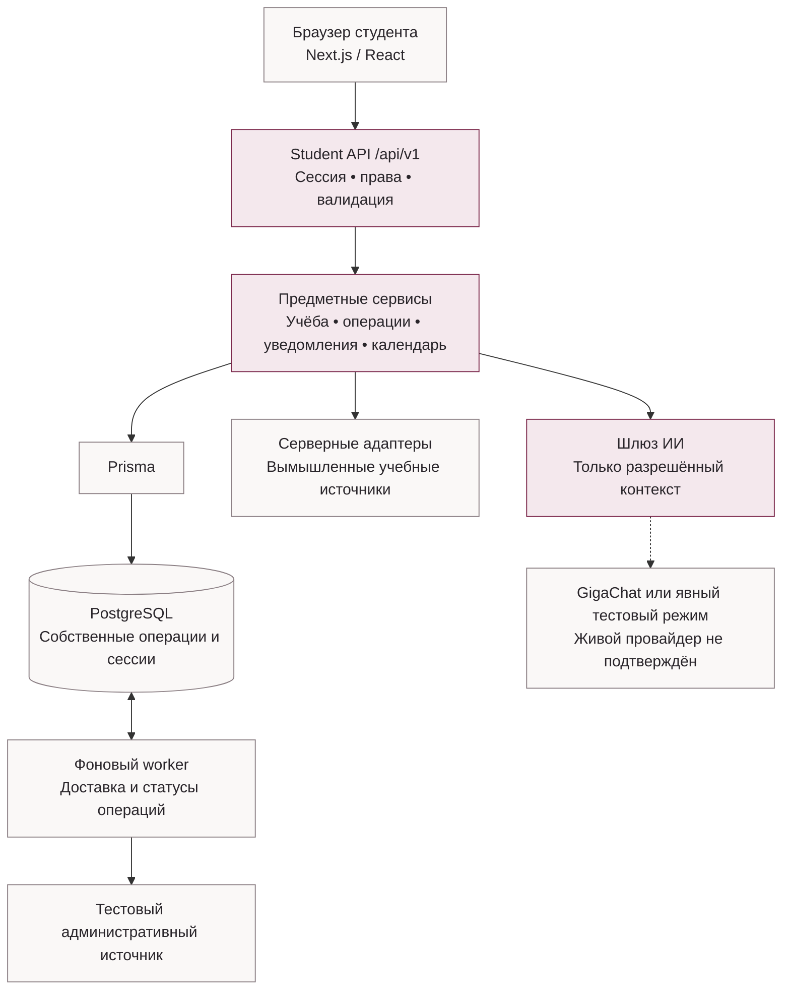
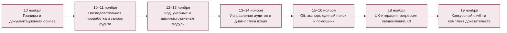
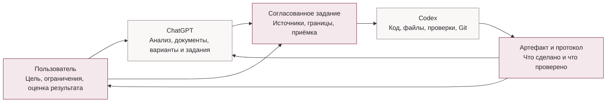
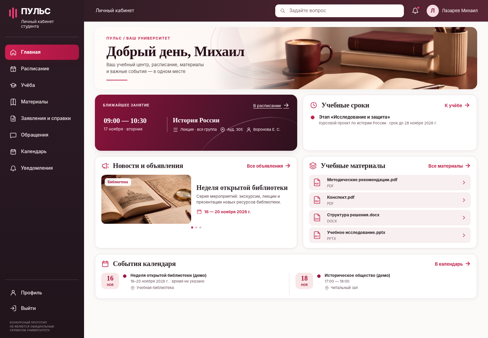
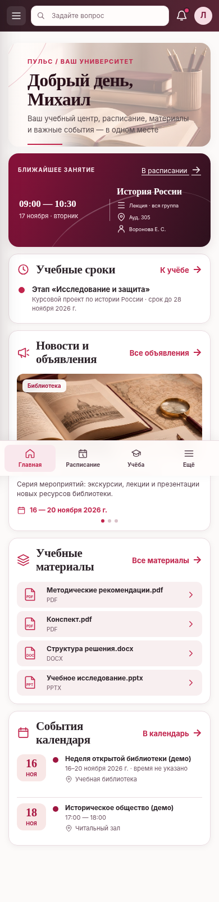
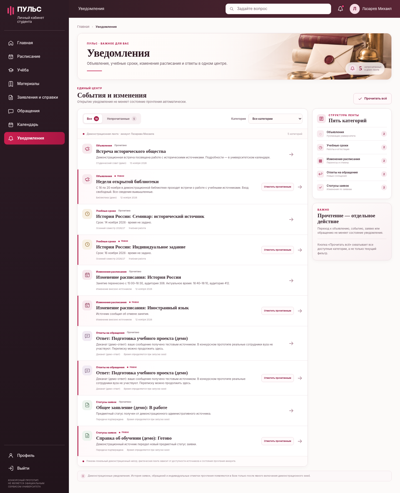
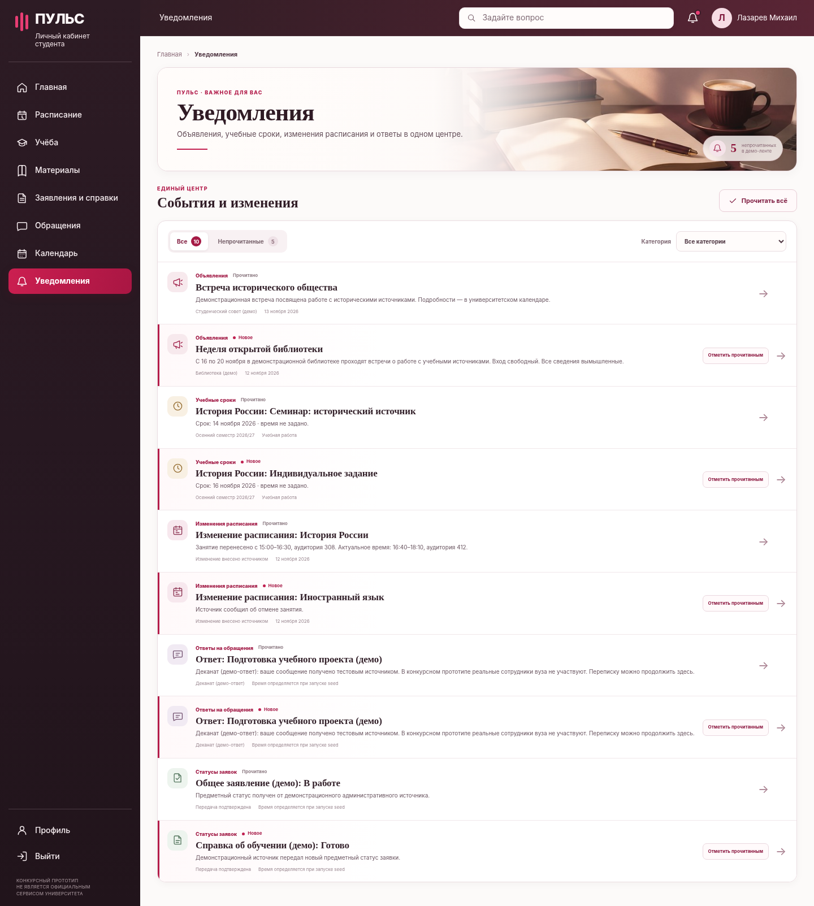

# ПУЛЬС — цифровой деканат будущего

## 1. Титульная страница

**История проектирования и разработки системы с использованием искусственного интеллекта**

Конкурсное задание: **«Цифровой деканат будущего»**  
Назначение: русскоязычный личный кабинет студента  
Год: **2026**  
Автор / команда: **[ЗАПОЛНИТЬ ПЕРЕД ПОДАЧЕЙ]**  
Образовательная организация, если указывается: **[ЗАПОЛНИТЬ ПЕРЕД ПОДАЧЕЙ]**  
Работающее приложение: **[ДОБАВИТЬ ПУБЛИЧНУЮ ССЫЛКУ ПОСЛЕ ПРОВЕРКИ]**  
Исходный код: [GomanNik/puls-student-cabinet](https://github.com/GomanNik/puls-student-cabinet)

Срез разработки: **10–18 ноября 2026 года**. Редакция отчёта: **19 ноября 2026 года**.

ПУЛЬС объединяет учебные сведения и собственные действия студента в одном кабинете. ИИ участвовал в подготовке требований, проектировании, создании кода, проверках и исправлениях. Человек определял границы продукта, оценивал результаты и принимал решения о пересмотре неудачных вариантов.

**Статус материала.** Это содержательный проект конкурсного отчёта. Приложение реализовано в коде; отдельные локальные проверки и CI отражены в источниках. Публичное размещение и полная конкурсная приёмка пока не подтверждены. Архивные изображения ниже показывают HTML-макеты, а не доказывают работу сервера.

**Как читать доказательства.** «Подтверждено первоисточником» означает наличие прямого запроса, файла, коммита или протокола — с указанием того, что именно он подтверждает. Отчёт исполнителя о тестах не равен их повторной независимой проверке. «Известно из контекста, требует проверки» используется для воспоминаний и косвенных сведений. «Не удалось подтвердить» обозначает отсутствие необходимого доказательства. Обозначения И1–И10 раскрыты в приложении Б.

## 2. Проблема и концепция

В исходном конкурсном задании учебная жизнь описана как разрозненный процесс: расписание, оценки, справки и объявления доступны через разные каналы. Особенно неудобно переключаться между ними с телефона. ПУЛЬС отвечает на эту задачу единым студенческим кабинетом, в котором информация связана с действием: занятие ведёт к дисциплине, учебная работа — к сроку и результату, обращение — к переписке, уведомление — к соответствующему объекту. Это продуктовая гипотеза, основанная на задании и проектных требованиях. Подтверждённых интервью, опросов однокурсников или измерений экономии времени в материалах нет. [И1, И3]

Граница проекта намеренно ограничена студентом. В прототип не включены кабинеты преподавателя и администратора, полноценная LMS и подключение к реальным университетским системам. При этом собственные действия пользователя обрабатывает настоящий сервер и сохраняет настоящая база данных. Университетские сведения поступают из детерминированных тестовых источников. Такой подход позволяет показать сквозные сценарии без использования чужих персональных данных. Принцип зафиксирован уже в исходном задании этапа 0 и развит в архитектуре. **Подтверждено первоисточниками задания и спецификаций.** [И1: П1, И4]

Отдельное проектное решение — универсальная учебная модель. Дисциплина может включать занятия, посещаемость, разные виды работ, курсовой проект, текущие результаты и официальную аттестацию. Отсутствие баллов не трактуется как ноль, отсутствие отметки посещения — как пропуск. Официальная подгруппа определяется для конкретной дисциплины; студент не переключается на чужой учебный контекст. Эти правила делают интерфейс содержательнее простого списка оценок. **Подтверждено проектными документами; полнота исполнения всех сочетаний требует приёмки.** [И3, И4]

## 3. Возможности приложения

Реестр ниже отделяет наличие реализованного модуля от подтверждения всех его сценариев. Основание реализации — журнал, README, история изменений и адресные артефакты; наличие красивого макета не используется как доказательство функции.

| Область | Что предусмотрено и реализовано в коде | Подтверждение и граница |
|---|---|---|
| **Вход и профиль — обязательное ядро** | Вход по логину и паролю, собственный профиль, серверная сессия, выход | Журнал 14.11 фиксирует браузерный вход двух вымышленных пользователей и отдельные API-проверки; это локальная проверка [И2] |
| **Расписание — обязательное ядро** | Сегодня и неделя, занятия, аудитории, преподаватели, изменения; персональный контекст подгруппы | Реализация учебного блока зафиксирована 13.11; внешний университетский источник заменён серверной фикстурой [И2, И8] |
| **Успеваемость — обязательное ядро** | Дисциплины семестра, работы, текущие результаты, посещаемость, официальная аттестация | Наличие блоков подтверждено журналом и README; полная визуальная приёмка сочетаний результатов не приложена [И2, И8] |
| **Заявления и справки — обязательное ядро** | Создание собственной операции, статус и история; демонстрационные ответы административного источника | Реализованы серверные операции и хранение; журнал 14.11 подтверждает собственные записи двух аккаунтов. Полный публичный сценарий с worker ещё нужно предъявить [И2, И5] |
| **Уведомления — обязательное ядро** | Объявления, учебные сроки, изменения расписания, ответы и статусы заявок; индивидуальное прочтение | Отдельное исправление открытия 18.11 и тестовый файл подтверждены Git; результаты двух E2E приведены по отчёту Codex [И1: П7, И6] |
| Обращения | Собственные обращения и история переписки | Реализация и раздельные записи зафиксированы журналом; ответы деканата демонстрационные [И2] |
| Учебные материалы | Просмотр разрешённых материалов и скачивание; демонстрационные PDF/DOCX/PPTX/XLSX | Файлы и серверные проверки перечислены в матрице исправлений. Матрица не является протоколом открытия каждого файла [И5] |
| Календарь и экспорт | Учебные и университетские события, выгрузки ICS/PDF/XLSX | Реализация отмечена 13.11; исправление хронологии и колонки дисциплины XLSX зафиксировано коммитом 15.11 [И2, И6] |
| Поиск и ИИ-помощник | Единый ввод вопроса и поиска, разрешённый учебный контекст, локальная история текущей вкладки | Содержание объединения подтверждают PATCH_NOTES и README. Реальный вызов GigaChat не подтверждён [И8, И10] |

Формулировка «реализовано в коде» не означает, что все перечисленные возможности прошли полную конкурсную приёмку. На момент подготовки отчёта подтверждено наличие пяти основных модулей; окончательное соответствие требованиям работающего публичного прототипа остаётся открытым.

[ТРЕБУЕТСЯ СКРИНШОТ: актуальное приложение на финальном коммите — расписание, дисциплина с результатами, созданная заявка со статусом и переписка; подписи должны указывать, какое действие выполнено через сервер.]

## 4. Архитектура и технологии

Браузер показывает интерфейс и отправляет запросы в собственный Student API. Сервер определяет пользователя по сессии, проверяет права и выполняет предметную операцию. Собственные заявки, обращения, сообщения и отметки прочтения сохраняются в PostgreSQL через Prisma. Учебные сведения читаются через серверные адаптеры тестовых источников; браузер не подключается к университетским системам. **Подтверждено архитектурой и журналом реализации.** [И2, И4]

*Схема 1. Основные границы приложения. Схема описывает архитектуру; она не является протоколом развёртывания.*

Фоновый worker отделяет сохранение пользовательского намерения от получения ответа тестового административного источника. Это позволяет различать «запрос сохранён», «доставка подтверждена», «ответ пока неизвестен» и предметный статус заявления. В исправлениях отдельно рассматривались повторная доставка, устаревшие события и защита от отката статусов. [И4, И5]

Основной стек — Next.js App Router, React и TypeScript; сервер работает на Node.js. PostgreSQL хранит данные, Prisma обеспечивает доступ к ним, Zod проверяет вход и ответы по контрактам OpenAPI 3.1. Для интерфейса используются Tailwind CSS, Radix UI/shadcn/ui и Lucide. Docker Compose и Caddy подготовлены для размещения, но наличие конфигурации не доказывает работоспособность публичного сервера. [И4, И8]

## 5. Методология работы с искусственным интеллектом

Разработка начиналась с документов, чтобы несколько ИИ-сеансов опирались на одну предметную модель. Требования связывались с источниками, пользовательскими сценариями, данными, API и критериями приёмки. Это особенно важно для подгрупп, отсутствующих оценок, истории заявок и разграничения пользователей: такие правила нельзя надёжно восстановить по одному изображению интерфейса. [И1: П1, И3]

Первый подход оказался слишком массовым. 10 ноября Codex создал 27 начальных файлов; пользователь в тот же день потребовал перехода к последовательной проработке групп по 1–3 документа. Первоначальный комплект был основой, а не 27 готовыми спецификациями: в нём были 26 требований, 14 сценариев и пустые разделы маршрутов OpenAPI. Факт создания подтверждён историей действий Codex; отказ от массового подхода — прямым сообщением в ChatGPT «Сформировать промт разработки файлов». Полные ответы ChatGPT этой итерации недоступны. Последующий рост требований подтверждён актуальными документами, но не позволяет приписать всю их редактуру одному инструменту. [И1, И2, И3]

*Схема 2. Датированные опорные события. Визуальное проектирование шло параллельно; точные даты отдельных партий HTML-макета не установлены.*

| Дата | Задача и решение человека | Работа ИИ | Доказанный результат |
|---|---|---|---|
| 10.11 | Задать границы; затем изменить массовый подход | Codex подготовил основу; в ChatGPT обсуждался новый порядок | 27 начальных файлов; подтверждена команда работать последовательно |
| 11.11 | Проверить документы и исправлять только доказанное | ChatGPT получил отдельные задания на аудит и исправления | Сохранены оригиналы П2 и П3; итоговый ZIP не доступен |
| 12–13.11 | Перейти к реализации; отделить этап А от этапа Б | Codex реализовал сервер, учебные и административные блоки | Датированный журнал; часть кода на этом этапе ещё не запускалась |
| 13.11 | Исправить CODE-001–010 и КОМП-01–08 | Codex менял код и подготовил матрицу | Статическая трассировка; не протокол испытаний |
| 14.11 | Восстановить фактическую интерактивность входа | Codex проверил браузер и локальный HTTPS-прокси | В журнале описаны причина, исправление и работа двух аккаунтов |
| 15–16.11 | Зафиксировать код, исправить экспорт, объединить поиск и помощника | Codex работал с Git; часть работы передана ChatGPT через архив | Коммиты и PATCH_NOTES; последний отдельно отмечает отсутствие запусков |
| 18.11 | Пересмотреть компоновку, устранить дефект уведомлений, подготовить CI | Codex менял код, добавлял регрессию и автоматизацию | Коммит уведомлений, файл E2E, конфигурация CI и сохранённые отчёты запусков |

Независимый аудит использовался как отдельная процедура: сначала чтение актуального архива и доказательства, затем адресные изменения. В поручении 11 ноября явно разделены AUD-001–AUD-011 и гипотезы H-01–H-07. Это не та же серия, что CODE/КОМП 13 ноября или поздняя таблица AUD-001–019 в реестре требований. Смешение этих серий дало бы неверное представление о количестве и закрытии ошибок. [И1: П2–П4, И3, И5]

Пользователь также изменял режим исполнения. 13 ноября приоритет был отдан реализации крупных блоков с отложенными проверками; это фиксировалось статусом «Реализовано в коде, тестирование отложено». Поздние конкретные поручения разрешали диагностику входа, подготовку CI и регрессию уведомлений. Таким образом, тесты выполнялись в пределах отдельных задач; нельзя утверждать, что весь проект непрерывно тестировался с первого дня. [И2, И1: П5, П7]

*Схема 3. Рабочий цикл. Роли пересекались: Codex создал первую документационную основу, а ChatGPT позднее подготовил патч по архиву. Авторство конкретного артефакта определяется источником, а не общей ролью инструмента.*

[ТРЕБУЕТСЯ СКРИНШОТ: безопасный фрагмент истории 10–11 ноября с постановкой задачи и результатом подготовки документов; показать последовательную проработку и связь требования со сценарием, без личных ссылок и данных аккаунта.]

## 6. Портфолио лучших промптов

Отобраны **семь оригинальных заданий**, реконструированных текстов нет. Полные выбранные сообщения или явно сокращённые разделы, источники и ограничения приведены в [отдельном портфолио](PULS_SELECTED_AI_PROMPTS.md).

| Пример и инструмент | Ключевой фрагмент оригинала | Результат и проверка |
|---|---|---|
| [П1 · Codex](PULS_SELECTED_AI_PROMPTS.md#p1) — документационная основа | «Данные пользовательских операций сохраняются в настоящей базе данных.» | 27 начальных файлов; дальнейшая детализация потребовала отдельных итераций |
| [П2 · ChatGPT](PULS_SELECTED_AI_PROMPTS.md#p2) — доказательный аудит | «Не называй предполагаемые ошибки подтверждёнными без прямых доказательств.» | Подтверждён запрос; полный итоговый отчёт не доступен |
| [П3 · ChatGPT](PULS_SELECTED_AI_PROMPTS.md#p3) — адресные правки | «Не выдавай гипотезы H-01–H-07 за ошибки.» | Задан контроль неизменности остальных файлов; итоговые хеши не получены |
| [П4 · Codex](PULS_SELECTED_AI_PROMPTS.md#p4) — безопасность | «Не допускать commit новой P-мутации после завершившегося отзыва той же сессии.» | Конкретный транзакционный инвариант отражён в матрице; runtime-проверка тогда была отложена |
| [П5 · Codex](PULS_SELECTED_AI_PROMPTS.md#p5) — первопричина входа | «Не ограничивайся чтением исходников: установи, на каком этапе перестаёт работать клиентская часть.» | В журнале зафиксировано восстановление гидрации после исправления прокси |
| [П6 · Codex](PULS_SELECTED_AI_PROMPTS.md#p6) — адаптивная компоновка | «При неполном последнем ряду карточки не должны растягиваться на всю ширину.» | Подтверждена новая постановка; все требуемые снимки результата не найдены |
| [П7 · Codex](PULS_SELECTED_AI_PROMPTS.md#p7) — регрессия уведомлений | «Если обновление на сервере завершилось ошибкой, не показывай ложное подтверждение прочтения.» | Отдельный коммит, тестовый файл; успешные запуски — по сохранённому отчёту |

Эти задания показывают не длину общения с ИИ, а способы управления работой: явные источники, запрет менять посторонние решения, проверяемое поведение и честный статус завершённости. П2 и П3 представлены вместе, потому что демонстрируют разделение экспертизы и исправлений; их включение не означает подтверждения закрытия аудита.

## 7. Итерации и исправления

### 7.1. От большого комплекта документов к последовательной проработке

**Проблема.** Первоначальная подготовка охватывала почти весь комплект сразу.

**Недостаток.** Количество файлов создавало впечатление готовности, хотя в первых версиях ещё не хватало детализации требований, сценариев и API.

**Корректировка задания.** Пользователь потребовал доводить небольшие группы документов, а не одновременно писать весь комплект и затем объявлять его проверенным ИИ.

**Решение.** Дальнейшая организация работы закрепила раздельную ответственность документов, приоритет актуальных требований и адресные исправления. Эти принципы отражены в действующих правилах работы; нынешний набор содержит отдельные предметные, архитектурные, UX- и защитные спецификации.

**Подтверждённый результат.** Создание 27 начальных файлов, последующая команда пользователя и существование развитого комплекта подтверждены. Полная цепочка авторства промежуточных редакций недоступна. Поэтому результат описывается как изменение процесса и развитие документов, без утверждения, что одна конкретная команда автоматически устранила все противоречия. [И1, И2, И3, И4]

### 7.2. Видимая форма входа, которая не принимала ввод

**Проблема.** Страница входа отображалась, но поля и кнопки не реагировали.

**Недостаток первой попытки.** Изменения поведения формы и CSP не доказали восстановления интерактивности. Успешные ответы API подтверждали серверный вход, но не работу браузерной формы.

**Корректировка задания.** Пользователь потребовал найти точку остановки клиентского выполнения, проверить настоящий браузер, сохранить архитектуру и не ослаблять production-защиту.

**Техническое решение.** Codex установил, что локальный HTTPS-прокси не передавал WebSocket Upgrade для потока Next.js; React ожидал данные и не завершал гидрацию. В прокси добавлена ограниченная обработка этого соединения.

**Подтверждённый результат.** Журнал 14 ноября содержит сравнение до/после: ответ WebSocket 101, интерактивные поля, переключение пароля, ошибочный вход и успешный вход обоих демонстрационных студентов. Изменение относится к локальной среде разработки; оно не доказывает доступность публичного сервера. [И1: П5, И2]

[ТРЕБУЕТСЯ СКРИНШОТ: сохранившаяся диагностика входа 14.11 — блокировка гидрации до исправления и интерактивная форма после; если исторических кадров нет, использовать подписанную схему по журналу, не инсценировать старый дефект.]

### 7.3. Полноширинные строки на широком экране

**Проблема.** Небольшие записи о работах растягивались на широкую страницу; результаты и состояния одной работы могли повторяться в отдельных списках.

**Недостаток решения.** Формальное использование доступной ширины не обеспечивало компактного чтения и ясной иерархии. Источник подтверждает отмену прежнего указания, но не позволяет установить автора каждой исходной рекомендации ИИ.

**Корректировка задания.** Пользователь потребовал сетку до трёх карточек на широком экране, двух на среднем и одной на мобильном; неполный ряд не должен растягиваться. Одной работе должна соответствовать единая карточка с состоянием и доступным результатом.

**Техническое решение, заданное исполнителю.** Адаптивная сетка, сохранение поиска, фильтров и серверной пагинации, отдельная компактная аттестация, отказ от декоративного заполнения пустоты. Требовалась проверка на 360, 768, 1440 и 1600 px.

**Подтверждённый результат.** Подтверждён пересмотр требований и конкретное задание Codex. Полный визуальный протокол реализации не найден; успешная приёмка не объявляется. Это пример полезной коррекции ИИ-итерации с ещё недостающим доказательством результата. [И1: П6]

[ТРЕБУЕТСЯ СКРИНШОТ: вкладка «Работы» до и после исправления на 1440/1600 px и после на 360/768 px; отдельно неполные ряды из 1, 2 и 5 объектов. Указать коммиты, не подменять эти экраны снимками главной.]

### 7.4. Уведомление открывалось, но оставалось непрочитанным

**Проблема.** Открытие уведомления не меняло его состояние прочтения.

**Недостаток реализации.** Переход по ссылке обходил вызов read API. Визуальное посещение объекта и сохранение индивидуальной отметки были разъединены.

**Корректировка задания.** Пользователь потребовал серверное сохранение, обновление состояния и счётчика, устойчивость после перезагрузки, отсутствие лишних запросов и ложного успеха при сбое. Позднее отдельно уточнил: счётчик остаётся в верхней панели, новый счётчик в боковом меню не нужен.

**Техническое решение.** Перед переходом к объекту выполняется запрос отметки прочтения. Переход и обновление состояния согласованы с успешным ответом; при ошибке нельзя показывать сохранение. Исправление выделено в отдельный коммит и сопровождено адресным E2E-файлом.

**Подтверждённый результат.** Коммит `de1fb52` меняет обработчик и добавляет `notification-open.spec.ts`. Сохранённый ответ Codex сообщает о двух прошедших E2E-тестах и успешном CI. Наличие коммита подтверждено Git; оригинальные визуальные доказательства и экспорт протоколов нужны для окончательной подачи. [И1: П7, И6, И7]

[ТРЕБУЕТСЯ СКРИНШОТ: непрочитанное уведомление, его состояние после открытия и после перезагрузки на коммите de1fb52 или более позднем проверенном; дополнить протоколом ошибки сервера и изоляции двух аккаунтов.]

## 8. Дизайн и мобильный интерфейс

Визуальная работа включала изображения-ориентиры, обсуждение Figma, автономные HTML-экраны и последующие изменения приложения. Завершённый импорт в Figma не подтверждён и не включён в перечень выполненных работ. Фактически найден HTML-архив ревизии 09: **25 HTML-файлов** и сохранённые preview-изображения. Точные даты отдельных партий и авторство каждого графического ресурса не установлены. [И9]

Выбор графитовых, сливовых и бордовых оттенков подтверждается документами редизайна, действующей UX-спецификацией и изображениями. Светлая рабочая область, тёмная навигация и цветовые акценты отделяют основные действия от второстепенных. Отказ от сезонности известен из ретроспективы пользователя и требует исходной реплики для исторической атрибуции; по самим изображениям можно подтвердить выбранную палитру, но не весь ход её обсуждения. [И4, И9]

*Рисунок 1. Главная страница автономного HTML-макета, ревизия 09, 1440 px. Сохранённый preview из архива; точная дата создания кадра не установлена. Имена и учебные сведения относятся к демонстрационному набору. Это визуальный ориентир, не снимок текущего серверного приложения.*

*Рисунок 2. Тот же HTML-макет при ширине 390 px: одноколоночное содержимое и мобильная навигация. Снимок не подтверждает работу сценариев на обязательных 360 px и не заменяет проверку форм и доступа к данным.*

*Рисунок 3. Ранняя сохранённая редакция уведомлений: боковая поясняющая колонка и крупная иллюстрация в заголовке. Точная дата этой редакции не установлена.*

*Рисунок 4. Ревизия 09: другая иллюстрация, упрощённая композиция и более широкая область ленты. Сравнение показывает изменение макета, а не доказывает, что вариант прошёл пользовательское исследование. Оба кадра предшествуют доказательству серверного исправления прочтения; их нельзя использовать как «до/после» исправления из §7.4. Текст о прочтении на раннем макете исторический и не задаёт актуальное поведение.*

Дизайн оценивался человеком по реальным экранам, что позволяло заметить проблемы, незаметные в текстовом описании: чрезмерное растяжение, дублирование работ и пустые блоки. Подтверждением пересмотра служит П6. Полного набора исторических скриншотов работающего приложения в доступной подборке нет, поэтому в отчёте сохранено различие между визуальной концепцией и окончательной приёмкой.

[ТРЕБУЕТСЯ СКРИНШОТ: актуальное серверное приложение на 360 px — вход, расписание, создание заявки, переписка, уведомления; рядом desktop 1440 px с теми же данными. Проверить клавиатуру, ошибки и отсутствие горизонтального переполнения.]

## 9. Безопасность и работа с данными

Защита строится на сервере. После входа браузер получает защищённую cookie с непрозрачным идентификатором сессии. Пароли обрабатываются Argon2id; при запросе объекта сервер проверяет живую сессию и право конкретного студента на этот объект. Скрыть чужую кнопку в интерфейсе недостаточно: защита должна действовать и при подмене идентификатора в прямом запросе. **Механизмы описаны спецификацией и журналом реализации; отдельные проверки входа зафиксированы 14 ноября.** [И2, И4]

Собственные действия сохраняются в PostgreSQL. Учебные данные относятся к тестовым источникам и доступны только на чтение; студент не выставляет себе оценки и не редактирует официальную посещаемость. Для изменяющих запросов предусмотрены защита CSRF/Origin, транзакции и проверка сессии в операции. В П4 отдельно сформулирован сценарий конкуренции изменения данных с выходом из аккаунта. [И1: П4, И4, И5]

Демонстрационный набор рассчитан минимум на двух студентов с различными данными. Журнал подтверждает существование раздельных профилей, заявок и переписки и работу обоих входов. Это важное, но ограниченное свидетельство: наличие двух пользователей не заменяет отрицательные проверки каждого защищённого объекта. Полная итоговая матрица запретов должна сопровождать конкурсную приёмку. [И2]

ИИ-помощник получает разрешённый сервером контекст и не наделяется правом изменять учебные записи. GigaChat рассматривается как провайдер внутри приложения; предусмотрен явно обозначенный тестовый режим. Работа адаптера не доказывает, что GigaChat писал код проекта или что реальные запросы провайдеру уже испытаны. [И4, И5, И8]

Секреты сервисов и пароли не включаются в отчёт, изображения и репозиторий. Все показанные учебные персонажи и сведения относятся к вымышленной демонстрации. Прототип обозначается как конкурсный концепт и использует собственное название и знак ПУЛЬС; официальный логотип университета в представленных макетах отсутствует. Источники и лицензии графических ресурсов нужно окончательно документировать перед публикацией. [И9]

## 10. Тестирование и автоматизация

В ходе разработки существовали разные уровни доказательств: чтение кода, автоматические проверки, адресная браузерная диагностика и CI. В таблице сохранены даты и ограничения. При подготовке этого отчёта приложение, тесты и сборки повторно не запускались.

| Этап | Что зафиксировано | Что это доказывает и чего не доказывает |
|---|---|---|
| 12.11, первая программная итерация | По журналу: typecheck, lint, build; 22 unit и 19 integration; E2E 4 из 5 | Обнаружена проблема истечения сессии. После исправления UTC integration прошли, повтор всего E2E не выполнен. Итерацию нельзя называть полностью прошедшей [И2] |
| 13.11, этап А | Запись кода, генерация контрактов и статическая матрица | Новые тестовые сценарии не запускались; статическая трассировка не подтверждает runtime [И2, И5] |
| 14.11, форма входа | Chrome/CDP, HTTP-запросы, проверка прокси; ввод, ошибочный и успешные входы | Адресное подтверждение восстановления локальной формы; не полный E2E-набор [И2] |
| 18.11, подготовка репозитория | README сообщает о TypeScript, ESLint, 85 unit, 54 integration, production build и проверке артефактов | Сохранённый отчёт о конкретной версии; не независимое повторение и не проверка внешнего хостинга [И8] |
| 18.11, CI на `80f9294` | В README указан успешный [Actions 44317626916](https://github.com/GomanNik/puls-student-cabinet/actions/runs/44317626916) | Нужен доступный жюри протокол этого запуска; общий CI не выполняет E2E [И7, И8] |
| 18.11, уведомления, `de1fb52` | По итоговому ответу Codex: 2 E2E, TypeScript, ESLint, build и [Actions 44352118677](https://github.com/GomanNik/puls-student-cabinet/actions/runs/44352118677) | Коммит и тестовый файл существуют; статусы запусков приведены по сохранённому ответу, без новой проверки сервиса [И1: П7, И6] |

Конфигурация [GitHub Actions](.github/workflows/quality.yml) реально существует. Она выполняет проверку схемы Prisma, миграции в изолированной тестовой PostgreSQL, TypeScript, ESLint, unit/integration, production-сборку и проверку артефактов. В ней нет шага E2E и нет автоматического развёртывания. **CI подтверждён конфигурацией и сохранёнными отчётами; CD не подключён.** [И7, И8]

Не подтверждены итоговый полный E2E-прогон, доступность публичного сервера из России, работа до 28 ноября, реальный GigaChat и восстановление из резервной копии. Это границы доказательств, а не утверждение о наличии соответствующих дефектов. Документ `CONTEST_FINAL_AUDIT.md` отсутствует.

[ТРЕБУЕТСЯ СКРИНШОТ: GitHub Actions с номером запуска, SHA и всеми завершёнными шагами; приложить текстовые результаты unit/integration и отдельный локальный E2E-протокол уведомлений. Скрыть секреты и личные данные, сохранить даты и идентификаторы версии.]

## 11. Этапы, выполненные вручную

Человеческий вклад заключался прежде всего в постановке и проверке задачи:

- **Определение продукта:** выбор студенческого модуля, ограничение объёма, принятие вымышленных источников и реального хранения собственных операций. Это зафиксировано в исходных заданиях. [И1, И3]
- **Организация разработки:** передача актуальных архивов, разделение документационных задач, изменение режима реализации и проверок, перенос работы между ChatGPT и Codex. Факт передачи патча подтверждает PATCH_NOTES; его успешная приёмка там не заявлена. [И1, И2, И10]
- **Редакторские и визуальные решения:** выбор палитры, отказ от лишних блоков, оценка компоновки и отмена полноширинных списков. Прямое задание П6 показывает критерии этой оценки. [И1, И4]
- **Обнаружение дефектов:** повторное сообщение о неработающем входе, замечания к учебным данным и фиксация непрочитанного уведомления после открытия. Техническую причину и код исправления далее исследовал Codex. [И1: П5–П7]
- **Контроль достоверности:** требование разделять гипотезы и ошибки, не объявлять непройденные тесты успешными, сохранять остальные документы и историю Git. [И1: П2–П5, П7]
- **Подготовка конкурсного материала:** выбор существенных примеров работы с ИИ и требование доказательной истории вместо пересказа. Настоящий комплект подготовлен по этому поручению.

Нет подтверждения, что пользователь вручную написал отдельные модули кода, провёл интервью со студентами или лично развернул публичный сервер. Эти действия не включаются в заявленный вклад.

ChatGPT в проекте использовался для анализа и проектирования, обсуждения визуальных решений и подготовки задач. Codex работал непосредственно с файлами, реализацией, проверками и Git. Эти роли не исключали пересечений; первые 27 файлов создал именно Codex, а патч объединённого помощника готовился в линии работы через ChatGPT. Результат каждого инструмента указан по своему источнику. [И1, И2, И10]

## 12. Итоги

За подтверждённый период проект прошёл от документационной основы до кода студенческого кабинета с собственным API, PostgreSQL, учебными и административными модулями. Сформирована подробная предметная модель, подготовлены интерфейсные варианты, исправлены конкретные дефекты, добавлены проверки и CI. Обязательные пять областей конкурсного ядра отражены в реализации; полное соответствие работающего публичного прототипа ещё предстоит подтвердить окончательной приёмкой. [И2–И8]

Практический результат применения ИИ — возможность вести связанную работу над требованиями, интерфейсом и сервером, сохраняя проверяемые артефакты. При этом ошибки возникали и в технических предположениях, и в способе организации работы, и в компоновке экранов. Пользователь изменял задания по результатам проверки, а наиболее полезные исправления сопровождались конкретной причиной и ограниченным набором проверок.

К подаче необходимо завершить публичное размещение, подтвердить основные сценарии и изоляцию двух аккаунтов, добавить актуальные снимки приложения и протоколы. До этого момента данный документ остаётся проектом отчёта, а не заявлением о завершённой конкурсной приёмке. Подробный внутренний список подготовки вынесен в отдельный файл и не является частью самооценки для жюри.

## Приложение А. Подтверждённые инструменты и их роль

| Инструмент / средство | Действительная роль и результат | Источник и статус |
|---|---|---|
| **ChatGPT** | Обсуждение требований, задания на независимый аудит и правки, визуальные итерации; линия подготовки патча единого помощника | Оригиналы П2/П3, история обсуждений и И10. Не все ответы ChatGPT доступны; точная модель не установлена |
| **Codex** | Документационная основа, программные модули, диагностика входа, исправление уведомлений, тесты и Git | П1, П4–П7; И2, И5–И7. Точная модель и самостоятельная сторонняя IDE не установлены |
| **HTML, CSS, JavaScript** | Автономные интерактивные визуальные макеты | Архив ревизии 09 и четыре перенесённых preview, И9. Генератор каждой иллюстрации не установлен |
| **Google Chrome / CDP** | Адресная браузерная диагностика формы входа | Журнал 14.11, И2 |
| **Git** | Фиксация исходников и отдельного исправления уведомлений | История изменений и коммит de1fb52, И6 |
| **GitHub** | Размещение репозитория и ссылок на историю | Ссылка в README, И8; доступ для жюри необходимо проверить перед подачей |
| **GitHub Actions** | CI: проверка схемы, миграции, типизация, линтер, тесты, сборка | Реальный workflow и ссылки на запуски, И7; CD отсутствует |
| **Node.js, pnpm** | Среда выполнения и управление зависимостями/командами | README, журнал и workflow, И2/И7/И8 |
| **Next.js, React, TypeScript** | Веб-приложение, серверные обработчики и интерфейс | Журнал реализации, архитектура и сборочные проверки, И2/И4/И8 |
| **PostgreSQL, Prisma** | Сессии и собственные данные, миграции и доступ к БД | Журнал локальных операций и CI, И2/И7 |
| **Tailwind CSS, Radix UI/shadcn/ui, Lucide** | Стили, UI-компоненты и иконки | Документированная основа интерфейса, И4/И8; это библиотеки, не ИИ-авторы |
| **Noto Sans** | Шрифт для подготовленных документов и выгрузок | Журнал 13.11 фиксирует получение шрифта и чтение лицензии OFL, И2; это графический ресурс, не ИИ-инструмент |
| **Zod, OpenAPI 3.1** | Проверяемые контракты Student API и серверных источников | Контракты, генерация и матрица исправлений, И4/И5 |
| **Argon2id** | Хеширование паролей | Журнал авторизации и спецификация безопасности, И2/И4 |
| **Vitest, Playwright** | Модульные/интеграционные и браузерные проверки | Журнал, workflow и тестовый файл уведомлений, И2/И6/И7 |
| **ESLint, TypeScript compiler** | Статические проверки исходников | Workflow и сохранённые результаты, И7/И8 |
| **Docker Compose, Caddy** | Конфигурация контейнерного размещения и HTTPS | И8; публичное исполнение конфигурации не подтверждено |
| **GigaChat** | Серверный адаптер помощника внутри продукта с отдельным тестовым режимом | И4/И5/И8; реальный вызов провайдеру и участие в написании кода не подтверждены |

Figma обсуждалась, но выполненный импорт не доказан. Использование Cursor, Copilot, отдельного графического редактора или конкретного генератора изображений не установлено, поэтому они не заявлены участниками разработки. Эта граница необходима для достоверного перечня; происхождение иллюстраций остаётся пунктом подготовки.

## Приложение Б. Источники

| ID | Доступный материал | Что подтверждает |
|---|---|---|
| **И1** | [Портфолио оригинальных промптов](PULS_SELECTED_AI_PROMPTS.md), П1–П7; предоставленный пользователем текст конкурсного задания в беседе аудита 11.11 | Исходные задачи, ограничения, критерии и требования конкурса. Дословные выдержки опубликованы без приватных ссылок. Официальная веб-страница в этой работе не проверялась |
| **И2** | [Журнал разработки с ИИ](документация/11_Журнал_разработки_с_ИИ.md) | Датированные отчёты 10–14.11 о действиях, проверках и ограничениях |
| **И3** | [Концепция](документация/02_Концепция_продукта.md), [требования](документация/03_Реестр_функциональных_требований.md), [сценарии](документация/04_Пользовательские_сценарии.md), [модель данных](документация/06_Модель_данных.md) | Предметные решения; сами по себе не доказывают выполнение приложения |
| **И4** | [Архитектура](документация/05_Архитектура.md), [UX](документация/07_Дизайн_и_пользовательский_опыт.md), [безопасность](документация/08_Безопасность.md), [API](документация/API/README.md) | Проектные механизмы, границы и контракты |
| **И5** | [Результат исправлений двух аудитов](документация/Тестирование/Результат_исправлений_двух_аудитов.md) | Внесённые изменения и статическая трассировка 13.11; не протокол тестов |
| **И6** | [CHANGELOG](CHANGELOG.md), [коммит уведомлений](https://github.com/GomanNik/puls-student-cabinet/commit/de1fb526b0fed1cb5a8d3c6f2e5b312417ce3032) | История фиксации кода и конкретное исправление |
| **И7** | [Workflow CI](.github/workflows/quality.yml), [запуск на 80f9294](https://github.com/GomanNik/puls-student-cabinet/actions/runs/44317626916), [запуск исправления уведомлений](https://github.com/GomanNik/puls-student-cabinet/actions/runs/44352118677) | Состав CI; ссылки на результаты из сохранённых отчётов. Успех удалённых запусков при подготовке этого текста повторно не проверялся |
| **И8** | [README](README.md), [развёртывание](deploy/README.md) | Сводка реализации, результатов проверок, отсутствие публичного сервера и CD |
| **И9** | Архив `PULS_HTML_revision_09.zip`; четыре исходных preview в [каталоге иллюстраций](contest-report-assets/) | Реальные HTML-макеты, их композиция и мобильный вариант. Перенесены без изменения изображений; не снимки текущего приложения |
| **И10** | [PATCH_NOTES](PATCH_NOTES.md) | Содержание объединения поиска и помощника; прямо указано, что патч не запускался при подготовке |

Внутреннее исследование истории использовано для отбора источников, но не включается в публичный пакет: оно содержит локальные пути и ссылки на личную переписку. Исторические события в отчёте опираются на найденные сообщения, документы и Git; неполнота доступа к ответам ChatGPT сохранена в оговорках.

## Приложение В. Указания для последующей вёрстки

Светлый фон, графитовый основной текст, сливовые заголовки и бордовые акценты. Таблицы — с повторяемой шапкой; код и пути — только там, где они помогают проверке. Mermaid-схемы при экспорте перевести в векторные иллюстрации и проверить подписи. Desktop и mobile размещать рядом с общей легендой; длинные снимки уведомлений вынести на отдельные развороты, сохранив читаемость текста.

Поля авторства, публичной ссылки и пометки о недостающих изображениях необходимо заполнить до окончательного экспорта. После добавления новых свидетельств обновить соответствующие статусы в тексте. Итоговая PDF-версия в рамках этой работы не создавалась.

