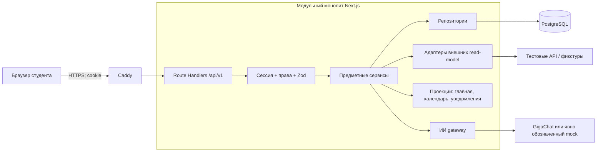
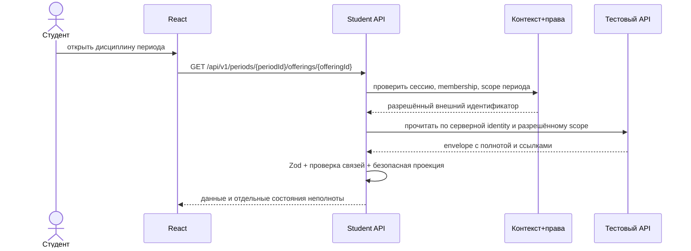
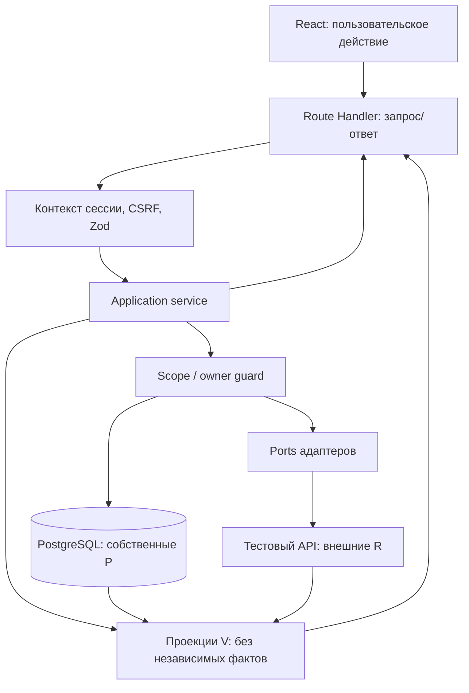
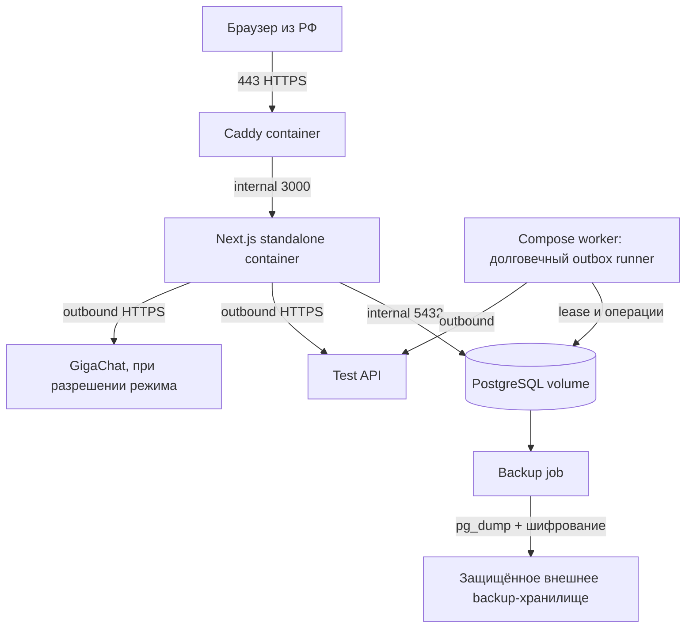

# 05. Архитектура проекта «ПУЛЬС»

> **Назначение:** исполнимая архитектурная спецификация отдельного студенческого модуля конкурсного веб-приложения «ПУЛЬС».  
> **Дата:** 11.11.2026. **Статус:** согласованная для реализации архитектурная спецификация; выполнена адресная синхронизация с актуальным UX 07 от 11.11.2026; не свидетельствует о наличии программного кода.  
> **Основания:** актуальные переданные документы `00`, `01`, `02`, `03`, `04`, `06`, `10`; нормативные пути в проекте — `документация/00_Паспорт_проекта.md`, `01_Основания_и_ограничения.md`, `02_Концепция_продукта.md`, `03_Реестр_функциональных_требований.md`, `04_Пользовательские_сценарии.md`, `06_Модель_данных.md`, `10_Журнал_архитектурных_решений.md`.  
> **Правило реализации:** все названия, URI и коды в этом документе, не утверждённые в предметных источниках, являются **инженерными контрактами**, а не новыми университетскими регламентами.

## 1. Область действия, приоритет источников и границы

Разрабатывается только кабинет **студента**. Жюри использует обычные вымышленные тестовые аккаунты, отдельной роли жюри нет. Отсутствуют кабинеты преподавателя, деканата и администратора; студент не редактирует первичные университетские данные, не выбирает чужие подгруппы, не отправляет учебные работы и не выставляет оценки/посещаемость. Собственные операции (логин, сессии, заявки, обращения, сообщения, прочтение уведомлений) сохраняются в PostgreSQL. Внешняя учебная информация поступает по серверным контрактам тестовых API с детерминированными вымышленными данными. Нет реальных университетских интеграций, постоянного кэша внешних read-model, Redis, runtime MSW, вложений в заявки/обращения, личного календаря, постоянной истории ИИ и изменяющих действий ИИ.

**Приоритет:** обязательные конкурсные ограничения и подтверждённые решения заказчика; актуальные предметные уточнения 02–04 от 11.11.2026; согласованная логическая модель 06 от 11.11.2026; утверждённые технические ограничения 01; старые записи 10 только если не противоречат этому порядку. Документ 10 утверждает, что стек и сессии не выбраны, но это устаревшее положение, перекрытое ТЕХ-001–ТЕХ-011 в 01. Документ 01 содержит старые оговорки о подгруппах, тогда как актуальные 02–04 и 06 требуют **автоматически определяемого официального назначения на каждую конкретную дисциплину**. Отсутствие синхронизации других документов не даёт права менять эту модель.

**Гарантии системы:** сервер всегда определяет текущего аккаунта из сессии; выдаёт только персонально разрешённый контекст; не подменяет неизвестные данные нулём, отсутствием активности или ошибкой; сохраняет одну бизнес-сущность и строит несколько отображений; разделяет план занятия, проведение и посещаемость; работу, выполнение, сдачу, проверку и результат; административное отклонение и сбой транспорта. Ни один счётчик, балл или процент не рассчитывается без достоверных полных множеств и подтверждённого алгоритма источника.

### 1.1. Архитектурные критерии качества

| Критерий | Проверяемый инвариант |
|---|---|
| Безопасность | Неавторизованные запросы не возвращают личные данные; межаккаунтные запросы не дают прочесть или изменить чужой объект даже при прямой подмене идентификатора |
| Целостность | Транзакционные собственные записи; идемпотентность операций; внешний университетский факт не копируется в независимую локальную бизнес-запись |
| Достоверность | Явные статусы `UNKNOWN`, `NOT_APPLICABLE`, `PENDING`, `SOURCE_ERROR`, `FORBIDDEN`, подтверждённый `KNOWN_ZERO`; полнота каждой выборки отдельно |
| Устойчивость | Сбой расписания не ломает заявки; сбой ИИ не блокирует кабинет; неизвестная доставка не выдаётся за отклонение |
| Проверяемость | Повторяемые фикстуры ТД-01–ТД-20, изолированные адаптеры и тесты прямого API и интерфейса |
| Доступность | Русскоязычный адаптивный интерфейс от 360 px, цель WCAG 2.2 AA, поддерживаемые браузеры по ТЕХ-009 |
| Эксплуатация | HTTPS, ежедневный backup и проверяемое восстановление; публикация в РФ без VPN |

### 1.2. Процесс и доверенные границы



Браузер — недоверенная среда. Route Handler — входная граница протокола, а не место предметных правил. Сервис — граница операции и права. Репозиторий не обращается к внешним API. Адаптер не имеет полномочий изменять локальные предметные записи. Проекции не сохраняют собственные университетские факты. Компоненты React не выполняют проверку права как единственный барьер.

### 1.3. Действующие архитектурные решения и правила изменения

| Тема | Действующее основание | Архитектурное следствие / приёмка |
|---|---|---|
| Только студент и собственный Student API | 00 §3–5; 01 РЕШ-001–005, ТЕХ-002; 02–04 | Ни одной преподавательской/административной роли, собственного клиента внешних API или доступа из браузера к базе |
| Защита сессии и изоляция | 01 ТЕХ-003, НФТ-04–08; 06 §§2–3 | Непрозрачная cookie, Argon2id, серверное определение identity, проверка владения каждой записи и membership каждого R-объекта |
| Академическая деятельность | Актуальные 02 §§5–6; 03 ФТ-67–77; 04 СЦ-19–24; 06 §§8–11 | Семестр и offering — обязательный контекст; работа, выполнение и оценка не тождественны; без выдуманных баллов/обязательных этапов |
| Официальная подгруппа | 02/03/04/06 от 11.11.2026 имеют приоритет над старыми оговорками 01 и 10 | Назначение по offering, только своё; отсутствие/конфликт не превращается в переключатель |
| Типизированные заявки | 03 ФТ-13–15, 35–40; 04 СЦ-08–10; 06 §12 | Персональное локальное сохранение; бизнес-статус только от подтверждённого источника; 4 утверждённых статуса |
| Переписка | 03 ФТ-19–20, 41–43; 04 СЦ-13/13А/13Б; 06 §13 | Категории, `OPEN`, сохранённая хронология, демо-ответ; без вложений и кабинета сотрудника |
| Проекции и хранение | 01 ТЕХ-004–006; 06 §§2, 14–17 | P — PostgreSQL; R — серверное test API; C — конфигурация; V — вычисление; T — внутри запроса; без постоянного учебного кэша |
| Эксплуатация и качество | 01 ТЕХ-007–011 | OpenAPI 3.1, Docker Compose/Caddy/РФ, backup+restore, целевые метрики, Vitest/Playwright |

**Контроль изменений:** поправки в 05, основанные на техническом делегировании, меняют только механизм исполнения и должны оставаться совместимыми с утверждёнными предметными инвариантами. Например, `message_delivery_operation` — техническая таблица очереди, но не новый статус обращения. Отдельные точные формы, шкалы и университетские нормы нельзя молчаливо объявлять утверждёнными. Внешние материальные факты никогда не выводятся из названия ресурса, даты загрузки, сходства текстов или предыдущего API-ответа.

## 2. Технологическая основа и организация исполнения

| Слой | Фиксированное решение | Причина и ограничение |
|---|---|---|
| Клиент и сервер | Next.js App Router, React, TypeScript, Node.js LTS, `pnpm` | Одна кодовая база и типизация; клиентские компоненты только при необходимости взаимодействия |
| HTTP | Собственный REST/JSON `/api/v1/*` через Route Handlers | Единый контракт для UI и тестов, независимо от серверного рендеринга |
| База | PostgreSQL + Prisma ORM и миграции | Транзакции, FK, уникальные ограничения; сложные CHECK/partial indexes через SQL миграции |
| Проверка данных | Zod + TypeScript DTO | Граница доверия на каждой команде и каждом внешнем ответе; TypeScript не заменяет runtime validation |
| UI | Tailwind CSS, Radix UI/shadcn/ui, Lucide | Принятый набор инструментов; конкретные экраны и токены остаются зоной документа 07 |
| Пароли/сессии | Argon2id, PostgreSQL, непрозрачный HttpOnly токен | Нет JWT и localStorage, отзыв возможен сразу |
| Внешние сведения | Серверные адаптеры тестовых API | Нет прямых клиентских обращений к тестовым системам; нет runtime MSW |
| ИИ | Серверный gateway к GigaChat + явный mock | Контроль контекста и секретов; core не зависит от провайдера |
| Качество | Vitest, Playwright, OpenAPI 3.1 | Проверка изоляции, контрактов, бизнес-инвариантов и браузерных путей |
| Публикация | Docker Compose + Caddy + PostgreSQL, VPS РФ | Минимальная эксплуатационная сложность; один origin |

**Версионирование библиотек:** перед началом реализации фиксировать совместимые конкретные версии в `pnpm-lock.yaml`, base image через digest/поддерживаемую LTS-линейку; не полагаться на `latest`. Обновления не должны менять согласованные предметные контракты; major-upgrade допускается только после регрессии. Код сервера собирается в `output: 'standalone'`, Prisma Client генерируется на этапе сборки, миграции запускаются отдельным одноразовым шагом, не на каждом HTTP-запросе.

**Модульный монолит:** одно развёртываемое приложение, один пул PostgreSQL, набор независимых предметных модулей с явными публичными сервисами. Не вводить брокер, Kubernetes, Redis, CQRS с отдельным хранилищем, микросервисы или обязательный cron, если текущие требования реализуемы транзакцией и ограниченным синхронным/восстанавливаемым опросом. Масштабирование экземпляров Next.js возможно благодаря вынесенным сессиям и записям в БД; конкурентный запуск фоновых задач требует DB lease или блокировок.

## 3. Модули и правила зависимостей

| Модуль | Публичная ответственность | Зависимости / запрещённые действия |
|---|---|---|
| `auth` | Вход, выход, разрешение сессии, профиль владельца | `accounts` repository; не доверять `accountId` из URL |
| `student-context` | Внешняя identity, периоды, membership, официальные назначения и правила scope | `auth`, адаптер контекста; не делает переключения чужой подгруппы |
| `schedule` | План и изменения, отдельно факт проведения/посещения | `student-context`, адаптеры; не выводит присутствие по плану |
| `academics` | Предложения дисциплин, работы и этапы, прогресс, аттестации и результаты | `student-context`; не пишет official grades и не вычисляет неподтверждённый итог |
| `materials` | Ссылки/метаданные и защищённое разрешение ресурса | `student-context`, read-model; не создает работу по существованию файла |
| `requests` | Каталог форм, создание, своя история, проекция бизнес-статуса и внешние операции | БД и внешний command adapter; не смешивает `REJECTED` и `ERROR` |
| `appeals` | Создание обращения, сообщения, внешние ответы и доставка | БД и command adapter; не создаёт кабинет деканата |
| `calendar` | Общие события и разрешённые проекции сроков, единая выдача и экспорт | `academics`, адаптер календаря; не содержит персональных создаваемых событий |
| `notifications` | Сбор пяти категорий, read/unread по аккаунту, ссылки | Проекции из источников, БД прочтения; не копирует первоисточник |
| `dashboard` | Композиция главной из независимых частичных результатов | Публичные read-сервисы; не новая БД учебных фактов |
| `assistant` | Минимальный разрешённый контекст, безопасные ответы | Read-сервисы и server provider; не вызывает write-сервис |
| `integrations` | Протокол, таймауты, validation, normalization, контроль полноты | Не знает cookie, не принимает произвольный `studentId` из UI |

**Направление:** `route → application service → domain/ports → repository|adapter`; `presenter → read-service`, но не `repository → route`, `external adapter → auth cookie`, `client → Prisma` или `client → mock API`. Общие типы находятся в `shared/contracts`, без циклических импортов между модулями. Серверные импорты маркировать `server-only`.

### 3.1. Взаимодействие чтения



### 3.2. Взаимодействие собственной команды

```mermaid
sequenceDiagram
 actor U as Студент
 participant A as Student API
 participant DB as PostgreSQL
 participant W as Надёжный runner
 participant E as Тестовый command API
 U->>A: POST заявка + Idempotency-Key
 A->>A: сессия, Origin/CSRF, тип формы, Zod
 A->>DB: транзакция: ключ+заявка+outbox+operation
 DB-->>A: локально сохранено; бизнес-статус ещё не подтверждён
 A-->>U: 201 + локальный ID, статус передачи «ожидается»
 W->>DB: claim operation (SKIP LOCKED, lease)
 W->>E: отправить с неизменным operationId
 alt подтверждённое принятие
  E-->>W: ACK + SUBMITTED/иной подтверждённый предметный статус
  W->>DB: атомарно записать attempt, businessStatus и transition
 else timeout / транспортная ошибка
  E--xW: результат не подтверждён
  W->>DB: attempt + UNKNOWN/RETRYABLE_ERROR; оставить заявку
 end
 Note over A,DB: Локальное сохранение не означает внешнюю отправку; timeout не равен REJECTED
```

После ответа `201` внешняя отправка выполняется **только** долговечным runner по зафиксированной в БД операции. Не запускать внутри Route Handler fire-and-forget, не смешивать послеответную отправку с синхронным результатом HTTP. Runner запускается отдельным процессом, имеет повторный запуск после рестарта и периодический опрос (§11.2, §15.1). Для демонстрации допускается синхронный запрос `GET /requests/{id}` после создания — он читает то, что действительно зафиксировано. Если необходимо ускорить первый переход, сервер может сигнализировать runner через недолговечный wake-up, но БД остаётся единственным долговечным источником заданий; wake-up не является условием доставки.

### 3.3. Контракты между слоями и composition root

- Все Route Handlers — тонкие обёртки вокруг сервиса: чтение сессии, Zod-запрос, вызов `execute(ctx, command)` или `query(ctx, filter)`, сериализация ответа; `ctx.accountId` создаётся только сервером. Ошибки централизованы, ORM-ошибки не становятся текстом API.
- Для чтения `student-context` выдаёт **не подделываемый клиентом серверный** `AuthorizedAcademicScope`, содержащий source, externalStudentIdentity, period, разрешённые offerings, официальные subgroup assignments и аудитории. Его можно использовать лишь в пределах текущего запроса; он не кешируется в браузере и не конструируется из URL.
- Предметные сервисы реализуют один публичный интерфейс по модулю (`RequestsService`, `AcademicReadService` и т. п.); зависимости инъецируются через серверный composition root. Тесты подменяют только ports адаптеров и clock, а не логику ACL. Репозитории применяют owner-scoped predicates и транзакции; интерфейс DTO не включает Prisma Model.
- Независимые частичные read-срезы допускается объединять только после проверки источника, `periodId`, `offeringId`, принадлежности студента и полноты. Любой `ExternalRef` — отдельный кортеж с namespace, не «просто UUID». Изменение fixture mode не должно менять локальную identity или владельца операции.
- При ошибке приложения после commit локальной команды чтение её объекта остаётся возможным. При ошибке до commit клиент получает ошибку и не получает подтверждение создания; внешняя передача невозможна до commit.



## 4. Защита, авторизация и текущий пользователь

1. `POST /api/v1/auth/login`: по HTTPS, нормализованный логин, Zod, ограничение частоты по IP и нормализованному логину (первичная реализация — БД/обратный прокси; не считать память процесса распределённым лимитом), постоянное время ошибки насколько возможно; Argon2id с параметрами зафиксированными в коде и тесте (`memoryCost=65536 KiB`, `timeCost=3`, `parallelism=1` как стартовые технические параметры, адаптировать по измерению VPS). Не раскрывать, существует ли аккаунт.
2. После успешной проверки `crypto.randomBytes(32)`, хранить `SHA-256(token)` в `auth_session.token_digest` как байтовую строку или hex, сам токен только в cookie `__Host-puls_session` (`Path=/`, `HttpOnly`, `Secure`, `SameSite=Lax`, без Domain). При логине менять ID сессии; применять `Cache-Control: no-store`.
3. Каждая защищённая операция извлекает cookie, вычисляет digest, проверяет в БД отсутствие `revoked_at`, `expires_at`, истечение 12 часов после последней активности и абсолютного срока 7 суток от `issued_at`; продлевает только activity (например, не чаще раза в 5 минут через условный UPDATE), **не** продлевает абсолютный предел. Состояние аккаунта и credential должно разрешать вход.
4. `POST /api/v1/auth/logout`: отозвать сессию и обнулить cookie с тем же набором атрибутов; повторный logout безопасен. Для неавторизованных запросов `401`, для заведомо чужого защищённого ID единообразно `404` (не выдавать существование чужого объекта); для известного неразрешённого действия `403`.
5. **CSRF:** каждый изменяющий endpoint проверяет `Origin` по точному публичному origin и отклоняет отсутствие/несоответствие (допустимый same-origin запрос без Origin — только если совместим с принятой политикой и дополнительно защищён CSRF-токеном). Выбрать единый строгий механизм: `Origin` обязателен для `POST/PATCH/PUT/DELETE`, кроме документированных machine-to-machine подписанных callback; формы браузера отправляют same-origin fetch с Origin; дополнительно `Sec-Fetch-Site` должен быть `same-origin` или `none` в совместимых браузерах. Никаких публичных изменяющих GET. CORS не открывать для чужих origin.
6. Security headers: HSTS после проверки HTTPS, CSP без небезопасного `unsafe-eval`, `frame-ancestors 'none'`, `X-Content-Type-Options: nosniff`, `Referrer-Policy: strict-origin-when-cross-origin`; не рендерить непроверенный HTML из материалов, обращений или ИИ. Для ссылок `rel=noopener noreferrer`.
7. **Права:** на локальные заявки `WHERE id = ? AND owner_account_id = session.accountId`; обращения так же; сообщения только после владения родительским обращением; read state `account_id` всегда из сессии. На R-объекты: серверное разрешение `(source, externalStudentId, membership, period, offering, subgroup, audience)` до обращения и **после** получения проверка каждой возвращённой связи. Нельзя считать введённые `periodId/offeringId/subgroupId` доказательством membership.
8. `student_external_identity` сопоставляет `(source_code, external_student_id)` с одним `account_id`; нельзя разрешать универсальный `GET /students/{id}`. Для групповых событий разрешать доступ по подтверждённой membership/audience, не по случайному совпадению названия группы.
9. ИИ получает только безопасные DTO, не cookie, не токен, не пароль, не identity других пользователей; пользовательский prompt не способен изменить политику.

**Тесты безопасности:** запросы без cookie и с истёкшей/отозванной cookie, фиксация session rotation, CSRF другого origin, подмена local ID, внешнего ID, offering, period, subgroup, parent appeal, notification event key, даты экспорта, URL материала и попытка обхода через assistant. Каждую ручку тестировать под аккаунтами A и B. Для каждой страницы нет кэша персонального ответа в общем CDN: `private, no-store`, серверные read-запросы с `cache: 'no-store'`.

### 4.1. Строгая политика угроз и защита сессионных команд

| Угроза | Непременная мера | Отрицательная проверка |
|---|---|---|
| IDOR при подмене URL или тела | Account из cookie, owner WHERE, подтверждённый AcademicScope, 404 для чужого объекта | A запрашивает request/appeal/message/material/offering/subgroup/event B всеми методами |
| CSRF при авторизации cookie | Строгая сверка `Origin===APP_ORIGIN` на любой изменяющей пользовательской операции; `Secure` и `SameSite=Lax`; `Sec-Fetch-Site` дополнительный фильтр | cross-origin POST/PATCH/DELETE, пустой Origin, CORS preflight, переходы по GET |
| Перебор паролей | Rate limit по hashed login и IP; задержки и единая ошибка, cap размера запроса | серия ошибок и последовательные попытки с разных логинов и с одинаковым логином |
| Сессионная фиксация/кража | новый случайный токен после login; digest в БД, logout revocation; cookie `__Host-` | повтор старой cookie и доступ после logout/expiry; утечка токена отсутствует в API/log |
| XSS/HTML из R и ИИ | текстовое экранирование, строгий CSP, без опасного HTML/MDX исполнения, allowlist ссылок | `script`, SVG/HTML-payload, javascript URL, промпт как данные |
| Подмена источника R | trusted `sourceCode`, Zod и контекстные проверки на **каждом** объекте после получения | источник возвращает чужое offering, один подменённый `studentId`, отсутствие `sourceRevision` |
| Секреты/SSRF | server-only env, фиксированные base URLs, запрет входящего произвольного target URL, фильтр схем | пользователь передаёт внутренний IP, `file:`, credentials in URL, запрещённый домен |

**CSRF-политика для реализации:** браузерные изменяющие запросы отправляются из собственного origin. Отсутствующий либо несовпадающий `Origin` отклоняется `403 CSRF_ORIGIN_INVALID`; поддержка старых клиентов без `Origin` не является требованием. Машинные задания runner не проходят публичные cookie Routes и вызывают сервис напрямую. Для будущих подписанных webhook потребуется отдельная аутентификация, но публичных webhook в MVP нет. Вход и выход тоже защищаются от CSRF; серверные GET не должны мутировать предметные данные, кроме допустимого ограниченного обновления технического времени активности сессии.

**Распределённый rate limit на одном VPS:** выбрать таблицу `auth_rate_bucket(key_digest bytea PK, window_start timestamptz, failed_count integer, blocked_until? timestamptz)` и атомарный `INSERT ... ON CONFLICT DO UPDATE` под транзакцией; ключ — HMAC секретом сервера по нормализованному логину и/или IP, а не сырой логин. Стартовый порог как инженерная конфигурация: 5 неудачных попыток / 15 мин на login bucket, 30 / 15 мин на IP bucket, блокировка 15 мин; успешная аутентификация сбрасывает только свой login bucket. При недоступной БД вход не допускается «без лимита». За reverse proxy доверять IP только от собственного Caddy, не произвольному `X-Forwarded-For`; не использовать IP-блокировку как единственное средство. Лимиты, HTTP 429 и Retry-After тестируются, не объявляются достигнутыми заранее.

**Минимизация экспозиции:** применять на всех персональных ответах `Cache-Control: private, no-store`, запрещать индексирование защищённых страниц; не включать test credentials, API keys, профили или список доступных external identities в client bundle. Попытки открытия чужих записей фиксировать как безопасное событие аудита, но не раскрывать чужой ID/содержимое в журнале.

## 5. Данные: физическая PostgreSQL-модель

Логическая модель 06 различает **P** (собственная БД), **R** (внешняя read-model), **C** (фикстуры/справочники), **V** (вычисляемая проекция) и **T** (временная команда). **Не превращать все сущности 06 в таблицы**: это нарушило бы ТЕХ-005. Здесь таблицы относятся только к P и к минимальным локальным C, необходимым FK. Справочники факультетов/программ/групп в прототипе допустимо материализовать как вымышленные справочные данные для связанного локального профиля; это **не** вторая копия внешних учебных фактов. Если профиль хранит денормализованные названия, их следует обновлять из единственного источника профиля, не использовать как авторизацию для academic membership.

### 5.1. Схема физических таблиц и колонок

Общие соглашения: `uuid` с `gen_random_uuid()` (расширение `pgcrypto`), `timestamptz` UTC, `date` для безвременных сроков, `text` с CHECK длины, `jsonb` для версионированных ответов типизированной формы. `created_at`/`updated_at` — серверные. Перечисленные `CHECK` обязательны SQL-миграциями, если Prisma не умеет выразить их напрямую.

| Таблица | Обязательные поля (тип; основные ключи) | FK, UNIQUE, CHECK и смысл |
|---|---|---|
| `student_account` | `account_id uuid PK`, `account_state_code text`, `is_demo_account boolean`, `created_at`, `updated_at`, `last_authenticated_at?` | `account_state_code` ограничен техническими `ACTIVE/DISABLED`; не вводит пользовательскую роль |
| `account_credential` | `credential_id uuid PK`, `account_id uuid`, `credential_type_code`, `login_identifier_normalized text`, `password_hash text`, `credential_state_code`, timestamps | FK account, `UNIQUE(login_identifier_normalized)`, `UNIQUE(account_id,credential_type_code)`; только `LOGIN_PASSWORD`, состояние `ACTIVE/DISABLED` |
| `auth_rate_bucket` | `key_digest bytea PK`, `window_start timestamptz`, `failed_count integer`, `blocked_until? timestamptz` | Техническое P-хранилище распределённого rate limit (§4.1), CHECK `failed_count>=0`, атомарный UPSERT, плановая очистка |
| `auth_session` | `session_id uuid PK`, `account_id uuid`, `token_digest bytea`, `issued_at`, `expires_at`, `last_activity_at`, `revoked_at?` | FK account, `UNIQUE(token_digest)`, CHECK `expires_at>issued_at`, `last_activity_at>=issued_at`; явная серверная ревокация |
| `faculty_ref` | `faculty_id uuid PK`, `name text`, `source_code?`, `external_id?` | справочник вымышленного профиля, optional UNIQUE(source,external) |
| `study_program_ref` | `program_id uuid PK`, `faculty_id?`, `name`, `source_code?`, `external_id?` | FK faculty |
| `academic_group_ref` | `group_id uuid PK`, `program_id?`, `group_code`, `display_name`, `source_code?`, `external_id?` | FK program; внешняя уникальность в источнике, не глобально по display name |
| `student_profile` | `profile_id uuid PK`, `account_id uuid`, `full_name`, `faculty_id?`, `study_program_id?`, `course_number? integer`, `academic_group_id?`, `profile_source_code?`, `profile_external_id?`, `source_updated_at?`, `updated_at` | FK account `UNIQUE(account_id)`; FK справочников, CHECK `course_number>0` если задан; для ТД у каждого поле заполнено |
| `student_external_identity` | `external_identity_id uuid PK`, `account_id uuid`, `source_code text`, `external_student_id text`, `identity_kind_code?`, `valid_from? date`, `valid_to? date`, `source_updated_at?` | FK account; `UNIQUE(source_code,external_student_id)`, `UNIQUE(account_id,source_code,external_student_id)`; CHECK диапазона дат; активность учитывается сервером |
| `request_type_catalog` | `request_type_id uuid PK`, `request_kind_code text`, `request_type_code text`, `display_name`, `description?`, `form_schema_version text`, `source_code?`, `external_id?`, `is_available boolean` | `UNIQUE(request_type_code)`; `request_kind_code IN ('APPLICATION','CERTIFICATE')`; список демонстрационных типов — конфигурация, не выдуманный нормативный каталог |
| `student_request` | `request_id uuid PK`, `owner_account_id uuid`, `request_type_id uuid`, `form_schema_version text`, `submitted_data jsonb`, `local_state_code text`, `business_status_code text?`, `rejection_reason?`, `created_at`, `submitted_at?`, `updated_at` | FKs account/type; `jsonb_typeof(submitted_data)='object'`; business status только `SUBMITTED/IN_PROGRESS/READY/REJECTED`, когда подтверждён; техническое `local_state_code` отдельно |
| `request_external_operation` | `operation_id uuid PK`, `request_id uuid`, `source_code`, `operation_kind_code`, `external_operation_id?`, `correlation_id text`, `external_state_code`, `started_at?`, `updated_at`, `completed_at?`, `last_error_code?`, `last_error_summary?`, `next_attempt_at?`, `next_poll_at?`, `last_seen_source_revision?`, `lease_until?`, `lease_token? uuid` | FK request; `UNIQUE(request_id,source_code,operation_kind_code)` для одной передачи данного вида; `UNIQUE(source_code,external_operation_id)` частичный при наличии; корреляция сохраняется при повторах |
| `request_external_attempt` | `attempt_id uuid PK`, `operation_id uuid`, `attempt_number integer`, `started_at`, `completed_at?`, `outcome_code`, `external_response_code?`, `error_code?`, `safe_error_summary?`, `request_payload_hash?`, `response_payload_hash?` | FK operation, UNIQUE(operation_id,attempt_number), CHECK attempt_number>0 |
| `request_state_transition` | `transition_id uuid PK`, `request_id uuid`, `state_dimension_code`, `from_state_code?`, `to_state_code`, `changed_at`, `change_source_code`, `reason_code?`, `event_occurrence_key?` | FK request, unique `(request_id,state_dimension_code,event_occurrence_key)` только при непустом key; переходы подтверждены ответом или серверным событием |
| `student_appeal` | `appeal_id uuid PK`, `owner_account_id uuid`, `category_code text`, `subject? text`, `form_schema_version? text`, `submitted_data jsonb`, `local_state_code text`, `business_status_code text`, `created_at`, `submitted_at?`, `updated_at` | FK account; `UNIQUE(appeal_id,owner_account_id)` для FK сообщения; `jsonb_typeof(submitted_data)='object'`; category `QUESTION/PROBLEM/OTHER`, `business_status_code='OPEN'` («Открыто»); subject только если указан в схеме формы; тело первого сообщения хранить **только** в `appeal_message`, не повторять в `submitted_data` |
| `appeal_external_operation` | `operation_id uuid PK`, `appeal_id uuid`, `source_code`, `operation_kind_code`, `external_operation_id?`, `external_appeal_id?`, `correlation_id`, `external_state_code`, `started_at?`, `updated_at`, `completed_at?`, `last_error_code?`, `last_error_summary?`, `next_attempt_at?`, `next_poll_at?`, `reply_cursor?`, `lease_until?`, `lease_token? uuid` | FK appeal, UNIQUE(appeal_id,source_code,operation_kind_code); частичные UNIQUE(source_code,external_operation_id) и UNIQUE(source_code,external_appeal_id) для известных ID |
| `appeal_external_attempt` | `attempt_id uuid PK`, `operation_id uuid`, `attempt_number`, `started_at`, `completed_at?`, `outcome_code`, `external_response_code?`, `error_code?`, `safe_error_summary?`, `request_payload_hash?`, `response_payload_hash?` | FK operation, UNIQUE(operation_id,attempt_number) |
| `appeal_message` | `message_id uuid PK`, `appeal_id uuid`, `sender_kind_code`, `sender_account_id? uuid`, `external_sender_ref? text`, `sequence_number bigint`, `body text`, `created_at`, `source_created_at?`, `external_message_id?`, `source_code?` | FK appeal/account; UNIQUE(appeal_id,sequence_number); составной FK `(appeal_id,sender_account_id)` → `student_appeal(appeal_id,owner_account_id)` для студенческого отправителя; CHECK для `STUDENT/EXTERNAL_PARTY`, непустого body и согласованности отправителей; partial UNIQUE(source_code,external_message_id) при наличии внешнего ID |
| `message_delivery_operation` | `delivery_operation_id uuid PK`, `message_id uuid`, `source_code`, `remote_idempotency_key text`, `delivery_state_code text`, `next_attempt_at? timestamptz`, `lease_until? timestamptz`, `lease_token? uuid`, `external_message_id? text`, `last_error_code?`, `created_at`, `updated_at` | **Технический outbox-слой**, расширение P из §13.5 модели 06 без нового предметного процесса; FK message, `UNIQUE(message_id,source_code)`, `UNIQUE(source_code,remote_idempotency_key)`, nullable partial UNIQUE(source_code,external_message_id); только исходящие сообщения после создания обращения |
| `message_delivery_attempt` | `delivery_attempt_id uuid PK`, `message_id uuid`, `source_code`, `attempt_number`, `delivery_state_code`, `attempted_at`, `completed_at?`, `external_message_id?`, `error_code?`, `safe_error_summary?` | FK `(message_id,source_code)` → техническая UNIQUE в `message_delivery_operation`, UNIQUE(message_id,source_code,attempt_number), CHECK attempt_number>0; входящие ответы не имеют исходящих попыток |
| `student_notification_state` | `account_id uuid`, `source_kind_code text`, `source_ref text`, `category_code text`, `event_occurrence_key text`, `read_at timestamptz` | FK account; составной PK `(account_id,source_kind_code,source_ref,category_code,event_occurrence_key)`; запись = прочитано, отсутствие = непрочитано |
| `idempotency_record` | `idempotency_record_id uuid PK`, `account_id uuid`, `operation_scope_code`, `key_digest bytea`, `request_payload_hash bytea`, `result_object_type?`, `result_object_id? uuid`, `created_at`, `expires_at`, `state_code` | FK account; UNIQUE(account_id,operation_scope_code,key_digest), CHECK expires>created; `state_code IN ('PENDING','COMMITTED')` технический |
| `security_audit_event` | `audit_event_id uuid PK`, `actor_account_id?`, `event_code`, `target_type_code?`, `target_id?`, `outcome_code`, `correlation_id`, `occurred_at`, `safe_metadata jsonb` | FK actor nullable; не сохранять текст сообщений/пароли/ключи/сырой внешний JSON; ограничить retention |

**Физические дополнения к 06:** `next_attempt_at`, `lease_until`, `state_code`, `event_occurrence_key`, а также `message_delivery_operation` — минимальная техническая поддержка устойчивой доставки, транзакционного захвата и дедупликации; не создают новых предметных статусов. `student_appeal` повторяет поля §13.1 документа 06 (`form_schema_version`, `submitted_data`, `business_status_code`, `submitted_at`), которых недостаточно было в первой редакции 05. Колонки внешних кодов — `text` со schema validation и проверкой допустимых переходов в сервисе; пользовательские статусы фиксированы CHECK. Для `external_sender_ref` использовать **однозначно кодированный** составной внешний ключ `(source_code, object_kind, external_sender_id)` с length-prefix/canonical encoding, а не неоднозначную текстовую конкатенацию через `:`; проверять соответствие источнику.

### 5.2. Важные физические инварианты и индексы

- Все FK к собственным записям обязательны; `ON DELETE RESTRICT` для заявок, сообщений, переходов, истории попыток; для отзыва сессии — update `revoked_at`, не каскадное удаление учебной истории. Очистка старых технических строк — явный обслуживающий шаг.
- `student_request(owner_account_id,created_at DESC,request_id)`, `student_appeal(owner_account_id,updated_at DESC,appeal_id)`, `appeal_message(appeal_id,sequence_number ASC)`, `auth_session(account_id,expires_at)`; `student_notification_state(account_id,read_at DESC)`, `request_state_transition(request_id,changed_at,id)`; `request_external_operation(external_state_code,next_attempt_at)`; аналогично обращениям; `idempotency_record(expires_at)`.
- Уникальность внешних ID всегда ограничена source namespace; PostgreSQL `UNIQUE(source_code,external_message_id)` с nullable разрешает несколько NULL. При необходимости требование «одна связь на источник» проверяется partial UNIQUE по `valid_to IS NULL`, а не глобальным `UNIQUE(account_id)` — один аккаунт может иметь несколько источников.
- `sequence_number` в `appeal_message` выдаётся транзакцией с `SELECT ... FOR UPDATE` по родительскому `student_appeal`, затем `MAX(sequence_number)+1`; при конкурентной отправке обе транзакции последовательно получат уникальный номер. Источник внешнего ответа дедуплицируется `source_code + external_message_id`; при отсутствии ID только явный стабильный source occurrence key, иначе не принимать потенциально дублируемый push как новое сообщение.
- Уникальность уведомления определяется **событием**, не только сущностью заявки/обращения. Новая смена состояния или ответ формирует новый ключ. Повтор того же изменения сохраняет тот же ключ.
- Для Form JSON `form_schema_version` иммутабелен после отправки; Zod-схема конкретной версии валидирует payload. Дополнительная проверка полей формы на БД не заменяет схемы, но jsonb object CHECK исключает грубую порчу.
- Не делать FK в PostgreSQL между собственным объектом и read-model сущностью вне БД: проверять `source_code`, `academic_period_id`, `offering_id` и внешние ссылки в сервисе на нормализованном DTO.

#### 5.2.1. Исполнимые ограничения PostgreSQL, которые нельзя оставить только на словах

SQL ниже — **нормативный шаблон для миграций**, имена и синтаксис должны применяться после согласования имен полей с `schema.prisma`. `CHECK` и частичные индексы хранить в SQL миграции, не рассчитывать на Zod как на замену DB constraints.

```sql
-- Бизнес-статус появляется только после подтверждения внешнего источника.
ALTER TABLE student_request ADD CONSTRAINT student_request_business_status_ck
  CHECK (business_status_code IS NULL OR business_status_code IN
    ('SUBMITTED','IN_PROGRESS','READY','REJECTED'));
ALTER TABLE student_appeal ADD CONSTRAINT student_appeal_business_ck
  CHECK (business_status_code = 'OPEN');
ALTER TABLE student_appeal ADD CONSTRAINT student_appeal_category_ck
  CHECK (category_code IN ('QUESTION','PROBLEM','OTHER'));
ALTER TABLE student_request ADD CONSTRAINT request_json_object_ck
  CHECK (jsonb_typeof(submitted_data)='object');
ALTER TABLE student_appeal ADD CONSTRAINT appeal_json_object_ck
  CHECK (jsonb_typeof(submitted_data)='object');

-- Никакого сообщения студента в чужом обращении даже при ошибке сервиса.
ALTER TABLE student_appeal ADD CONSTRAINT appeal_owner_pair_uk
  UNIQUE (appeal_id,owner_account_id);
ALTER TABLE appeal_message ADD CONSTRAINT student_message_owner_fk
  FOREIGN KEY (appeal_id,sender_account_id)
  REFERENCES student_appeal(appeal_id,owner_account_id);
ALTER TABLE appeal_message ADD CONSTRAINT appeal_message_sender_ck
  CHECK (length(btrim(body)) > 0 AND (
    (sender_kind_code='STUDENT' AND sender_account_id IS NOT NULL
      AND external_sender_ref IS NULL AND source_code IS NULL)
    OR
    (sender_kind_code='EXTERNAL_PARTY' AND sender_account_id IS NULL
      AND external_sender_ref IS NOT NULL AND source_code IS NOT NULL)
  ));
CREATE UNIQUE INDEX reply_external_message_once_uq
  ON appeal_message(source_code,external_message_id)
  WHERE external_message_id IS NOT NULL;
CREATE UNIQUE INDEX request_transition_occurrence_uq
  ON request_state_transition(request_id,state_dimension_code,event_occurrence_key)
  WHERE event_occurrence_key IS NOT NULL;

-- Две одновременно выполняемые команды не должны дать одну нумерацию.
CREATE UNIQUE INDEX appeal_message_order_uq
  ON appeal_message(appeal_id,sequence_number);
```

Для `STUDENT` отправителя `sender_account_id` обязателен, причём SQL FK + `CHECK` защищают владельца независимо от проверок сервиса; для внешнего ответа только серверный adapter имеет право вставки, `EXTERNAL_PARTY` никогда не принимается из публичного POST. `source_code` и `external_message_id` нельзя доверять браузеру. Уникальные индексы, уже созданные Prisma, не создавать второй раз: в итоговой миграции один физический constraint на каждый инвариант. Если таблица адресована `@@map`, применить реальное имя из migration.

**Дополнительные физические правила:** индексы под владельца, внешний источник, state/next_attempt и сроки действия сессий; `RESTRICT` для персональной истории, `ON DELETE SET NULL` только там, где допустимо отвязать необязательный технический actor. Для `student_external_identity` действует `(source_code,external_student_id)→account_id` без пересечения периодов действия; при разрешении активной identity не более одного кандидата. Нельзя иметь два одновременно действующих назначения subgroup для одного `(student,offering)`; если внешний источник нарушил правило, R-адаптер объявляет конфликт, а не пытается записать FK в PostgreSQL. Прочтение и идемпотентность используют составные UNIQUE соответственно модели 06. UUID — внутренний идентификатор P; source-prefixed external ID не включать в FK.

### 5.3. Транзакции и миграции

`Prisma.$transaction` используется для атомарного создания `student_request + request_external_operation + idempotency_record`, обращения с первым сообщением и операцией, сообщения с записью под блокировкой обращения, bulk read-upsert, вставки внешнего ответа с дедупликацией, обновления статуса вместе с `request_state_transition`. Никаких HTTP-вызовов **внутри транзакции**. После commit операция доступна для попытки передачи. На конфликт `P2002` при идемпотентности повторно читать сохранённую запись, проверять hash; `P2034`/serialization deadlock — строго ограниченный повтор транзакции. Изменение бизнес-статуса и создание transition одной транзакцией, повторный callback с тем же occurrence ID — no-op.

Prisma schema описывает таблицы и связи, `prisma migrate dev` — только локально, `prisma migrate deploy` — только в релизе и перед поднятием трафика. SQL migrations добавляют CHECK, partial unique, нужные индексы и `pgcrypto`. В CI `prisma migrate diff`/проверка drift, миграция чистой БД и миграция копии тестового набора. Миграции только вперёд: перед destructive change резервная копия, двухшаговое совместимое изменение (expand → migrate data → contract), SQL rollback документируется для операционной процедуры, не обещается автоматически.

### 5.4. Разделение моделей P/R/C/V/T

| Класс | Примеры из 06 | Реализация |
|---|---|---|
| P | аккаунты, профиль, сессии, identity, заявки, обращения, сообщения, прочтение, попытки/идемпотентность | Prisma/PostgreSQL |
| R | academic period, offering, subgroup assignment, schedule, actual class, attendance, work, progress/stages, results, attestation, deadlines, materials, announcements, university events | внешние DTO по серверным адаптерам, без таблиц и постоянного кэша |
| C | каталог форм, фикстуры студентов, источников, доступные демонстрационные темы | versioned seed/config; каталог форм допустимо хранить в PostgreSQL для FK и истории |
| V | overview, timeline, discipline view, notification feed, calendar items, экспорт | чистые вычисления по разрешённым P/R; не independent rows |
| T | assistant request, read envelope, API command, export context | в памяти запроса; без долговременной истории диалога |

`faculty_ref`, `study_program_ref`, `academic_group_ref` — локальные справочники **только для атрибутов профиля**, а не авторитетный реестр учебных назначений. `academic_period_ref`, `discipline_ref`, `discipline_offering`, `student_offering_membership`, `student_subgroup_assignment` и все остальные R из 06 **не** материализуются в БД. Схемы DTO должны сохранять идентификаторы, связи, метаданные полноты и provenance.

### 5.5. Операционная консистентность собственных записей

- Отказы DB-доступа при записи возвращают 503 без положительного результата. Для идемпотентного POST единственный commit создаёт и результат, и idempotency record, и outbox. Если соединение оборвалось после commit, повтор с тем же ключом извлекает уже существующий результат. При `P2002` требуется отличать idempotency-конфликт от иной UNIQUE-ошибки; универсально превращать любой P2002 в успешный replay нельзя.
- Требование **неизменяемого авторства**: `owner_account_id`, source identity, ID родительского обращения и автора сообщения не изменяются пользовательскими операциями. Предметные статусы не принимаются из тела POST/PATCH; технические коды изменяются только серверным runner.
- `auth_rate_bucket` — технический P-объект защиты логина, не университетская сущность. Отдельные `request_external_operation`/`appeal_external_operation`/`message_delivery_operation` образуют локальный outbox. Технические runner lease, attempt и query cursor сохраняются в PostgreSQL, но не становятся самостоятельными пользовательскими объектами.
- Для заявок/обращений таблицы P не содержат FK на period/offering/work в R. Если тип услуги не требует учебного контекста, не придумывать обязательный FK. Если форма явно ссылается на внешний объект, до локального commit выполнить серверное разрешение scope; в записи сохранить только проверенный `ExternalRef` в versioned payload, для последующего чтения проверять его актуальность без переписывания исторической формы.
- Периодическая очистка idempotency records после 24 часов, expired sessions и технических попыток — отдельная управляемая задача с retention; не удалять записи заявок, переписку и read-state вследствие такой очистки. Политика удаления персональных демонстрационных данных согласуется с режимом конкурса, но автоматическое очищение до демонстрации запрещено.

## 6. Учебная read-model: семестр, занятия, работа и аттестация

### 6.1. Серверное разрешение академического контекста

Начальная команда `getStudentAcademicContext(session.accountId)` извлекает из БД активную внешнюю identity и получает от адаптера список доступных периодов и memberships; для каждого `offering` проверяет `academic_period_id`, связанное направление/группу и официальные назначения. Отдельные подгруппы одного студента могут различаться по discipline offering. Отсутствие назначения означает «нет подтверждённых сведений» и не даёт право выбирать одну из чужих подгрупп. Запрос на schedule получает общегрупповые занятия плюс занятия **именно официальной** подгруппы в контексте offering. У пользователя нет API операции по назначению/переключению подгруппы.

**Нормализованные IDs:** `ExternalRef = {sourceCode, objectKind, externalId}`, затем `PeriodRef`, `OfferingRef`, `SubgroupRef`, `WorkRef`, `SessionRef`. Во всех DTO, где релевантно, сохраняются `periodId`, `offeringId`, `groupId`, `subgroupId?` и `sourceUpdatedAt/revision`. Никакого join по тексту названия курса или заголовка работы. Для самостоятельной учебной единицы (`independent_academic_unit`) допускается явная связь с учебным периодом без принудительной дисциплины; курсовая, привязанная к offering, не дублируется как самостоятельная единица.

### 6.2. План, проведение и посещаемость

`ScheduleEntry` — план занятия (`scheduleId`, offering, время, аудитория, преподаватель, audience/subgroup, `changeRevision`, `status` источника). `ActualClassSession` — отдельно подтверждённое проведение со ссылкой на scheduleId **только если источник её подтвердил**, возможно без такого scheduleId. `StudentAttendance` — персональный факт (`actualSessionId`, student external identity, status/absence reason только если сообщён). Показанный перенос ссылается на стабильный schedule event, содержит revision и изменения, но не меняет ID по причине смены времени. Отсутствие ActualClassSession не означает отмены; отсутствие Attendance не означает прогул. Процент посещаемости не рассчитывается, пока источник не подтвердил полноту множеств проведённых занятий и отметок.

### 6.3. Универсальная деятельность

Для каждого offering сервер объединяет **без искусственного объединения фактов** независимые множества: назначенные занятия, confirmed actual sessions, attendance, `AcademicWork`, `AcademicWorkStage`, `StudentWorkProgress`, `StudentStageProgress`, `AssessmentComponent`, `StudentComponentResult`, `StudentCourseResult`, `AttestationPlan`, `LearningMaterial`, `AcademicDeadline`. Клиент может показывать пустые секции или скрывать неприменимые секции по UX 07, но сервер возвращает метаданные наличия/полноты.

`AcademicWork` описывает **выдачу**, тип источника (`лабораторная`, `семинарская`, `индивидуальное задание`, `конспект как задание`, `проект`, `курсовая` — лишь допустимые демонстрационные примеры, не обязательный справочник работ для каждой дисциплины), выдачу, содержание и подтверждённый срок, если есть. `StudentWorkProgress` отделяет факт выполнения, `submitted_at`, факт принятия на проверку и `assessed_at`/результат, только если они переданы. Этапы длительной работы существуют по `academic_work_stage` исключительно когда известны источнику; ни одной обязательной «первой стадии» система не выдумывает. `LearningMaterial` с явной `learning_material_relation` может относиться к offering, работе или занятию; файл/ссылка сам по себе **не** означает работу.

`GradingModel` и `AssessmentComponent` описывают применимые шкалы **лишь если известны**. БРС может сосуществовать с экзаменом или зачётом. `StudentComponentResult` хранит исходную шкалу, `raw_value_text`, `decimal_value?` с точной decimal-семантикой, provenance и момент оценивания. `StudentCourseResult` — только официально переданный результат, не самостоятельный подсчёт по компонентам. `AttestationPlan` различает план и итог; незавершённая аттестация не является «не сдал». Точность сроков (`DATE` vs `DATETIME`) сохраняется как есть.

### 6.4. Проекция дисциплины и отсутствие данных

`DisciplineProgressView` имеет отдельные линии `activity` (что было назначено/прошло), `completion` (что подтверждено сделанным/сданным), `results` (что реально оценено или аттестовано). `AcademicActivityTimelineItem` — сортированная временная проекция с указанием вида даты (`ISSUED`, `DUE`, `SUBMITTED`, `ASSESSED`, `ACTUAL`, `ATTESTATION`) и ссылкой на исходный объект; один объект допускает несколько событий **разных видов**, но одна дата не притворяется другой. Даты без времени сортируются по календарному дню в выбранной зоне, в интерфейсе не отображается искусственное время.

Каждый список/поле может иметь `dataState`: `NOT_APPLICABLE` — проверенно не предусмотрено, `UNKNOWN` — неизвестно, `PENDING` — ожидается, `KNOWN_ZERO` — реально нулевое значение, `SOURCE_ERROR` — техническая проблема, `FORBIDDEN` — доступ не дан. `NO_DATA` для пустой **полной** выборки не доказывает `NOT_APPLICABLE` типа активности. API отдаёт `isComplete:true|false|null` **отдельно для schedule, actual, attendance, work, stage, assessment, attestation, material**, чтобы не создавать ложные выводы из частично успешного запроса.

**Контрольные примеры:** студент A с двумя официальными подгруппами по разным offering, английский с тремя подгруппами; дисциплина с лабораторными+баллами+экзаменом, другая с семинарами+конспектом+курсовой+зачётом без баллов; одинаковая дисциплина в двух семестрах; занятие в плане без проведения; работа выдана без информации о сдаче; работа с этапами и без этапов; исходный балл `0`; неполный источник. Не задавать кодом «лабораторные обязательны» или «за 3 пропуска незачёт».

### 6.5. Предметные инварианты, конкретный алгоритм разрешения scope и самостоятельные единицы

Порядок разрешения любого `GET /periods/{periodId}/offerings/{offeringId}`:

1. Получить только серверную `student_external_identity`, проверить её активность и уникальность; при конфликте не обращаться к произвольному студенту.
2. Получить проверенные предложения обучения для текущего студента, строго сопоставить `sourceCode`, `externalStudentId`, `academicPeriodId` и `offeringId`. Отсутствующий membership — **нет права на объект**, а не пустая дисциплина.
3. Для каждого `offering` получить назначения с интервалом действия, относящиеся к запрашиваемой дате. Один корректный assignment допускает свою subgroup; отсутствие или конфликт оставляет только доказанные общегрупповые занятия и возвращает частичный статус. ID другой подгруппы, даже корректный для того же offering, не становится разрешённым параметром.
4. Отправить во внешний тестовый source только вычисленный scope, а после ответа **каждую** связанную запись независимо проверить на совпадение source/student/period/offering и audience. Неподтверждённые связи изолировать, пометить срез PARTIAL или ERROR, не подставлять данные соседней дисциплины.
5. Объединять только подтверждённые записи с устойчивыми внешними ключами и provenance; для навигации выдавать только внутренние opaque references, разрешаемые сервером в момент перехода. Пагинация не должна переключать period или subgroup.

**Пример двух дисциплин:** лабораторные и БРС с экзаменом в offering А, семинары, индивидуальное задание, задание «подготовить конспект» и курсовая с зачётом в offering Б. Отсутствие балльной шкалы у Б означает отсутствие такого механизма, **не нулевой рейтинг**. `independent_academic_unit`, если предоставлена источником, живёт в своём подтверждённом period и может содержать самостоятельный курсовой проект; нельзя автоматически создавать для неё фиктивный discipline offering. API списка периода должен включать типизированные учебные единицы с явным discriminant и проверенными идентификаторами, а не скрывать их только потому, что у них нет `offeringId`.

**Статусы работы:** `issuedOn/issuedAt` (выдача) не равен `completedAt` (выполнение), `submittedAt` (передача студентом в университетскую систему), `checkedAt/assessedAt` (проверка/оценка); неизвестный шаг остаётся неизвестным. Наличие `StudentComponentResult` не доказывает выполненность любого задания без явной связи. Отложенные работы показывают только исходный срок и подтверждённый факт выполнения; «просрочено», «не выполнено», «не допущен» без явно согласованного правила и полных фактов не вычисляются. Никаких POST/PUT/PATCH для этих R-объектов в Student API.

**Точность интеграционной модели:** для `AcademicWork`, `AcademicWorkStage`, `AcademicDeadline`, `StudentWorkProgress`, `AttestationPlan`, `ActualClassSession` обязательны opaque external identity и ссылки только по достоверным ID. Срок `dueOn`/`dueAt` выбирается по источнику; `AcademicActivityTimelineItem` порождается функцией, которая по каждому факту создаёт различимые события вида выдача/срок/выполнение/оценка/проведение, не отдельную сохраняемую таблицу. `student_course_result` — официальный внешний итог, не подсчёт компонентов. Противоречащие source revisions не молча перезаписывают ранее полученные данные между разными срезами одного ответа: отдаётся partial/unknown с provenance.

## 7. Заявления и справки

Каталог `request_type_catalog` хранит **демонстрационные**, явно маркированные типы `APPLICATION/CERTIFICATE` с `form_schema_version`. Для каждого типа серверный реестр `requestFormSchemas[typeCode][version]` задаёт **только подтверждённые или нейтральные демонстрационные поля**, ограничения длины, типы и необязательность. Конкретные реквизиты реальных университетских форм не изобретать; перед реализацией фикстуру каталога выбрать в рамках уже подтверждённого объёма и обозначить как демонстрационную. GET каталога возвращает доступные формы и версии; POST валидирует тип, право и форму по **серверной версии**. Произвольное поле клиентского JSON не разрешается без схемы (`strict`).

Создание — `POST` с Idempotency-Key, локальное сохранение `student_request` + external operation в одной транзакции и последующая **асинхронная передача только из долговечного runner** после commit. Сразу после локального commit `local_state_code='STORED'`, `business_status_code=NULL`, `submitted_at` — момент принятия **собственным** сервером. **Это не «Отправлена».** Только после доказанного подтверждения приёма внешним тестовым источником `business_status_code='SUBMITTED'` («Отправлена»); последующие `IN_PROGRESS`, `READY`, `REJECTED` устанавливаются исключительно по подтверждённому событию test API. Техническое «Ожидает передачи» при NULL — не пятый административный статус. Отрицательный ответ типа `REJECTED` — предметное решение источника и может иметь переданную им причину; timeout/500 — только `external_state_code=RETRYABLE_ERROR/UNKNOWN`, не `REJECTED`. Согласованы четыре **видимых** статуса, никакой пятой предметной стадии пользователь не получает. Локальные технические признаки могут показываться отдельной фразой «Не удалось подтвердить передачу» без превращения её в статус заявки.

Повтор новой подачи после завершения прежней не блокируется только совпадением полей; это **другая операция с другим ключом**. Повтор той же сетевой команды с тем же ключом и хешем в 24-часовом окне возвращает тот же request; тот же ключ с другим hash — `409 IDEMPOTENCY_CONFLICT`. В 06 запрещено без подтверждения вводить глобальный запрет дубликатов или правила повторного заказа справки; такой запрет не нужен технически. История только собственная; каждый `GET /requests/{id}` с фильтром владельца. Смена бизнес-статуса и `request_state_transition` атомарны. Историю внешних попыток и техническое состояние выдавать клиенту безопасно, без секретов.

### 7.1. Внешняя обработка и повторное восстановление

Адаптер должен принимать стабильный `operationId` и `correlationId`, а test API — дедуплицировать по operationId. Состояния: `PENDING`, `SENDING`, `ACKNOWLEDGED`, `UNKNOWN`, `RETRYABLE_ERROR`, `PERMANENT_TECHNICAL_ERROR` — **технические** коды интеграции, не новый университетский жизненный цикл. При неоднозначном timeout перед повтором сначала запросить состояние по `operationId` (если API поддерживает); если не поддерживает, повторить **тот же operationId** и тем самым обеспечить идемпотентную приёмку тестовым источником. Никогда не слать новый ID при retry. Извлечение статуса заявки — только при подтверждённой связке `requestId→externalOperationId` и корректной подписи/аутентификации канала.

### 7.2. Таблица истины для пользовательского и технического состояния заявки

| Событие | Собственная запись | Техническое состояние | Предметный статус в UI |
|---|---|---|---|
| Валидный POST и commit | существует, `local_state_code=STORED` | `PENDING`/ожидание runner | **Не подтверждён**; «Сохранена, передача ожидается» — техническая фраза |
| Timeout/500 внешнего источника | остаётся | `UNKNOWN` или `RETRYABLE_ERROR`; сверка и retry | **Не выдумывать** `SUBMITTED`/`REJECTED`; предыдущий подтверждённый статус, если он был, сохраняется |
| Внешний API доказуемо принял заявку | остаётся | `ACKNOWLEDGED` | `SUBMITTED` («Отправлена») с source occurrence ID |
| Внешний источник сообщает обработку | остаётся | передача ACK, дальше polling | `IN_PROGRESS` («Принята в работу») |
| Внешний источник сообщает готовность | остаётся | monitoring может завершиться | `READY` («Готова») |
| Внешний источник сообщает предметный отказ | остаётся | допустима успешная доставка при отказе в услуге | `REJECTED` («Отклонена»), причина только если предоставлена |
| Внешняя схема недостоверна или ответы конфликтуют | остаётся | `EXTERNAL_INVALID_RESPONSE`/`UNKNOWN` | не откатывать ранее подтверждённое состояние, сообщить об ошибке актуализации |

**Переходы:** локальный статус не является значением `business_status_code`. Переход в `READY` или `REJECTED` без промежуточных событий допускается **только** если сам достоверный источник передал такой итог; придумывать недостающую историю стадий нельзя. Подтверждения коррелируются с исходным `operationId`, `sourceCode`, `externalOperationId`, `requestId`, и уникальным occurrence ключом. Порядок внешних версий (`sourceRevision`/`sourceUpdatedAt`) проверяется; старый ответ не должен возвращать запись с READY к SUBMITTED. При отсутствии надёжного порядка конфликт сохраняется как техническая неопределённость, а не разрешается «последний ответ победил».

**Единый демонстрационный каталог MVP (согласован с UX 07 §5.2):** ровно два типа `request_type_catalog`, у каждого `form_schema_version='v1'`. Это фикстуры, а не регламент университета. Контракт выбран на уровне инженерного делегирования и **одинаков** для server Zod, клиентской формы, seed, OpenAPI, записи `submitted_data` и просмотра истории:

| `request_type_code` / вид | Отображаемое имя | Строгие поля `submitted_data` (`v1`) | Валидация и смысл |
|---|---|---|---|
| `DEMO_CERTIFICATE` / `CERTIFICATE` | «Справка об обучении (демо)» | `copies: integer`; `presentationPlace?: string`; `comment?: string` | `copies` обязательно, целое от 1 до 5, UI по умолчанию 1; `presentationPlace` «Место предъявления» — необязательно, ≤160 символов; `comment` — необязательно, ≤500 символов |
| `DEMO_APPLICATION` / `APPLICATION` | «Общее заявление (демо)» | `subject: string`; `statementBody: string`; `comment?: string` | `subject` «Тема заявления» — обязательно, 3–120 символов; `statementBody` «Текст заявления» — обязательно, 10–3000 символов; `comment` — необязательно, ≤500 символов |

Валидация считает Unicode-символы по явно выбранному правилу Zod/UX, нормализует переносы строк и удаляет крайние пробелы обязательных строк; пустые необязательные строки нормализуются в отсутствие поля. Дополнительные свойства/неизвестные поля отклоняются `422`; клиент и сервер используют одинаковые имена, обязательность, числовой диапазон и предельную длину. В `POST /requests` тип выбирается известным `requestTypeCode`, версия формы берётся из действующего каталога и сверяется сервером (при устаревшей версии — `409 FORM_SCHEMA_CHANGED` до commit с безопасным сообщением обновить форму). `ownerAccountId` и статусы никогда не принимаются из браузерного payload. Снимок фактически поданных значений хранится с версией для правильного отображения после изменения каталога. Прежние предложения `purposeComment` и одиночный `statementText` **не входят** в действующие схемы и не должны реализовываться параллельно. Никаких паспортов, СНИЛС, ИНН, вложений, реальных сроков и юридических последствий в фикстурах нет. Для будущего нового типа применяется новая версия серверной схемы, не изменение задним числом старых заявок.

## 8. Обращения и переписка

`student_appeal.category_code`: `QUESTION`, `PROBLEM`, `OTHER`; первоначальное состояние `OPEN` («Открыто»). **Для демонстрационной формы UX 07 §5.4** `POST /appeals` принимает строго `{categoryCode, subject, firstMessage}`: категория обязательна и из трёх кодов, `subject` — обязательная непустая строка 3–120 символов, `firstMessage` — обязательная непустая строка 10–3000 символов, с обрезкой крайних пробелов; остальные поля запрещены. Физическая колонка `student_appeal.subject` остаётся nullable, поскольку это ограничение конкретной демо-формы, а не универсальная предметная обязанность. При отправке последующего сообщения `POST /appeals/{id}/messages` принимает только непустое `body` (1–3000 символов после trim; выбранный технический лимит), без `senderKind`, `ownerId` или произвольных вложений. Создание обращения с темой/текстом + первое сообщение — одна транзакция. Отправка последующего сообщения в собственное обращение — отдельная транзакционная операция и отдельная запись попытки доставки, без изменения официальных университетских данных. Вложения отсутствуют. История упорядочена по `sequence_number`, не по клиентским часам; `source_created_at` внешнего ответа хранится отдельно от `created_at` получения. Ответная сторона в интерфейсе — **«Деканат (демо-ответ)»**, не реальный сотрудник. Сервер не принимает `sender_kind=EXTERNAL_PARTY` от браузерного студента.

**Первая реплика** включается в команду создания обращения один раз; её приём внешним источником подтверждается через `appeal_external_operation`, и отдельная отправка через `message_delivery_operation` для неё не создаётся. **Последующая реплика** создаёт `appeal_message + message_delivery_operation + idempotency_record` в одной локальной транзакции. Runner берёт запись outbox по lease, передаёт неизменный `remote_idempotency_key=messageId`, проверяет результат при timeout, фиксирует попытку и новое техническое состояние; одна запись сообщения никогда не оборачивается в новую удалённую команду с иным ID. Для reply API сначала проверяется подтверждённая внешняя привязка обращения. Входящая реплика не имеет исходящей delivery-operation.

Внешние ответы поступают через **серверный опрос test API по внешнему operationId** (без публичного webhook в MVP). Стабильный внешний `messageId` и `sourceCode` дают дедупликацию; повтор опроса не создаёт второго ответа. Идентичность/владелец обращения проверяются при сохранении, номер последовательности атомарно выдаётся под блокировкой родителя. Временная недоступность test API не уничтожает локальные сообщения: пользователь видит сохранённый текст и отдельно состояние доставки. Получение нового ответа создаёт один новый элемент уведомлений на каждый уникальный messageId. Сервис ответов не позволяет обходной путь `GET` чужой истории через произвольный external appeal ID.

### 8.1. Надёжная передача сообщений и получение демонстрационного ответа

| Этап | Транзакционно / извне | Поведение при ошибке |
|---|---|---|
| Создание обращения с первой репликой | В одном commit `student_appeal`, `appeal_message`, `appeal_external_operation`, idempotency record | отсутствие commit → нет локального успеха; после commit первая реплика одна |
| Передача создания | Runner с одним неизменным `operationId`, внешний `upsert/create` идемпотентен | timeout → `UNKNOWN`, запрос состояния либо retry того же ID |
| Последующая реплика | В одном commit новый `appeal_message`, `message_delivery_operation` и idempotency record | duplicate HTTP того же ключа → исходный messageId |
| Доставка реплики | Worker lease на `message_delivery_operation`, затем `sendMessage(externalAppealId, remoteIdempotencyKey, body)` | ACK фиксируется; при неопределённости сверка по remote key, не новый messageId |
| Внешний ответ | Периодический `listReplies(externalAppealId,cursor)` только по уже проверенной привязке | дубликат `(sourceCode,externalMessageId)` игнорируется; неверная привязка — ошибка, не новая реплика |
| Просмотр истории | `GET appeals/{id}/messages`, parent owner scoped, сортировка `(sequence_number ASC,message_id)` | сеть мока недоступна → локальная история доступна, доставка обозначена отдельно |

**Ordering и concurrency:** получить `SELECT ... FOR UPDATE` родительского обращения, затем вычислить следующий номер в той же транзакции; параллельные внешние реплики и исходящие сообщения не получают одинаковый sequence. Источник может предоставить время раньше локального времени, но `sequence_number` — стабильный порядок отображения, `source_created_at` — исходная метка для подписи времени. Никакой внешней реплике не разрешено назначить `senderAccountId` и пройти как сообщение студента. Внешний демонстрационный отправитель всегда подписан «Деканат (демо-ответ)».

**Защита от вечного ожидания:** runner выбирает только записи, у которых `next_attempt_at<=now()` и `lease_until` истёк или отсутствует; делает атомарный claim, записывает attempt, releases lease с проверкой `lease_token`. `lease_token` UUID добавляется в каждую command operation/outbox operation как технический fencing token; ответ запоздавшего worker не может перезаписать состояние более позднего claim. Максимум 5 автоматических попыток на одну техническую отправку с backoff 10с/1мин/5мин/15мин/1ч; после исчерпания автоматических попыток объект остаётся локально, статус технического отказа доступен, требует операторской диагностики (не UI сотрудника вуза). Тестовый источник **обязан** дедуплицировать remote command IDs, потому что lease гарантирует только at-least-once delivery.

## 9. Уведомления и объявления

Сервис формирует `NotificationFeedItem` из пяти категорий: объявления, подтверждённые сроки, изменения расписания, новые ответы в собственных обращениях, изменения статуса собственных заявок. Агрегатор получает доступные студенту источники через их read-сервисы, затем конструирует стабильный ключ:

`(sourceKind, canonicalSourceRef, category, eventOccurrenceKey)`.

Для учебного срока occurrence ID — проверенный устойчивый ID срока + версия изменения **только если речь о новом изменении**, для schedule — source changeId/revision, для обращения — `message_id`, для заявки — `transition_id`, для объявления — стабильный ID публикации. **Текущее время опроса, позиция в списке и `fetchedAt` не используются как ID.** Лента — V; собственная таблица хранит только факт прочтения по account и полному ключу. `POST /notifications/read` с конкретными доступными ключами и `POST /notifications/read-all` **со всем серверно доступным набором уведомлений текущего аккаунта из пяти категорий, независимо от фильтра UI и количества показанных страниц**: транзакционный `INSERT ... ON CONFLICT DO NOTHING`. Нельзя отметить произвольный чужой ключ, даже если прислан корректный синтаксис.

Если источник уведомлений недоступен, выдаётся `PARTIAL` и явно выделяется неизвестная часть, а не «новых нет». Если событие перестало быть видимым, в ленте оно не показывается и не даёт доступа к объекту; локальная read state может сохраняться до политики очистки. Переход из уведомления ведёт к *исходному* объекту через внутренний canonical route с повторной ACL-проверкой, не напрямую к произвольному URL из внешней фикстуры. `read-all` для доступных в момент команды событий не гарантирует прочтение будущих событий.

### 9.1. Детерминированное формирование уведомлений и операция «Прочитать всё»

Нормализация уведомления выполняется **после** разрешения read-scope: `sourceCode`, `sourceKind`, `canonicalSourceRef`, `category`, `eventOccurrenceKey`, `occurredAt`, `targetKind`, `targetRef`. Формат канонического идентификатора — versioned length-prefixed или canonical JSON + SHA-256/URL-safe base64, **не** простая склейка неэкранированных строк через `:` (внешний ID может содержать `:`). Полный исходный tuple сохраняется в `student_notification_state`, а токен интерфейса лишь кодирует ссылку. Чужой допустимый синтаксически токен не подтверждает право: сервер повторно строит доступный набор и сопоставляет tuple.

«Прочитать всё» означает **все серверно доступные уведомления данного аккаунта из пяти категорий независимо от выбранной категории, фильтра «Непрочитанные» и пагинации** (как в UX 07 §5.6), а не первый `limit=20`. Клиент показывает подтверждение: «Отметить прочитанными все доступные сейчас уведомления? Действие затронет и записи вне выбранного фильтра». Тело `POST /notifications/read-all` пустое (или пустой объект) — фильтры из UI в этой команде не принимаются. Сервер заново разрешает владельца и source-scope, обходит все доступные категории и страницы, не доверяет переданным клиентом event keys; однажды созданные новые occurrence IDs остаются непрочитанными после предыдущего вызова.

**Неполнота:** если одна категория целиком недоступна, а остальные категории можно полностью и достоверно перечислить, допустимо атомарно отметить только проверенные события доступных категорий. Ответ **`200` с JSON**, например `{markedCount, alreadyReadCount, completeness:'PARTIAL', unavailableCategories:[...]}`, а UI пишет «Доступные уведомления отмечены прочитанными. Часть источников не проверена». `completeness:'COMPLETE'` допустима только при полной обработке всех пяти категорий; тогда текст «Все доступные уведомления отмечены прочитанными». Если отдельная категория содержит только частично проверенные записи, отмечаются лишь достоверно идентифицированные разрешённые события, а ответ обязан сохранять `PARTIAL`. **Не** обещать прочтение отсутствующих и будущих событий; счётчик unread при `PARTIAL` не объявлять полным. Если безопасность набора невозможно доказать, достигнут защитный предел (например, 5000 событий) либо произошёл сбой записи, вернуть `409/503` **без частичного commit той же операции** и без подтверждения успеха. Read-state writes выполняются единой БД-транзакцией после безопасной сборки ограниченного набора, с проверкой конфликтов и уникальности ключей. 204 без тела для read-all не используется, потому что клиенту необходима честная информация о полноте. Отдельное `POST /notifications/read` возвращает подтверждение для индивидуальных отметок.

Полная лента создаётся из **пяти** утверждённых категорий. Не создавать дополнительных дубликатов «уведомление календаря» из одной и той же университетской записи без отдельного подтверждённого события; срок может быть виден в календаре и уведомлениях как две проекции того же срока. Если у источника изменения расписания нет устойчивого revision/change ID, не генерировать уведомление по `fetchedAt`; возвращать частичность или исключить неподтверждённую нотификацию с диагностикой.

## 10. Календарь, сроки, экспорт и материалы

### 10.1. Единый календарь

`CalendarViewItem` складывается из разрешённых `calendar_event` с `audience_scope` и **проекций** подтверждённых `academic_deadline`/даты аттестации, без создания новых строк calendar event. Для каждой записи **логический кортеж ключа** `(sourceCode,kind,sourceId,eventOccurrenceId)` (печатная форма с `:` не используется как машиночитаемый ID); внутреннее представление — канонический JSON с версией; наружный `eventKey` — HMAC-SHA256 от этого кортежа в base64url, **без передачи исходного JSON/идентификаторов**, как в §9.1. Для открытия детали сервер сопоставляет token с ключами разрешённых событий выбранной даты/периода и заново проверяет ACL. Из устойчивого кортежа формируется ICS `UID`; origin (`UNIVERSITY_EVENT`, `ACADEMIC_DEADLINE`, `ATTESTATION`), `dateOnly` или `startsAt/endsAt`, IANA zone, title, allowed deep link, provenance. Изменение срока работы изменяет связанную проекцию, не создаёт независимый календарь; дедупликация только по явной исходной связи, не совпадающему заголовку и дате. Если срок уже является отдельным университетским событием, adapter должен предоставить explicit canonical link, иначе не склеивать похожие записи.

`audience_scope` рассматривает общие, факультетские, программные, групповые, offering и персональные области только там, где они подтверждены источником; `null` не трактуется как глобальная публикация. Студенту возвращается только пересечение его актуального разрешённого scope. Личного создания/редактирования событий нет.

### 10.2. Экспорт: один snapshot на один запрос

**Единый контракт выбранного календаря:** список `GET /api/v1/calendar?from=YYYY-MM-DD&to=YYYY-MM-DD&eventKinds=UNIVERSITY,ACADEMIC`, предпросмотр `GET /api/v1/calendar/export-preview` с теми же `from,to,eventKinds` и файл `GET /api/v1/calendar/export?format=ics|pdf|xlsx&from=...&to=...&eventKinds=...&selectionToken=...`. `eventKinds` — непустое подмножество двух **видимых категорий UX**: `UNIVERSITY` («События университета» → origin `UNIVERSITY_EVENT`) и `ACADEMIC` («Учебные сроки» → origin `ACADEMIC_DEADLINE` и подтверждённые `ATTESTATION`). Изменение категории в календаре/диалоге обновляет **одну** `CalendarSelection`; нельзя скрыто экспортировать оба типа, когда один выключен. Любые значения кроме этих кодов/повторы/пустой набор отклоняются Zod `422`. Диапазон максимум 366 дней; лимит записей/размера, например 5000 событий; превышение — `413/422` без выдачи файла.

Серверная функция `buildCalendarSelection(AuthorizedScope, from, to, eventKinds)` возвращает нормализованные разрешённые элементы и `completenessBySource`. **Предпросмотр** разрешён только при полной достоверной выборке для выбранных категорий, возвращает `{count, selectionToken, expiresAt, filterSummary}` без внутренних source ID; токен — HMAC-SHA256 с version, временем жизни 5 минут, серверно связанный с аккаунтом, диапазоном, категориями и дайджестом **канонически отсортированного содержимого** (ID, вид, описание, дата/время/зона, scope и source revision). Публичный токен непрозрачен, не является правом доступа и не содержит персональных данных в читаемом виде. При экспорте API заново проверяет сессию/ACL/фильтры, получает **свежий полный** selection, безопасно сравнивает token и актуальный digest: различие/истечение — `409 CALENDAR_SELECTION_CHANGED` с требованием повторить предпросмотр; `PARTIAL`/ошибка любого выбранного источника — `503 SOURCE_INCOMPLETE`, **без бинарного файла**; пустое полное множество — `422 CALENDAR_SELECTION_EMPTY`. UI не может подтвердить частичный экспорт в MVP. После успешной проверки **один** неизменяемый `CalendarExportDTO` поступает в выбранный сериализатор. Три формата при идентичном состоянии источников используют одинаковые элементы и фильтры; между независимыми запросами изменение источника выявляется при проверке selectionToken. Никаких «экспортировано 12 событий», пока полный предпросмотр не подтверждён.

ICS: RFC 5545, UTF-8 CRLF, escape `\, ;` и newline, folding по octet limit, стабильный `UID` из canonical ID и домена прототипа, `DTSTAMP`, `DTSTART;VALUE=DATE` для date-only, `DTSTART/DTEND` с корректной зоной для timed событий, корректные полуоткрытые интервалы. PDF: серверная генерация через `pdf-lib` + `@pdf-lib/fontkit` с проверенным лицензированным встроенным кириллическим шрифтом, без внешних URL при сборке. XLSX: `exceljs` в серверном модуле, потоковая или ограниченная генерация, даты как форматированные значения, санитизация формул (`=,+,-,@` в начале не выполнять как формулу), sheet name без произвольного user input. `Content-Disposition: attachment` с безопасным именем и `Cache-Control: private,no-store`; MIME: `text/calendar; charset=utf-8`, `application/pdf`, `application/vnd.openxmlformats-officedocument.spreadsheetml.sheet`.

### 10.3. Учебные материалы

`LearningMaterial` содержит `materialId`, type `LINK|FILE`, title, URL или безопасный resource handle, source, offering/work/session IDs **только при подтверждённой явной связи**, аудиторию и метаданные MIME/размера. Список отдаётся лишь после проверки membership и связи. Для URL запрещать `javascript:`, `data:`, встроенные credentials, произвольные `file://`; разрешать HTTPS, домены из allowlist демонстрационных источников либо публично безопасные ссылки. Сервер не делает произвольные proxy fetch по URL из клиента (SSRF). Для защищённого FILE используется **серверный streaming endpoint**: в каждом `GET`/`HEAD` проверять сессию, точный academic scope и material ID, затем считывать только из фиксированного разрешённого хранилища демонстрационных файлов либо через server-to-server test API. Клиенту не выдаётся постоянный прямой URL закрытого хранилища или переносимый bearer-токен скачивания. Ограничить допустимые MIME/size, `Content-Disposition`, диапазоны `Range` (или безопасно отклонять неподдерживаемые), `Cache-Control: private,no-store`; не раскрывать внутренние пути файловой системы и секретные presigned credentials. Метаданные — не само хранилище файла. Не вводить загрузку студентом материалов.

### 10.4. Формальная граница выбора событий и файловых ресурсов

`CalendarSelection` принимает `(AuthorizedAcademicScope, from, to, eventKinds)` и возвращает `items[]` + `completenessBySource` + **серверный** `provenance`; публично передаются только разрешённые календарные поля и агрегированные сведения о полноте. `eventKinds=UNIVERSITY|ACADEMIC` имеет одну семантику для UI, preview, экспортов и календарного списка. `selectionToken` проверяет точную идентичность актуальной выборки, но не авторизует доступ. Источники: общий университетский календарь, только канонические академические сроки и известные даты аттестаций. Для одного и того же `academic_deadline` UID и точное значение даты одинаковы в дисциплине, главной, календаре и экспортных форматах. Аттестация привязывается к периоду/учебной единице; отсутствие времени у даты экзамена не превращается в начало в 09:00. Параметры не дают выгрузить чужой period через прямой запрос.

Для разных HTTP-запросов единая историческая копия не сохраняется, но **один `selectionToken` позволяет серверу обнаружить изменившуюся выборку** и отклонить экспорт с `409`, не выдавая несовпадающие файлы. Эквивалентность проверяется по одинаковому диапазону, видимым категориям и актуальной канонической версии содержимого. Если источник изменён, UI перечитывает предпросмотр; при `PARTIAL`/ошибке любого выбранного источника нет ни корректного previewToken, ни файла. Токен не заменяет повторную ACL-проверку. Валидировать диапазон до обращения к источнику; для Excel экспортировать значения как литералы, не как формулы, включая поля, начинающиеся `=`, `+`, `-`, `@`, TAB, CR и LF.

Для FILE: `LearningMaterial` содержит лишь метаданные и доверенный immutable resource handle; фикстуры могут указывать на лицензированные демонстрационные файлы сервера, но **не** на локальный путь из пользовательского JSON. Скачивание потоковое с ограничением времени/размера, правильным MIME и filename; при отсутствии ресурса — 404/503, не подложный «успех». Для LINK — URL из разрешённого и проверенного fixture source, при переходе уведомлять о внешнем ресурсе согласно UX, не выполнять server-side fetch из адреса клиента.

## 11. Интеграции и отказоустойчивость

### 11.1. Контракт test source

Каждый адаптер реализует узкие интерфейсы, например `AcademicContextPort`, `SchedulePort`, `AcademicWorkPort`, `ResultsPort`, `MaterialsPort`, `AnnouncementsPort`, `CalendarPort`, `RequestCommandPort`, `AppealCommandPort`, `AssistantProviderPort`. Для чтения общий envelope:

```ts
type Availability = 'OK'|'PARTIAL'|'NO_DATA'|'NOT_APPLICABLE'|'ERROR';
type Completeness = true | false | null;
type ExternalRead<T> = {
  sourceCode: string;
  requestedScope: { externalStudentId: string; periodId?: string; offeringId?: string };
  availability: Availability;
  isComplete: Completeness;
  fetchedAt: string;
  sourceUpdatedAt?: string;
  sourceRevision?: string;
  safeErrorCode?: string;
  items: T[];
};
```

Адаптер валидирует внешние payload Zod, нормализует коды, ID, date-only/timezone и явные связи; чужие или противоречивые данные отбрасывает как `PARTIAL/ERROR`, не пытается «починить» связку по совпадению названия. `NO_DATA` означает успешный пустой ответ в известной области, а `NOT_APPLICABLE` — подтверждённое отсутствие класса активности. `FORBIDDEN` — результат собственной ACL, а не просто случай `NO_DATA`. **Полнота каждого факта и периода раздельна**.

### 11.2. Политика сетевых вызовов

- HTTP из Node.js `fetch` c `AbortSignal.timeout`: обычный read timeout 2 с, команды 4 с, ИИ 12 с (технические стартовые значения, конфигурируемые и измеряемые); TLS verification обязательно.
- На независимые чтения — параллельный `Promise.allSettled` с ограничением конкуренции, обособленные partial failures. На внешние GET — максимум 2 ограниченных попытки при timeout/502/503/504 с jitter, но без бесконечных retry. Для POST без внешнего idempotency contract автоматический retry **запрещён**.
- Для собственных command-adapter операций — долговечный `operationId`, persistent attempts, сверка status по ID и повтор с тем же ID. Backoff, например 10 с, 1 мин, 5 мин, затем ограниченный режим `RETRYABLE_ERROR`, без скрытого бесконечного DDOS внешнего API.
- Runner — **выделенный процесс того же приложения и образа** (Compose service `worker`, без HTTP-порта), который опрашивает outbox каждые ~5 секунд, выбирает `FOR UPDATE SKIP LOCKED` ожидающие операции, выставляет lease и fencing token, выполняет внешний вызов **без транзакции**, затем фиксирует попытку. После рестарта worker продолжает работу по `next_attempt_at`, истёкшим leases и прежнему `operationId`; cron VPS для работы очереди не требуется. Один VPS не требует брокера. Для ответов в обращениях runner опрашивает test API по связанной операции; дедупликация через unique externalMessageId.
- Разделять отсутствие источника, неполную выборку, неправильную схему и отказ прав. `502 EXTERNAL_INVALID_RESPONSE`, `503 EXTERNAL_UNAVAILABLE`, `504 EXTERNAL_TIMEOUT`; публичные ошибки безопасны и содержат `requestId` для диагностики.
- Детерминированные fixture modes: `OK`, `NO_DATA`, `PARTIAL`, `TIMEOUT`, `ERROR`, `INVALID_LINK`, `DUPLICATE_REPLY`; выбирать через **серверную** тестовую конфигурацию, не через параметр публичного клиента и не через свободный URL. Фикстуры имеют stable IDs, source revisions и полные связи по периодам.

### 11.3. Согласованность P и R

Никакой распределённой транзакции между PostgreSQL и тестовым API. Команда сначала создаёт собственный объект и operation в одной транзакции, затем удалённо передаёт и фиксирует результат; неизвестный remote outcome остаётся `UNKNOWN`, разрешается status-check/retry. Для чтения несколькими независимыми внешними вызовами единый глобальный snapshot **не гарантируется**: показывать `fetchedAt`, `sourceRevision` и partial state; не соединять записи разных периодов или несовместимых revisions без отметки. В уведомлениях и календаре использованы только stable canonical IDs; повторение доставки не порождает новые локальные сущности. Согласованность eventual для внешней обработки, строгая transactional для локального владения и сообщений.

### 11.4. Точные контракты адаптеров, поломки связи и периодическая актуализация

В качестве реализации test-source для MVP принимается детерминированный fixture-backed provider, доступный **только серверным ports**. Внутренний HTTP mock endpoint, если применяется для теста транспорта, слушает закрытую Docker-сеть без публичных ingress-маршрутов; браузер никогда не обращается к нему, а production URL реальных университетских систем запрещён. Поставщик внешних сведений выбирается посредством серверной конфигурации и может быть заменён реальным адаптером в будущем без изменения ApplicationService, `ExternalRef`, ACL и DTO. Во время одного запроса нельзя смешивать ответы разных режимов фикстуры как единый достоверный snapshot.

| Метод порта | Результат | Инварианты адаптера |
|---|---|---|
| `getContext(externalStudentIdentity)` | periods/membership/group/program | только identity текущего студента, явные period IDs, версии и полнота |
| `getAssignments(scope, offering)` | официальные subgroup assignments | assignment отдельно для каждой дисциплины, конфликт → PARTIAL |
| `getSchedule(scope,range)` / `getActualSessions(scope,range)` / `getAttendance(scope,range)` | три независимых множества | план не доказывает проведение и присутствие; полнота отдельно |
| `getWorks(scope,offering)` / `getProgress(scope,offering)` / `getStages(scope,work)` | выдача, персональные состояния, этапы | строго подтверждённые связи, никакой сдачи со стороны Student API |
| `getAssessments(scope,offering)` / `getAttestations(scope,offering)` | оценочные компоненты, результаты и план | единицы и точность значений источника, без выдуманных итогов |
| `getMaterials(scope,ref)` / `openMaterial(scope,id)` | metadata/stream | повторный ACL при открытии конкретного файла |
| `getAnnouncements(scope)` / `getCalendar(scope,range)` | события и аудитория | ни одного события без подтверждённого audience |
| `submitRequest(operationId,payload)` / `getRequestStatus(operationId)` | транспортный ACK, достоверный предметный статус или UNKNOWN | remote idempotency по operationId и provenance каждого статуса |
| `submitAppeal(operationId,payload)` / `sendMessage(messageId,...)` / `listReplies(externalAppealId,cursor)` | привязка и replies | stable remote IDs и dedup; только demo sender |

**Обязательные негативные наборы:** timeout **после** успешной обработки удалённого POST (не делать дубликат), статус READY после неоднозначного предыдущего ответа (не считать сетевым отказом), два одинаковых reply IDs, неправильный `sourceCode`, несовпадающий period/offering, избыточная чужая запись в полной коллекции, смена fixture revision при пагинации, частичный attendance и некорректный `dateOnly`. Валидатор может вернуть частичную коллекцию только если у неё есть безопасно определённый разрешённый scope; иначе 502/503 вместо риска утечки.

**Периодические запросы:** подтверждённая приёмка заявки `SUBMITTED` не завершает проверку её дальнейшего статуса. Добавить в `request_external_operation` технические `next_poll_at`, `last_seen_source_revision?`, `lease_token?`; runner опрашивает статус с backoff до `READY/REJECTED` или пока fixture явно не объявит завершение наблюдения. Аналогично `appeal_external_operation` хранит `external_appeal_id`, `next_poll_at`, `reply_cursor?`, `lease_token?` и продолжает получать новые replies открытого обращения. Polling не создаёт новых заявок/обращений; каждый новый source occurrence записывает предметный переход/внешнее сообщение только один раз. Для `message_delivery_operation` также хранится `lease_token`; транзакция финализации сверяет fencing token. Эти поля технические, не являются новой системой преподавательского или деканатского учёта.

**Управление временем:** два timeout’а не подменяют друг друга: HTTP GET 2с, POST command 4с, LLM 12с — стартовые инженерные значения; при неполных данных уведомления и главная показывают `PARTIAL`. Нет runtime-кэша внешних учебных JSON, silent fallback на старую копию или бесконечных повторов. Ошибка порта и отказ прав пользователя обрабатываются до презентации данных и имеют разные безопасные коды.

## 12. Единый Student API и ошибки

Версия API: `/api/v1`. Все публичные ответы проходят серверную Zod-сериализацию, дату/время в ISO 8601, идентификаторы как opaque strings. Запросы/ответы JSON `application/json; charset=utf-8`; pagination через `cursor` и ограниченный `limit` для длинных списков. Только явно документированные query params; лишние поля команд запрещены. `studentId` и `accountId` не принимаются как входной контекст клиента. Версия `v1` меняется только при несовместимых контрактах; расширение DTO — опциональными полями. В API-артефакте отдельно описать OpenAPI 3.1 и Zod schemas на основе этих границ.

| Группа методов | Маршруты (принятый инженерный контракт) | Право/эффект |
|---|---|---|
| Вход | `POST /auth/login`, `POST /auth/logout`, `GET /auth/me` | public login, остальные из сессии |
| Профиль/главная | `GET /profile`, `GET /dashboard` | текущий аккаунт, partial summary |
| Контекст/занятия | `GET /periods`, `GET /periods/{periodId}/offerings`, `GET /periods/{periodId}/academic-units`, `GET /schedule?from&to`, `GET /schedule/{scheduleId}` | membership/официальная subgroup, дата ограничена; типизированные единицы периода с `kind=OFFERING|INDEPENDENT_UNIT` |
| Дисциплина и самостоятельные учебные единицы | `GET /periods/{periodId}/offerings/{offeringId}`, `GET /periods/{periodId}/offerings/{offeringId}/timeline`, `GET /periods/{periodId}/offerings/{offeringId}/works/{workId}`, `GET /periods/{periodId}/academic-units/{unitId}` | проверка всех периодов/offerings; самостоятельная курсовая без фиктивной дисциплины; проверенные ссылки на этапы внутри детали |
| Поиск и материалы | `GET /academic/search?q&limit`, `GET /materials?offeringId`, `GET /materials/{id}`, `GET /materials/{id}/download` | Поиск по всем разрешённым периодам/работам, не только первой порции; recheck ACL материалов |
| Заявки | `GET /requests/types`, `GET /requests`, `POST /requests`, `GET /requests/{id}` | только свои, идемпотентное создание |
| Обращения | `GET /appeals`, `POST /appeals`, `GET /appeals/{id}`, `GET /appeals/{id}/messages`, `POST /appeals/{id}/messages` | только свои, идемпотентное создание/сообщение |
| Уведомления и объявления | `GET /notifications`, `POST /notifications/read`, `POST /notifications/read-all`, `GET /announcements/{announcementId}` | Только текущему аккаунту; read-all не учитывает UI-фильтр; деталь объявления адресуется с отдельной ACL-проверкой |
| Календарь | `GET /calendar?from&to&eventKinds`, `GET /calendar/export-preview?from&to&eventKinds`, `GET /calendar/export?format&from&to&eventKinds&selectionToken`, `GET /calendar/events/{eventKey}` | один фильтр категорий, HMAC выборки/409 при изменении, запрет PARTIAL-экспорта, ACL для детали события |
| Восстановление команд и ИИ | `POST /operations/resolve`, `POST /assistant/ask` | Resolve только по ключу намерения текущего аккаунта, без повторного создания; ИИ только чтение |

Базовый ответ: `{data, meta:{requestId, sourceStatus?, completeness?, fetchedAt?}}`; ошибка: `{error:{code,message,details?},meta:{requestId}}`. Пользовательские `message` — русские; `details` только безопасные поля валидации, не SQL, пути, секреты и внешние payload. HTTP: `200` чтение/replay, `201` создание, `204` logout без тела где уместно; `POST /notifications/read-all` — `200` с `markedCount` и `completeness`, `400` malformed, `401` no session, `403` запрещённая операция, `404` свой объект не найден **или** чужой объект, `409` конфликт ключа/перехода, `413` payload too large, `422` validation, `429` rate limit, `502/503/504` источник. Ошибки независимых секций `dashboard` и discipline read могут входить в `meta.partialErrors` при `200`, если хотя бы полезная часть достоверна; full error — если не удалось корректно определить защищённый scope.

### 12.1. Контракт идемпотентности

`Idempotency-Key`: random UUID v4/128-bit entropy, обязательный для create-команд. Digest ключа — SHA-256, payload hash — SHA-256 над **канонизированным** серверным DTO после валидации (стабильный порядок полей, normalization Unicode), scope включает тип операции и route parent ID. В транзакции unique insert `PENDING`, запись, update `COMMITTED` и result ID; никакой успешной записи без result object. Повтор с тем же ключом и hash — вернуть тот же объект и его **актуальный** статус (не запускать повторную предметную команду); с другим hash — 409. Если две транзакции соревнуются, вторая после unique conflict ждёт завершения первой/читает результат. TTL 24 ч после commit; после удаления ключ может трактоваться как новая операция — UI не повторяет старую команду с истёкшим ключом автоматически.

**Клиентский протокол одного намерения:** перед первой отправкой формы/обращения/сообщения UI создаёт один криптографически случайный `Idempotency-Key` и фиксирует `(operationScope,parentId?,key,createdAt)` в памяти текущей вкладки и, для восстановления после reload в том же браузерном сеансе, в `sessionStorage` (без текста обращения, формы, паролей, cookie, чужого ID). Ключ живёт до подтверждения коммита/определённого отказа либо истечения серверных 24 часов; при выходе/смене аккаунта состояние очищается. Для сетевого timeout UI **не генерирует новый ключ** и не запускает новую create-команду автоматически. Пока исход неизвестен — режим UX `MUTATION_UNCERTAIN` с безопасным повтором проверки; если исход подтверждён, открывается прежняя собственная запись ровно один раз.

**Безопасное разрешение исхода:** `POST /api/v1/operations/resolve` с `{operationScope, idempotencyKey}` требует действующей сессии и серверной проверки `account_id + scope + digest`; возвращает `COMMITTED` с безопасной ссылкой на **собственный** result object, `PENDING` для реально существующей незавершённой операции, `NOT_FOUND` для отсутствующей/чужой (без разглашения владельца), `EXPIRED` только когда собственная запись и факт срока можно однозначно доказать. `NOT_FOUND` **не означает** гарантированное отсутствие ранее созданной записи после истечения retention; клиент может показать список и запросить осознанное новое действие. Сетевой сбой resolver не превращается в новую create-команду. При повторной отправке в рамках того же открытого намерения применяется тот же ключ и **тот же канонический payload**, но только при наличии введённых данных и явном действии, не при слепом перезапуске страницы. При смене пользователя исход по чужому ключу не определяется. Серверная история — финальный источник правды, а `sessionStorage` не является хранилищем пользователя или полномочий.

### 12.2. Тонкие HTTP-контракты, курсоры и защита ответа

| Аспект | Правило для OpenAPI 3.1 / Codex |
|---|---|
| Входные фильтры | Только Zod `strict` DTO; даты `YYYY-MM-DD`, time ISO-8601 c offset для событий, IDs — opaque; запрет произвольного `studentId` и внешнего URL |
| Идентификаторы | ID в маршруте — ссылка на конкретный ресурс, не доказательство права. Для точечных R-объектов проверяются period/offering; глобальный `/academic/search` собирает все разрешённые периоды сервером; ссылки возвращаются только в разрешённом scope |
| Ответ с неполными данными | `data` — только проверенные элементы; `meta.sourceStatus`, `meta.completenessByDataset`, `meta.partialErrors` и только поля allowlist §12.4 (сырой provenance запрещён) |
| `404`/`403` | Чужой персональный или внешний объект → одинаковый 404; 403 для запрещённого типа действия/CSRF, не подтверждает наличие чужого объекта |
| `422` | Ошибка схемы с безопасными ошибками по именам полей; точные длины/ограничения фиксируются в серверной схеме, а не только в UI |
| `409` | `IDEMPOTENCY_CONFLICT`, подтверждённый конфликт ссылки или перехода; не использовать для временного сетевого timeout |
| Чтение списков | cursor кодирует position + filter hash + actor/scope hash и защищён HMAC сервера; сортировка детерминированная `created_at,id` либо source cursor |
| POST create | Требует `Idempotency-Key`, атомарного commit, отвечает 201 с локальным ID и `businessStatus:null`, если remote ACK ещё нет; `Location` ведёт к своему объекту |
| No-store | Персональные JSON, страницы/потоки, AI и export — `Cache-Control: private, no-store`, `Vary: Cookie`; cookie не появляется в JSON |
| Machine worker | Не имеет публичного endpoint’а для произвольного запуска; отдельный процесс из runtime service в приватном окружении |

**Пагинация:** ограничить `limit` диапазоном 1–100, вернуть `nextCursor|null`, «последний» определять по стабильному `(timestamp,id)` или фиксированному порядку источника. Переход по старому cursor после смены аккаунта/параметров должен быть отклонён, а не раскрывать старую страницу B. При R-пагинации, где источник не гарантирует snapshot/revision, при изменении revision возвращать `409 SOURCE_REVISION_CHANGED` с предложением начать выборку заново; не конкатенировать произвольные срезы разных периодов. Отдельные query параметры `periodId`, `offeringId`, `subgroupId` не могут обходить server-resolved assignment.

**Content negotiation:** для JSON и ошибок явно типизировать response schema; бинарные экспорты требуют MIME по формату и безопасного `Content-Disposition`. Установить максимальные body size (например 32 KiB для команд формы, 4 KiB для AI, 0 для logout) и timeouts, `OPTIONS/CORS` не открывают доступ cross-origin. `HEAD`/download проверяют те же права, что GET.

### 12.3. Адресация учебных объектов, серверный поиск и объявления

- **Самостоятельная единица:** `GET /periods/{periodId}/academic-units` возвращает независимые учебные единицы периода с discriminant `INDEPENDENT_UNIT` (при необходимости UI объединяет с предложениями дисциплин). `GET .../academic-units/{unitId}` возвращает курсовую, реальные этапы/сроки/результаты/материалы без искусственного `offeringId`. Все ID — непрозрачные разрешаемые сервером ссылки, при прямом открытии повторно проверяются `(account, externalIdentity, period, unitId)` и допустимая аудитория. Чужая запись — `404`, отсутствующая/изменившая принадлежность — безопасный `404/403` без предметных метаданных.
- **Работа дисциплины:** `GET .../offerings/{offeringId}/works/{workId}` резолвит идентичность по `(source, period, offering, work)` и возвращает деталь с подтверждёнными связями материала, этапа, результата. Этапы адресуются как внутренние `stageRef` в этой детали; при необходимости отдельного deep-link сервер принимает `stageRef` и выбирает одну проверенную стадию, не сравнивает названия.
- **Объявление:** `GET /announcements/{announcementId}` вызывает `AnnouncementsPort.getById(scope,id)` (или безопасную выборку из доверенного полного источника) и проверяет audience **до** выдачи текста. Элемента может не быть в первой порции ленты. Ссылка из уведомления или нажатия Д9 открывает ту же деталь; неизвестный, удалённый и чужой ID не раскрывают название/автора.
- **Календарное событие:** `GET /calendar/events/{eventKey}?on=YYYY-MM-DD` использует указанную календарную дату лишь как ограничитель выборки (не право доступа), сопоставляет HMAC opaque key по разрешённым событиям даты, пересчитывает актуальную аудиторию/источник и возвращает только разрешённую деталь. Срок адресует первичную работу/аттестацию, а не вторую редактируемую запись.
- **Глобальный учебный поиск Д1:** `GET /academic/search?q=<строка>&limit=10` ищет **во всех подтверждённых разрешённых периодах** текущего студента: offering + назначенные работы, включая не попавшие на главную/первые 20. Сервер получает authorized scope, собирает данные адаптеров в пределах контролируемого количества и лимитов времени, валидирует принадлежность **каждого** результата, нормализует Unicode и осуществляет ранжирование с предпочтением текущего периода, но без исключения остальных. В ответе максимум 10 результатов с `kind`, `title`, `periodLabel`, `disciplineLabel?`, `targetRef`, `completeness:'COMPLETE'|'PARTIAL'` и флагом `hasMore`; одинаковые названия разных периодов не сливаются. При подтверждённо отсутствующих совпадениях в полной области — пустой `COMPLETE`; при ошибке любого необходимого источника — `PARTIAL` или отдельный `503`, никогда «точно нет». Для тестовой фикстуры работа за пределами первой порции должна находиться без создания новой постоянной поисковой БД. Поиск по учебным спискам 07 §2.9 использует тот же server-scope и не сводится к `Array.filter()` над загруженной страницей.
- **Порционная выдача:** начальный лимит 20 для работ/уведомлений/заявок/обращений/материалов, для переписки последние 30 и курсор на предыдущие 30; при `limit` ниже технического максимума порядок устойчивый, фильтры применяются к полному разрешённому набору. Допускаются cursor/revision ошибки из §12.2, уже выведенный список не обнуляется при ошибке следующей порции. Client SSR и API получают одну нормализованную авторизованную проекцию, не самостоятельные backend правила для каждого экрана.

### 12.4. Строгая граница публичных метаданных и состояний источников

**Наружный allowlist meta:** `requestId`, `sourceStatus` (`READY|PARTIAL|SOURCE_ERROR`), `completenessByDataset`/`completenessByCategory` (значения `true|false|null`, **без внутренних source keys**), `fetchedAt?`, `sourceUpdatedAt?`, `partialErrors[]` только с безопасными кодами и категориями. Сырые поля внутреннего `ExternalRead.requestedScope`, `externalStudentId`, `accountId`, коды маршрутизации фикстур, source credentials, приватные URL, внутренние `sourceCode`, неподготовленные `ExternalRef` и исходный `provenance` **никогда не передаются** в браузер. Разрешённый `targetRef` — исключительно непрозрачный ссылочный идентификатор, перепроверяемый сервером. При ненадёжной метаинформации лучше опустить поле, чем переслать внешний payload. Проверка обоих аккаунтов должна анализировать JSON-снимки, включая вложенные значения и headers.

| Результат внутреннего адаптера | Публичный результат / состояние UX 07 | Запрет ложного вывода |
|---|---|---|
| `OK`, полное непустое множество | `READY`, данные и `completeness=true` | не выводить самостоятельную шкалу/процент |
| `NO_DATA` **и** `isComplete=true` | `EMPTY_CONFIRMED` для конкретного списка | не объявлять вид деятельности `NOT_APPLICABLE` |
| `NOT_APPLICABLE` с подтверждённым типом | `NOT_APPLICABLE` для вида деятельности | не заменять отсутствием баллов/нулём |
| `OK` с конкретным числовым `0` | `KNOWN_ZERO` и исходная единица измерения | не превращать в `UNKNOWN` |
| Подтверждённое значение ещё не указано | `PENDING`, если источник подтвердил ожидание; иначе `UNKNOWN` | не писать «не сдал», «пропустил» |
| `PARTIAL` / `isComplete=false` | `PARTIAL`, только доказанные записи, локальное предупреждение | не объявлять «все события», общий счётчик или пустоту |
| `ERROR`/timeout/invalid schema | `SOURCE_ERROR` или локальная ошибка части данных | не подменять ошибку пустым списком |
| Отказ серверного ACL | `FORBIDDEN`/безопасный `404` на объект | не сериализовать исходные названия/ID |
| Сессия истекла | `SESSION_EXPIRED` на клиенте после `401` | не отображать кэш другого аккаунта |

Интерфейсные `LOADING`, `MUTATION_PENDING`, `SAVED_LOCAL_ONLY` и `MUTATION_UNCERTAIN` — состояния запроса/локальной операции, а не коды внешнего учебного источника. Не использовать их как `academic_data_state`. Публичные DTO валидируются независимой схемой сериализации после нормализации, а не прямым `res.json(externalRead)`.

## 13. Время, даты и идентичность событий

Сервер хранит моменты в `timestamptz` UTC, зоной отображения является **IANA zone, заданная данными источника** для конкретного расписания/события (например `Asia/Omsk` для вымышленного омского набора, но не глобальное предположение о всех вузах). Период, срок `due_on:DATE`, дата экзамена и all-day calendar event остаются **датами**; не добавлять 23:59, не пересчитывать по timezone браузера. `due_at` — точное время с offset/zone и точностью источника; `issued_on/issued_at`, `completed_at`, `submitted_at`, `assessed_at`, `source_updated_at`, `fetched_at` существуют отдельно. Для повторяющихся занятий идентичность задаётся `sourceCode + scheduleEntryId + occurrenceId`, изменение времени не создаёт нового logical occurrence; отмена — изменение статуса источника, не физическое удаление. `eventOccurrenceKey` формируется из source revision/notification change ID, а не из времени получения.

Для date-range фильтров использовать включительные `from`/`to` по локальным календарным датам, в SQL переводить в half-open boundary с учётом IANA zone **только для timestamp событий**. Неправильная зона/неоднозначный local time при DST — validation error/частичная ошибка адаптера, а не тихая конверсия. Операционный сервер и БД работают в UTC; сравнение и сортировка date-only отделены от instant. Устойчивый ICS UID не меняется при переносе.

### 13.1. Исторические версии и устойчивые ключи

- `ExternalRef` всегда состоит из `{sourceCode,objectKind,externalId}`; `scheduleEventKey` дополняется `occurrenceId`, а `notificationKey` — `eventOccurrenceKey`. Если занятие перенесено, `scheduleEventKey` остаётся прежним, `revision` меняется; новое уведомление о переносе получает occurrence-key этой подтверждённой редакции.
- `sourceUpdatedAt` отражает момент изменения в источнике, `fetchedAt` момент получения; neither подменяет `issuedAt`, `dueAt`, `submittedAt` или `assessedAt`. Для пункта хронологии с двумя подтверждёнными действиями в одну дату создаются две записи с разным `eventKind`, не два разных учебных задания.
- `DATE` хранить как буквальный календарный день без JS преобразования в `Date.toISOString()` через timezone пользователя. `timestamptz` как UTC instant + `timeZone:IANA`, для календаря и ICS хранить оригинальную точность `DATE`/`INSTANT`. `DTEND;VALUE=DATE` в ICS — эксклюзивный следующий день, а для однодневного события без времени выставлять его только если исходная семантика дня подтверждена.
- Конфликты DST/зоны — ошибка контракта источника или явное значение offset. Предустановленный часовой пояс демонстрационного вуза относится к конкретной фикстуре, не к произвольному студенту. Сортировка date-only по дню, timestamp по instant, при равенстве по kind+sourceRef для воспроизводимости.

## 14. Серверный ИИ-помощник

`POST /assistant/ask` с Zod (`message`, `contextHint?` — только безопасный enum), серверной сессией, rate limit, maximum input/output tokens и timeout. Контекст собирается **только** из разрешённых read-сервисов текущего аккаунта; строгая allowlist: расписание/изменения, дисциплины и подтверждённые работы/результаты, календарные события, доступные материалы, собственные заявки и обращения **только если необходимы вопросу**. Минимизировать поля: не передавать учётные идентификаторы, пароли, cookie, секреты, чужие сообщения, полные профили при вопросе о занятии. Прежде чем передавать содержимое внешних материалов, маркировать его как **недоверенный текст**, не как инструкцию.

Системная политика: помощник поясняет факты, помогает найти раздел или формулировать текст для копирования, обозначает неполные данные, не инициирует **никаких** POST/PATCH в предметные сервисы, не сдаёт работы, не подаёт заявки, не отмечает read state и не меняет оценки. Результат выдаётся как текст и безопасные server-generated navigation targets, проходящие allowlist/ACL. Prompt injection в учебном материале не меняет scope и инструменты. GigaChat вызывается через серверный `AssistantProvider`; ключи и token refresh только в env, не в browser/network payload. `DEMO_MOCK` явно обозначается; при сбое выбранного реального GigaChat возвращается безопасная ошибка с возможностью повтора. Постоянная история ИИ на сервере не хранится: клиент передаёт ограниченный контекст из текущей вкладки, а сервер собирает академические факты заново в пределах действующей сессии. Не логировать полный вопрос/ответ. Ошибка ИИ не влияет на остальные модули.

### 14.1. Разрешённые намерения и безопасный формат ответа помощника

| Интент / пример вопроса | Источник только после ACL | Допустимый результат |
|---|---|---|
| «Какая у меня подгруппа по английскому?» | membership+assignment для offering | Своё официальное назначение или «не подтверждено»; чужие подгруппы скрыты |
| «Что у меня завтра?» | schedule в зоне студенческого контекста | Подтверждённые занятия с изменениями, safe link |
| «Что нужно сделать по предмету?» | works/stages/deadlines/progress отдельно | Выданное + известные сроки, без утверждения неизвестного выполнения |
| «Сколько баллов и когда экзамен?» | grading components, course result, attestation | Официальные данные; если нет баллов — не высчитывать их |
| «Где материалы/событие/заявка/обращение?» | разрешённые read-сервисы | Только server-approved deep links и корректное отсутствие данных |
| «Составь сообщение в деканат» | входной текст, минимальные факты при необходимости | Черновик для копирования; **не** POST/создание обращения |
| «Поменяй подгруппу, выставь оценку, отправь заявку» | не выполняется | Явный отказ от изменяющей операции с указанием, что студент может сделать самостоятельно в кабинете |

Реализация `AssistantService` получает намерение, извлекает необходимые данные в **ограниченном** режиме, формирует контекст с provenance и dataState, передаёт только белый список в `AssistantProvider.generate()`, проверяет response на запрещённые ссылки, несуществующие IDs и недостоверные утверждения. Модель не может вызывать произвольный URL или Prisma и не получает write tools. Ссылки формирует сервер из проверенных target kinds; при неполном контексте ответ явно говорит о границе известного. Провайдер может ошибиться даже при этих барьерах: factual-claim verification на базе доступных DTO и предопределённый шаблон для точных чисел/дат нужен для приоритетных демо-интентов; для свободного вопроса дать осторожный текст с ограничением уверенности.

Если нет ключа GigaChat или истёк срок действия токена, вызвать строго обозначенный deterministic mock-provider, который может цитировать только подтверждённый входной fixture context и возвращать `providerMode:'DEMO_MOCK'`. Нельзя называть такой ответ «GigaChat ответил». Текущие сообщения могут находиться в состоянии браузерного компонента до перезагрузки; **никакой** таблицы истории диалога, журналирования сырого запроса, контекстной памяти между аккаунтами или фоново выполняемых изменений. Тест prompt injection в учебном материале не должен менять разрешённый функционал.

## 15. Развёртывание и эксплуатация

### 15.1. Топология Docker Compose



Открыт наружу только 443 (80 для ACME redirect, SSH по ключам/allowlist); PostgreSQL и порт приложения не публикуются. Caddy управляет TLS, маршрутизацией и заголовками; один public origin упрощает cookie и CSRF. Сервис приложения запускается от непривилегированного пользователя, root FS read-only при совместимости, secrets через ограниченный `.env` на VPS/секреты оркестратора (не git и не client `NEXT_PUBLIC_*`). Postgres volume с отдельной учётной записью приложения минимальных прав; миграционная роль может иметь DDL отдельно. Healthchecks: Caddy, `/api/health/live`, `/api/health/ready` (ready проверяет DB и критические локальные зависимости, но не делает доступность всех внешних тестовых источников условием запуска). `restart: unless-stopped`, ресурсные лимиты и журналирование с ротацией.

Конфигурация: `NODE_ENV`, `APP_ORIGIN`, `DATABASE_URL`, `SESSION_COOKIE_NAME`, `AUTH_RATE_LIMIT_HMAC_KEY`, `SESSION_SECRET_PEPPER?` (только если применяется HMAC digest; при SHA-256 токена 256 bit pepper не обязателен), `MOCK_MODE`, server-only `TEST_API_BASE_*`, `TEST_API_TOKEN_*`, `GIGACHAT_*`, `LOG_LEVEL`, `TZ=UTC`, резервные пути. Для production: `APP_ORIGIN=https://<домен>`, secure cookies; отключены debug endpoints и переключение фикстур пользователем. Разделение `.env.example` **без секретов** и серверного `.env` с правами 0600. Фикстуры и seed тестовых аккаунтов не включают реальные ПД.

### 15.2. Резервирование и восстановление

Ежедневно `pg_dump -Fc` в зашифрованное внешнее хранилище с журналом результата и ротацией (например 7 ежедневных + 4 еженедельных: техническая политика прототипа). Файлы backup не доступны через Caddy. Перед изменением схемы отдельный backup; периодически (минимум один раз до конкурса и после существенного изменения) восстановить в отдельную тестовую БД и проверить FK, seed accounts, собственные заявки и сообщения, сессии отзывов. Для инцидента: остановить write-трафик, поднять чистый Postgres volume, восстановить backup, проверить миграционную версию, запустить smoke tests, вернуть HTTPS; потеря последних операций ограничена интервалом backup (целевой RPO до 24 ч, RTO до 2 ч как инженерный ориентир, **не гарантия**). До 28.11.2026 отслеживать доступность с российской сети и продление домена/сертификата.

### 15.3. Реальная последовательность запуска, секреты и аварийная эксплуатация

1. CI проверяет `pnpm install --frozen-lockfile`, TypeScript, lint, unit/contract tests, форматирование, отсутствие реальных ПД и известных секретов. Образ собирается многослойно; версия Node LTS и digest образа фиксируются.
2. Перед релизом создать backup, проверить конфигурацию окружения без раскрытия значений, выполнить отдельный `prisma migrate deploy` с миграционной DB-учёткой. При неуспехе миграции не направлять пользовательский трафик на несовместимый релиз.
3. Запустить PostgreSQL с volume и readiness, затем Next.js, затем Caddy с TLS, отдельно supervised runner и планировщик; у runner нет публичного HTTP-порта. Мок-источник, если запущен как отдельный контейнер, доступен только во внутренней сети Compose.
4. Проверить `health/live`, `health/ready`, реальную HTTPS-страницу, два demo login, request/appeal persistence, возврат 404 на чужой ID, одну задачу runner, ICS/PDF/XLSX и русский текст.
5. Production seed только детерминированно создаёт A/B при явном первом развертывании, **не** выполняет reset пользовательских данных при каждом restart/deploy. Пароли задавать безопасным скриптом первоначальной инициализации и **предоставлять тестовые логины/пароли жюри в комментарии к конкурсной работе в предусмотренном организаторами порядке** (только вымышленные демонстрационные аккаунты; после конкурса сменить/отозвать). Не помещать тестовые пароли в git, контейнерные образы, публичный интерфейс или README; комментарий заявки не является частью репозитория. Фикстуры содержат только вымышленные личности.
6. Ежедневный backup сопровождается успешным exit-code/контрольной суммой/шифрованием, независимой от VPS точкой хранения. Обязательная проверка restore в изолированной БД должна подтвердить не только наличие таблиц, но и данные, FK, tenant isolation, число локальных сообщений и способность повторно прочесть их после повторного входа. Резервная копия не доказывает восстановимость без restore-теста.

**Отказные состояния:** недоступен внешний AI — кабинет и остальные модули работают, mock помечен. Недоступен один учебный источник — частичная выдача без вымысла. Недоступен PostgreSQL — авторизация и локальные команды не выдаются за успешные; ready=false. Несовместимая миграция — rollback образа только с совместимой схемой или restore по плану; не делать непротестированный destructive down. Утрачена связность runner — `pending` остаётся в БД, наблюдаемость сигнализирует об отставании. До 28.11.2026 следует обеспечить реальную доступность из РФ; техническая спецификация сама не гарантирует uptime.

## 16. Наблюдаемость, диагностика и безопасность логов

Структурированный JSON лог: `timestamp`, `level`, `requestId`, `routeTemplate`, `method`, `status`, `durationMs`, `module`, `sourceCode?`, `safeErrorCode?`, `operationId?`; идентификаторы пользователя не логировать в открытом виде (допустим невосстанавливаемый корреляционный hash). `requestId` создавать на ingress и передавать вниз; в ошибке возвращать только correlation. Метрики: API p50/p95, ошибки по модулю, DB pool, количество pending/failed operations, время последней успешной обработки, доля PARTIAL/ERROR внешних read, успешность backup/restore, HTTP 401/403/404/429, uptime. Никаких паролей, cookie, секретов, `submitted_data`, тела обращения, полного внешнего ответа, вопроса ИИ в логе; при аварии — stack trace только в защищённых логах, не в ответе.

Отказ БД: `503`, отказ от команд; не выдавать фиктивный успех. Отказ отдельного внешнего источника: соответствующая часть помечена недоступной, остальная продолжает работать. Отказ Caddy/TLS: внешняя проверка, оповещение владельцу. Истёкшая сессия: 401 и повторный вход; backend не молча выдаёт чужую/анонимную выдачу. Зависшая внешняя операция: runner lease истекает, повтор по прежнему ID, число попыток ограничено, состояние доступно на странице объекта. Массовые ошибки фикстур — диагностика source validator, не подмена ошибочных данных пустым успешным списком.

## 17. Производительность, доступность и масштабирование

Цели из ТЕХ-009: Core Web Vitals LCP ≤2,5 с, INP ≤200 мс, CLS ≤0,1; p95 **обычных** операций собственного API ≤500 мс на демонстрационном наборе при локально/быстро доступных зависимостях; внешние ИИ-вызовы и timeout интеграций отдельно и не маскируются этими целями. Проверить после развёртывания под реалистичной сетью и двумя аккаунтами. Индексы на owner/FK, ограничение страниц до 50–100 записей, bounded windows на календарь, параллельная загрузка независимых read-model, динамические импорты тяжёлых экспортных библиотек, streaming ответов где уместно. Из-за запрета постоянного кэша внешних данных `fetch cache: no-store`; недоступность test API не компенсируется фальшивыми ранее сохранёнными данными.

Mobile-first от 360 px, keyboard и focus, alt/labels, контраст, доступные сообщения об ошибках, отсутствие горизонтальной прокрутки критических действий. Chrome/Edge/Firefox/Safari текущая и предыдущая стабильные версии, Chrome Android и Safari iOS. Экспортные файлы проверять также на кириллицу и открытие стандартными приложениями. Увеличение нагрузки: сначала измерять DB pool, route concurrency, adapter saturation и нагрузку экспорта; затем масштабировать stateless web instances за Caddy с общим Postgres, обеспечив только один активный lease на каждую операцию. Реальная максимальная посещаемость **не заявляется** без нагрузочного тестирования.

### 17.1. Бюджет ответа и деградация при малом VPS

Read API не должен последовательно ждать все независимые источники до общего максимального timeout: создать общий budget запроса (например 3–4с для dashboard, без ИИ), дать каждому adapter собственный более короткий timeout, возвратить достоверные части с `PARTIAL`. Для страниц, где нельзя достоверно установить membership/ACL, fail closed вместо частичного раскрытия. Экспорт на ограниченном объёме генерируется на сервере с запретом несогласованного partial; тяжелые PDF/XLSX библиотеки не включаются в client JS.

Нагрузочное испытание на двух разных seed аккаунтах плюс разумное число параллельных вызовов (например 20 concurrent read, 5 concurrent write): `p95 API ≤500ms` для **обычных локальных** endpoints при нормальном mock latency, LCP/INP/CLS из ТЕХ-009 измеряются в отдельной браузерной среде. `POST` с сохранением и внешней доставкой измеряется как время локального commit, а внешняя обработка — отдельно по latency runner/operation. Показать фактические результаты, не заявлять достижения до прогона. Следить за пределами соединений Prisma/Postgres, concurrency экспорта и остановкой медленных ответов при отказе источника.

## 18. Тестирование и приёмка

| Уровень | Обязательные проверки |
|---|---|
| Unit/Vitest | normalization login, session expiry, ACL membership, identity normalization, Zod unknown/zero, academic timeline, calendar UID, notification occurrence key, idempotency digest, form schema |
| DB integration | PostgreSQL тестовая БД, миграции и CHECK, FK/unique, две конкурентные команды с одним ключом, порядок сообщений, переход заявки+transition, per-account read-all, recovery lease |
| Contract | Каждый adapter валидирует тестовые modes OK/NO_DATA/PARTIAL/ERROR/TIMEOUT/invalid-link, не пропускает противоречивый offering/period и data чужого student |
| HTTP integration | все защищённые методы с 401, чужие IDs дают 404; чужой parent appeal, material, subgroup, period, notification, calendar filter; Origin/CSRF, rate limit, malformed JSON, errors |
| E2E/Playwright | СЦ-01–СЦ-24 с учётом СЦ-10А, 11.1–11.3, 13А/13Б, 14А как **запрета** действий; русский UI, 360 px, обновление страницы и повторный вход |
| Экспорт | один selection для ICS/PDF/XLSX; стабильный UID при изменении времени, DATE-only, TZ, формулы XLSX, UTF-8 кириллица; запрет чужих событий |
| Recovery | внезапное завершение runner после commit, двусмысленный timeout и повтор; восстановление БД из backup и smoke-path после restore |
| Безопасность | две независимые личности A/B, отрицательные IDOR по всему API, секреты не в source/build/logs, prompt injection и запрет write tools |

**Фикстуры:** ТД-01–ТД-20 по 03/04/06, включая несовпадающие группы/периоды, разные официальные подгруппы по offering, три подгруппы английского, перенос/отмену, две принципиально разные дисциплины, повтор дисциплины в семестрах, split план/проведение/посещение, unknown-vs-zero, курсовую с этапами, заявку с предметным отказом и техническим timeout, переписку, новое уведомление после прочтения старого. Два тестовых аккаунта воспроизводимы после reseed. Тесты проверяют **фактические** работающие API/БД, а не только наличие текста спецификации.

### 18.1. Минимальные критерии готовности подсистем

| Подсистема | Done означает |
|---|---|
| Auth | login/logout, серверный revocation, 12ч/7сут, Argon2id, cookies и CSRF, negative IDOR |
| Student context | scope по membership + period/offering + официальная subgroup; нет чужих занятий при подмене ID |
| Academics | две неодинаковые дисциплины, attendance vs scheduled, stages optional, raw official results, no invented scores |
| Requests | typed server form, persisted request, 4 business statuses, external operation attempt, idempotent retry, technical error ≠ rejected |
| Appeals | categories, OPEN, local messages, deterministic test reply, sequence and delivery trace, no foreign messages |
| Notifications | 5 типов, dedup/occurrence, read + read-all, recheck source ACL |
| Calendar | general audience, deadlines projection, all 3 exports match, no separate personal edit |
| Materials | confirmed relation, no bypass on file/link, no upload by student |
| Assistant | read only, least context, mock explicitly identified, provider failure isolated |
| Infrastructure | TLS, Russian reachability, backups + validated restore, healthy service logs, smoke of two accounts |

### 18.2. Сквозные тестовые наборы и доказательства проверяемости

| Набор из 03/04/06 | Инвариант, который нельзя заменить проверкой наличия страницы |
|---|---|
| ТД-01, ТД-02, ТД-03 | A/B независимы, у A разные назначения по offering, у английского 3+ подгрупп, чужие расписания недоступны |
| ТД-04–ТД-05 | Сегодня/неделя/перенос/отмена, изменение в ленте с той же исходной сущностью |
| ТД-06, ТД-16 | Две несходные дисциплины, одна повторена в двух семестрах; аттестация не заменяет текущий учёт |
| ТД-07 | Заказ справки и подача заявления, валидный локальный commit и последующее открытие собственных записей |
| ТД-08 | Внешний отказ/timeout по собственной заявке; бизнес-статус не выдумывается, запись не теряется |
| ТД-09 | Обращение с несколькими сообщениями от студента и демо-ответной стороны, сохранённая хронология |
| ТД-10 | Общий календарь: разные подтверждённые аудитории, чужие события отсечены |
| ТД-11 | Три формата ICS/PDF/XLSX с одним исходным набором событий |
| ТД-12 | Все пять категорий уведомлений и индивидуальные прочтение/«Прочитать всё» для A/B |
| ТД-13, ТД-19 | Метаданные файлов/ссылок, две связанные методички, файл «Конспект» без фиктивного задания |
| ТД-14–ТД-15 | ИИ read-only, не подменяет ошибку источника «нет оценок»; безопасность нескольких аккаунтов |
| ТД-17–ТД-18 | План не есть проведение/посещение; выданная работа без подтверждённого выполнения, `KNOWN_ZERO` отличен от UNKNOWN |
| ТД-20 | Перенос одного срока на всех проекциях и экспортных форматах, недоступный учебный source, различие «нет данных» и «активность не предусмотрена» |

Проверять **номера тестовых наборов по исходному документу 03 §6** перед написанием фикстур: данная таблица задаёт группы риска, а не заменяет точные значения и поля фикстур. Контрольный набор endpoint’ов: login/logout/me, профили A/B, offering разных периодов, schedule change, work/stage, request create/replay/status, appeal/message/reply, read/read-all, material download, календарь+3 экспорта, AI+mock. Для каждого — positive path, non-owner IDOR, malformed input, timeout/partial, повторный вход после записи; исключённые действия ФТ-59 и ФТ-61 проверяются как **отсутствующие**.

**Проверка архитектурного ограничения на уровне пакетов:** ESLint boundaries/test scan запрещает импорт `@/integrations/fixtures` и `@/shared/server` из клиентского кода; запрещает экспорт Prisma DTO клиенту; запрещает прямой `fetch(TEST_API_BASE)` из React и вызовы write-сервисов из модуля assistant. E2E не подменяется снимками страниц: создаёт собственные заявки и сообщения, перезагружает страницу, подтверждает persistence в БД и отказ на чужой ID.

## 19. Структура репозитория для Codex

```text
проект/
├─ документация/                    # существующие согласованные документы; здесь создаётся только 05
├─ src/
│  ├─ app/
│  │  ├─ (public)/login/page.tsx
│  │  ├─ (student)/layout.tsx        # guard/layout, но не единственная ACL
│  │  ├─ (student)/...               # страницы определяются UX 07
│  │  ├─ api/v1/                    # route.ts: thin HTTP adapters
│  │  │  ├─ auth/{login,logout,me}/
│  │  │  ├─ profile/  dashboard/  periods/  schedule/
│  │  │  ├─ requests/ appeals/ notifications/
│  │  │  └─ calendar/ materials/ assistant/
│  │  └─ api/health/{live,ready}/route.ts  # healthchecks вне Student API; ready — приватный
│  ├─ modules/
│  │  ├─ auth/                     # service, repository, session, rate-limit
│  │  ├─ student-context/          # identity, memberships, scope guards
│  │  ├─ academics/                # offerings, work, results, timeline
│  │  ├─ schedule/                 # plan, actual, attendance, changes
│  │  ├─ requests/                 # forms, commands, transitions, ports
│  │  ├─ appeals/                  # messaging, sequencing, delivery
│  │  ├─ notifications/            # composition, read states
│  │  ├─ calendar/                 # projection, selection, ICS/PDF/XLSX
│  │  ├─ materials/                # scope and download resolution
│  │  ├─ dashboard/                # read-only composition
│  │  └─ assistant/                # context policy, gateway, providers
│  ├─ integrations/
│  │  ├─ ports/                    # read/command contracts
│  │  ├─ test-api/                # HTTP adapters + Zod normalization
│  │  └─ fixtures/                # deterministic fabricated datasets
│  ├─ shared/
│  │  ├─ contracts/                # DTO and Zod schemas (no DB models to browser)
│  │  ├─ server/                   # prisma singleton, errors, auth guards
│  │  ├─ time/                     # IANA/date-only/instant utilities
│  │  ├─ events/                   # canonical refs and occurrence keys
│  │  └─ ui/                       # общие UI primitives, UX 07
│  └─ workers/                     # durable external command/reply runner
├─ prisma/
│  ├─ schema.prisma
│  ├─ migrations/                  # Prisma + custom SQL CHECK/index
│  └─ seed.ts                      # только вымышленные данные
├─ tests/{unit,integration,contract,e2e}/
├─ deploy/{Caddyfile,compose.yaml,backup.sh,restore.md}/
├─ package.json
├─ pnpm-lock.yaml
└─ .env.example                    # только имена переменных
```

Точечные Route Handlers должны вызывать экспортируемые публичные сервисы, не импортировать друг у друга `route.ts`. В `modules/*` держать `domain`, `application`, `infrastructure`, `schemas` по реальной сложности; не создавать пустые слои ради структуры. DB schema и fixture types разделены. Тестовые данные нельзя подтягивать в клиентский bundle.

## 20. Порядок реализации и ворота качества

1. **Фундамент:** pnpm/Next TypeScript, Prisma/SQL migrations, compose, Caddy шаблон, CI линтер/typecheck/Vitest; seed A/B; негативный тест прямой БД и ACL. Критерий — reproducible clean install и миграция пустой БД.
2. **Auth и scope:** credential/Argon2id, opaque session, logout/CSRF, профиль и внешняя identity, `student-context`; обязательный cross-account denial. Только после этого защищённые reads.
3. **Тестовые адаптеры и read envelope:** нормализация периодов, memberships, subgroup, расписания, partial/failure modes; schema checks и запрет чужого scope.
4. **Учебная модель:** дисциплины/работы/этапы/посещаемость/оценки/аттестация, universal timeline и material link; тест двух несходных моделей и семестров.
5. **Собственные административные операции:** request catalog, typed forms, idempotency, request external operation/runner; обращения+сообщения, детерминированные ответы. Проверка сохранения после повторного входа/перезагрузки.
6. **Проекции:** уведомления (read/read-all), календарь с подтверждёнными сроками и экспортными сериализаторами, dashboard; везде canonical ID и partial states.
7. **ИИ и UX:** безопасный read-only provider, mock fallback; UI по независимому документу 07 без архитектурной зависимости от конкретных макетов; mobile/accessibility и cross-browser.
8. **Перед публикацией:** сценарии 04, security E2E, backup+restore, production smoke и доступность из России, license inventory и маркировка конкурсного прототипа; измерить p95/Core Web Vitals. До успешной проверки не отмечать соответствующие критерии выполненными.

**Вертикальные срезы вместо пустого каркаса:** каждый этап заканчивать доступным в браузере защищённым пользовательским путём + проверкой API и БД. Приоритет реальной работающей вертикали: (1) вход двух студентов и изоляция; (2) учебные периоды, разные подгруппы и две принципиально разные дисциплины; (3) **одна полностью проходящая** типизированная заявка с настоящим commit, outbox и статусом; (4) обращение и сохранённое сообщение; (5) уведомление/календарь/экспорт; (6) ИИ. Ввод worker и внешнего polling выполняется по мере появления первой передаваемой операции, но **не подменяется** клиентским таймером или иллюзией внешнего успеха. Объём технических таблиц не оправдывает пропуск пользовательских сквозных тестов. Эта последовательность уточняет критический путь, а не отменяет безопасность и общую модель §5.

**Правило релиза:** если собственные операции не persist, отсутствует server ACL, чужие объекты доступны, fixture mode подменяет ошибку отсутствием учебной работы, или нет проверки restore, результат нельзя считать архитектурно готовым даже при красивом интерфейсе.

## 21. Матрица трассируемости ФТ-01–ФТ-77 и НФТ-01–НФТ-23

Таблица составлена повторно **из актуальных строк документа 03**: сохраняются идентификаторы, названия, статусы, ссылки на проверяемые сценарии 04. Номера разделов проверены на фактическое содержание 05. Статус `ВНЕ ОБЪЁМА` — проверяемый запрет, а не план функции. Таблица означает проектное покрытие, **не исполнение кода или тестов**.

| ID | Название из 03 | Статус 03 | Реализация/граница в 05 | Сценарии 04 |
|---|---|---|---|---|
| `ФТ-01` | Вход студента в личный кабинет | УТВЕРЖДЕНО | §4, §12, §18 | СЦ-01 |
| `ФТ-02` | Просмотр собственного профиля | УТВЕРЖДЕНО | §4–5, §12 | СЦ-02 |
| `ФТ-03` | Краткая сводка занятий на главной | УТВЕРЖДЕНО | §3, §6, §9, §11 | СЦ-03 |
| `ФТ-04` | Краткая сводка учебных действий и подтверждённых сроков на главной | УТВЕРЖДЕНО | §3, §6, §10 | СЦ-03 |
| `ФТ-05` | Краткая сводка объявлений и событий на главной | УТВЕРЖДЕНО | §3, §9–10 | СЦ-03 |
| `ФТ-06` | Точка входа к материалам по дисциплинам на главной | УТВЕРЖДЕНО | §3, §10 | СЦ-03, СЦ-12 |
| `ФТ-07` | Точка входа к ИИ-помощнику на главной | УТВЕРЖДЕНО | §3, §14 | СЦ-03, СЦ-14 |
| `ФТ-27` | Единая главная сводка без дублирования самостоятельных разделов | УТВЕРЖДЕНО | §3, §6, §9–10 | СЦ-03, СЦ-10, СЦ-13 |
| `ФТ-08` | Просмотр расписания на сегодня и неделю | УТВЕРЖДЕНО | §4, §6, §11 | СЦ-03, СЦ-05 |
| `ФТ-09` | Учёт подгрупп отдельно по каждой дисциплине | УТВЕРЖДЕНО | §4, §6, §11 | СЦ-04, СЦ-05 |
| `ФТ-10` | Отражение изменений, переносов и отмен занятий | УТВЕРЖДЕНО | §4, §6, §11 | СЦ-05 |
| `ФТ-28` | Автоматическое отображение официальной подгруппы в дисциплине | УТВЕРЖДЕНО | §4, §6, §11 | СЦ-04, СЦ-05 |
| `ФТ-29` | Неизменность официального назначения при просмотре | УТВЕРЖДЕНО как ограничение | §4, §6, §11 | СЦ-04, СЦ-05 |
| `ФТ-30` | Поддержка трёх и более подгрупп по одной дисциплине | УТВЕРЖДЕНО | §4, §6, §11 | СЦ-04, СЦ-05 |
| `ФТ-31` | Обработка отсутствующего или противоречивого назначения на подгруппу | УТВЕРЖДЕНО как ограничение достоверности | §4, §6, §11 | СЦ-04, СЦ-05 |
| `ФТ-11` | Обзор успеваемости и учебной деятельности за семестр | УТВЕРЖДЕНО | §4, §6, §11 | СЦ-06, СЦ-07 |
| `ФТ-12` | Поддержка различных способов учёта результатов и форм аттестации | УТВЕРЖДЕНО | §4, §6, §11 | СЦ-06, СЦ-07 |
| `ФТ-32` | Детализация результата по компонентам оценивания | УТВЕРЖДЕНО на уровне необходимости прозрачного представления | §4, §6, §11 | СЦ-06, СЦ-07 |
| `ФТ-33` | Официальная форма аттестации и результаты сессии | УТВЕРЖДЕНО | §4, §6, §11 | СЦ-06, СЦ-07 |
| `ФТ-34` | Запрет неподтверждённых расчётов и универсального процента прогресса | УТВЕРЖДЕНО как ограничение достоверности | §4, §6, §11 | СЦ-06, СЦ-07 |
| `ФТ-67` | Семестровый контекст дисциплины и её страница | УТВЕРЖДЕНО | §4, §6, §11 | СЦ-06, СЦ-07 |
| `ФТ-68` | Разнородный состав учебной деятельности без жёсткого шаблона | УТВЕРЖДЕНО | §4, §6, §11 | СЦ-06, СЦ-07, СЦ-12 |
| `ФТ-69` | Учебные занятия и подтверждённая посещаемость | УТВЕРЖДЕНО | §4, §6, §11 | СЦ-05, СЦ-06 |
| `ФТ-70` | Выданные учебные задания, обязательства и состояния выполнения | УТВЕРЖДЕНО | §4, §6, §11 | СЦ-03, СЦ-06, СЦ-07 |
| `ФТ-71` | Длительные работы и подтверждённые этапы | УТВЕРЖДЕНО | §4, §6, §11 | СЦ-06, СЦ-07 |
| `ФТ-72` | Разграничение задания, учебного материала и результата и подтверждённые связи | УТВЕРЖДЕНО | §4, §6, §11 | СЦ-06, СЦ-07, СЦ-12 |
| `ФТ-73` | Хронология учебных событий с сохранением смысла даты | УТВЕРЖДЕНО | §4, §6, §11 | СЦ-06, СЦ-07 |
| `ФТ-74` | Три независимых измерения учебного прогресса | УТВЕРЖДЕНО | §4, §6, §11 | СЦ-06, СЦ-07 |
| `ФТ-75` | Единая проекция учебных сроков для главной, дисциплины, календаря и экспорта | УТВЕРЖДЕНО | §6, §9–10, §13 | СЦ-03, СЦ-06, СЦ-11, СЦ-11.1, СЦ-11.2, СЦ-11.3 |
| `ФТ-76` | Достоверное отображение неполных и недоступных учебных сведений | УТВЕРЖДЕНО | §4, §6, §11 | СЦ-06, СЦ-07, СЦ-16 |
| `ФТ-77` | Только просмотр официальной академической информации студентом | УТВЕРЖДЕНО как граница функций | §4, §6, §11 | СЦ-06, СЦ-07, СЦ-15 |
| `ФТ-13` | Заказ справки | УТВЕРЖДЕНО | §5, §7, §11–12 | СЦ-08 |
| `ФТ-14` | Подача заявления | УТВЕРЖДЕНО | §5, §7, §11–12 | СЦ-09 |
| `ФТ-15` | Отображение статуса внутри соответствующей заявки | УТВЕРЖДЕНО | §5, §7, §11–12 | СЦ-10 |
| `ФТ-35` | Просмотр списка собственных заявок и запросов справок | УТВЕРЖДЕНО на уровне доступа к собственным запросам | §5, §7, §11–12 | СЦ-08, СЦ-09, СЦ-10 |
| `ФТ-36` | Отображение формы для выбранного типа заявления или справки | УТВЕРЖДЕНО на уровне необходимости типизированных форм | §5, §7, §11–12 | СЦ-08, СЦ-09 |
| `ФТ-37` | Проверка заполнения формы перед отправкой | УТВЕРЖДЕНО | §5, §7, §11–12 | СЦ-08, СЦ-09 |
| `ФТ-38` | Разделение локального сохранения заявки и её обработки внешней системой | УТВЕРЖДЕНО как архитектурно-функциональное ограничение | §5, §7, §11–12 | СЦ-08, СЦ-09, СЦ-10 |
| `ФТ-39` | Защита от дублирования повторных операций | УТВЕРЖДЕНО как техническое ограничение | §5, §7, §11–12 | СЦ-08, СЦ-09, СЦ-13Б |
| `ФТ-40` | Отображение ошибок обработки заявок | УТВЕРЖДЕНО | §5, §7, §11–12 | СЦ-08, СЦ-09, СЦ-10 |
| `ФТ-19` | Создание обращения в деканат | УТВЕРЖДЕНО | §5, §8, §11–12 | СЦ-13 |
| `ФТ-20` | Переписка внутри обращения | УТВЕРЖДЕНО | §5, §8, §11–12 | СЦ-13, СЦ-13А, СЦ-13Б |
| `ФТ-41` | Просмотр списка и подробностей собственных обращений | УТВЕРЖДЕНО на уровне доступа к истории обращений | §5, §8, §11–12 | СЦ-13, СЦ-13А |
| `ФТ-42` | Сохранение и упорядоченное отображение сообщений обращения | УТВЕРЖДЕНО | §5, §8, §11–12 | СЦ-13, СЦ-13А, СЦ-13Б |
| `ФТ-43` | Отображение ответных сообщений в переписке | УТВЕРЖДЕНО на уровне переписки | §5, §8, §11–12 | СЦ-13, СЦ-13А, СЦ-13Б |
| `ФТ-16` | Просмотр общего календаря университета | УТВЕРЖДЕНО | §10, §12–13 | СЦ-11 |
| `ФТ-44` | Учёт области действия календарного события | УТВЕРЖДЕНО на уровне релевантности событий | §10, §12–13 | СЦ-11, СЦ-11.1, СЦ-11.2, СЦ-11.3 |
| `ФТ-45` | Экспорт календаря в ICS | УТВЕРЖДЕНО | §10, §12–13 | СЦ-11.1 |
| `ФТ-46` | Экспорт календаря в PDF | УТВЕРЖДЕНО | §10, §12–13 | СЦ-11.2 |
| `ФТ-47` | Экспорт календаря в XLSX | УТВЕРЖДЕНО | §10, §12–13 | СЦ-11.3 |
| `ФТ-48` | Согласованность данных календаря во всех форматах экспорта | УТВЕРЖДЕНО | §10, §12–13 | СЦ-11.1, СЦ-11.2, СЦ-11.3 |
| `ФТ-17` | Просмотр уведомлений студента | УТВЕРЖДЕНО | §9, §12 | СЦ-10А |
| `ФТ-18` | Уведомление об изменении расписания | УТВЕРЖДЕНО | §9, §12 | СЦ-05, СЦ-10А |
| `ФТ-49` | Единый раздел уведомлений | УТВЕРЖДЕНО | §9, §12 | СЦ-03, СЦ-10А |
| `ФТ-50` | Индивидуальные состояния прочтения и действие «Прочитать всё» | УТВЕРЖДЕНО | §9, §12 | СЦ-10А |
| `ФТ-51` | Переход от уведомления к исходному объекту | УТВЕРЖДЕНО как проектное UX-решение | §9, §12 | СЦ-05, СЦ-10А |
| `ФТ-22` | Получение доступного учебного материала | УТВЕРЖДЕНО | §4, §10, §12 | СЦ-12 |
| `ФТ-52` | Просмотр списка материалов по дисциплине | УТВЕРЖДЕНО | §4, §10, §12 | СЦ-03, СЦ-12 |
| `ФТ-53` | Отображение основных сведений об учебном материале | УТВЕРЖДЕНО на уровне доступности материала | §4, §10, §12 | СЦ-12 |
| `ФТ-54` | Обработка недоступного или отсутствующего учебного материала | УТВЕРЖДЕНО как требование корректной обработки ошибок | §4, §10, §12 | СЦ-12 |
| `ФТ-21` | Взаимодействие студента с ИИ-помощником | УТВЕРЖДЕНО | §4, §14 | СЦ-14 |
| `ФТ-55` | Обработка пользовательского запроса и возврат ответа ИИ-помощника | УТВЕРЖДЕНО на уровне взаимодействия | §4, §14 | СЦ-14 |
| `ФТ-56` | Каталог поддерживаемых тем и интентов ИИ-помощника | УТВЕРЖДЕНО | §4, §14 | СЦ-14 |
| `ФТ-57` | Использование персонального учебного контекста текущего студента | УТВЕРЖДЕНО как ограничение доступа | §4, §14 | СЦ-14 |
| `ФТ-58` | Достоверность и обозначение неопределённости ответа ИИ | УТВЕРЖДЕНО как обязательное ограничение достоверности | §4, §14 | СЦ-14 |
| `ФТ-59` | Выполнение изменяющих действий ИИ только через разрешённые серверные операции | ВНЕ ОБЪЁМА текущего прототипа; обязательное ограничение для будущего расширения | §4, §14 | СЦ-14А |
| `ФТ-60` | Обработка неподдерживаемых запросов и ошибок ИИ-помощника | УТВЕРЖДЕНО | §4, §14 | СЦ-14, СЦ-16 |
| `ФТ-61` | Постоянная история диалогов с ИИ-помощником | ВНЕ ОБЪЁМА текущего прототипа | §4, §14 | СЦ-14 |
| `ФТ-23` | Сохранение пользовательских операций в настоящей базе данных | УТВЕРЖДЕНО | §3–5, §12, §18 | СЦ-08, СЦ-09, СЦ-13 |
| `ФТ-24` | Наличие собственного серверного API студенческого модуля | УТВЕРЖДЕНО | §3–5, §12, §18 | СЦ-01, СЦ-14 |
| `ФТ-25` | Изоляция данных и операций разных аккаунтов | УТВЕРЖДЕНО | §3–5, §12, §18 | СЦ-01, СЦ-14 |
| `ФТ-26` | Адаптивность основных пользовательских сценариев | УТВЕРЖДЕНО | §17–19 | СЦ-01, СЦ-14 |
| `ФТ-62` | Выполнение бизнес-правил на серверной стороне | УТВЕРЖДЕНО | §3–4, §12 | Сквозные сценарии 04 |
| `ФТ-63` | Запрет прямого обращения браузерного клиента к мокам внешних систем | УТВЕРЖДЕНО | §2–3, §11, §15 | Сквозные сценарии 04 |
| `ФТ-64` | Использование тестовых API/моков вместо реальных университетских систем | УТВЕРЖДЕНО | §2–3, §11, §15 | СЦ-03, СЦ-14 |
| `ФТ-65` | Разделение внешних учебных сведений и собственных пользовательских операций | УТВЕРЖДЕНО | §3, §5–6, §11 | СЦ-05, СЦ-13 |
| `ФТ-66` | Корректная обработка частичной недоступности внешних источников | УТВЕРЖДЕНО на уровне корректного результата | §6, §11–12, §16 | СЦ-03, СЦ-05, СЦ-16 |

### 21.1. Нефункциональные требования

| ID | Название из 03 | Статус 03 | Технический механизм и проверка |
|---|---|---|
| `НФТ-01` | Русскоязычный интерфейс и пользовательские сообщения | УТВЕРЖДЕНО | §1, §17–19, регрессионная проверка §18 |
| `НФТ-02` | Адаптивность от 360 px | УТВЕРЖДЕНО | §1, §17–19, регрессионная проверка §18 |
| `НФТ-03` | Сохранение функциональности на мобильном экране | УТВЕРЖДЕНО | §17–19, регрессионная проверка §18 |
| `НФТ-04` | Серверная проверка авторизации и сессии | УТВЕРЖДЕНО | §4, §12, регрессионная проверка §18 |
| `НФТ-05` | Безопасное хранение паролей | УТВЕРЖДЕНО | §4–5, регрессионная проверка §18 |
| `НФТ-06` | Защита секретов и ключей | УТВЕРЖДЕНО | §4, §15, регрессионная проверка §18 |
| `НФТ-07` | Проверка прав на каждый защищённый объект | УТВЕРЖДЕНО | §4, §6, §10–12, регрессионная проверка §18 |
| `НФТ-08` | Изоляция минимум двух тестовых аккаунтов | УТВЕРЖДЕНО | §4, §18, регрессионная проверка §18 |
| `НФТ-09` | Использование только вымышленных персональных и учебных данных | УТВЕРЖДЕНО | §1, §11, §15, регрессионная проверка §18 |
| `НФТ-10` | Отсутствие подключения к реальным университетским системам | УТВЕРЖДЕНО | §1, §11, §15, регрессионная проверка §18 |
| `НФТ-11` | Явная маркировка конкурсного концепта | УТВЕРЖДЕНО | §1, §15, регрессионная проверка §18 |
| `НФТ-12` | Неиспользование официального логотипа университета | УТВЕРЖДЕНО | §1, §15, регрессионная проверка §18 |
| `НФТ-13` | Соблюдение лицензий сторонних материалов | УТВЕРЖДЕНО | §2, §10, §15, регрессионная проверка §18 |
| `НФТ-14` | Доступность прототипа из России без VPN в конкурсный период | УТВЕРЖДЕНО | §15–17, регрессионная проверка §18 |
| `НФТ-15` | Сохранение доступности до объявления результатов конкурса | УТВЕРЖДЕНО | §15–17, регрессионная проверка §18 |
| `НФТ-16` | Понятная обработка ошибок и пустых состояний | УТВЕРЖДЕНО на уровне принципа | §6, §11–12, §16–18, регрессионная проверка §18 |
| `НФТ-17` | Доступность интерфейса | УТВЕРЖДЕНО как проектный критерий качества | §17–19, регрессионная проверка §18 |
| `НФТ-18` | Производительность основных сценариев | УТВЕРЖДЕНО как проектный критерий качества | §2, §17–18, регрессионная проверка §18 |
| `НФТ-19` | Совместимость с целевыми браузерами | УТВЕРЖДЕНО | §17–18, регрессионная проверка §18 |
| `НФТ-20` | Минимизация данных, передаваемых ИИ-помощнику | УТВЕРЖДЕНО | §14, регрессионная проверка §18 |
| `НФТ-21` | Недопущение раскрытия секретов и внутренних технических данных | УТВЕРЖДЕНО | §4, §14–16, регрессионная проверка §18 |
| `НФТ-22` | Масштабируемость выбранной архитектуры | УТВЕРЖДЕНО как проектное техническое требование | §2, §15, §17, регрессионная проверка §18 |
| `НФТ-23` | Цельный визуальный стиль и быстрая навигация | УТВЕРЖДЕНО как проектное UX-требование | §3, §17–19, регрессионная проверка §18 |

### 21.2. Сквозная трассировка сценариев и отрицательных проверок

| Набор сценариев 04 | Архитектурные точки проверки |
|---|---|
| СЦ-01–03 | §4 сессии; §3 профиль, dashboard; §12 API |
| СЦ-04–07, СЦ-19, СЦ-20, СЦ-21, СЦ-22, СЦ-23, СЦ-24 | §6 membership/официальная subgroup, занятия/факты/attendance, работы/этапы, два семестра, неизвестные значения |
| СЦ-08–10 | §7 typed forms, подтверждённые четыре статуса, независимые локальные состояния, idempotency, external attempts |
| СЦ-10А | §9 occurrence/read/read-all и отказы доступа |
| СЦ-11, СЦ-11.1–11.3 | §10–13 audience, projection, единая выборка экспорта, дата/время |
| СЦ-12 | §10.3–10.4 materials, guarded streaming/download |
| СЦ-13, СЦ-13А, СЦ-13Б | §8 durable outbox, локальная история, демо-ответ, sequence, дедупликация |
| СЦ-14 и СЦ-14А | §14 чтение, навигация и строгий запрет write actions |
| СЦ-15, СЦ-16, СЦ-17, СЦ-18 | §4 безопасность, §11 partial failures, §15–18 доступность, мобильность, E2E |

**Итог трассировки:** 77 уникальных ФТ и 23 уникальных НФТ, включая `ФТ-59`/`ФТ-61` как **исключённые возможности**. Наличие связей означает архитектурную проработку, а не тестовое подтверждение. Для окончательной сдачи приложения потребуются исполнимые тесты, точный OpenAPI и фикстуры ТД-01–ТД-20; это не созданные настоящим документом артефакты.


## 22. Повторный архитектурный аудит и условия передачи в реализацию

### 22.1. Сопоставленные основания

| Исходный файл | Обязательная роль | Что проверено в этой архитектуре |
|---|---|---|
| `00_Паспорт_проекта.md` | Конкурсный объём, две независимые вымышленные личности, сроки, работающий прототип | Реальные собственные операции, отдельный кабинет студента, внешний mock вместо университетской системы, публикация из РФ |
| `01_Основания_и_ограничения.md` | Обязательные ТЕХ-001–ТЕХ-011 и РП-решения | Стек, server session, cookie/CSRF, no runtime MSW, no постоянный R cache, transaction+idempotency 24 ч, Compose/Caddy, метрики, тесты |
| `02_Концепция_продукта.md` | Смысл персонального семестрового пространства и универсальная деятельность | Нет единого обязательного шаблона работ/баллов, три линии activity/completion/results, связанные представления сроков |
| `03_Реестр_функциональных_требований.md` | 77 ФТ, 23 НФТ и правила их статусов | Все идентификаторы включены в §21 с актуальными наименованиями и **статусами**; ФТ-59/61 не реализуются |
| `04_Пользовательские_сценарии.md` | 31 сценарий и проверяемые альтернативные пути | Потоки идентичности, прямые URL, частичная доступность, локальный commit vs внешнее ACK, replay, переписка, экспорт |
| `06_Модель_данных.md` | Логическая модель P/R/C/V/T, источники истины, ключи и взаимосвязи | Физически материализуются только P и минимальные C; все ключевые P-сущности отражены, внешние FK не придумываются; связь по period/offering |
| `10_Журнал_архитектурных_решений.md` | Исторический журнал ранее невыбранных вариантов | Старые «не определено» не отменяют уже утверждённые технические решения 01 и более поздние предметные уточнения 02–06 |

### 22.2. Контроль критических архитектурных конфликтов

| Проверка | Нормативный результат |
|---|---|
| «Заявка сохранена» против «заявка отправлена» | Первый момент — локальный commit; `SUBMITTED` появляется только после подтверждённого внешнего приёма (§7.2) |
| Устойчивость к повторной передаче | Создание request/appeal/message защищено 24-часовым ключом; во внешнем API используется неизменный remote operation ID; timeout ≠ отказ (§7–8, §11–12) |
| Нет учётных данных чужого студента | Scope разрешается из server session/identity, подтверждается до и после test-source read; FK владения на сообщения добавляет уровень БД (§4–6) |
| Уведомления и read-all | Устойчивый occurrence per event, персональная state строка, нет фиктивного read для неизвестного события (§9) |
| Курсовая, конспект и разные модели оценивания | Поддерживаются разные виды работ и их стадии; название файла не выдаёт работу, баллы не обязательны, аттестация не заменяет семестр (§6) |
| Даты и экспорт | DATE ≠ datetime, единый источник срока, стабильный UID, три сериализации одного разрешённого набора (§10, §13) |
| Частичный внешний ответ | PARTIAL/UNKNOWN/NOT_APPLICABLE/KNOWN_ZERO/SOURCE_ERROR не смешиваются; невозможность ACL определить context приводит к запрету (§6, §11) |
| Отказ Next.js после commit | Outbox переживает рестарт worker, lease/дедупликация предотвращает двойной предметный эффект (§5, §8, §11, §15) |
| Статус приложения | Документ описывает **проектную готовность**. Реальные миграции, сервисы, тесты, UI, резервные копии и production deployment не заявлены выполненными (§18–20) |

### 22.3. Запреты на реализацию без источника

**Не реализовывать:** официальную смену подгруппы, электронную сдачу работ/файлов студентом, выставление оценок/посещаемости, новые предметные статусы обращений и заявок, рассчитываемые без формулы итоги/пороги/средние, необоснованные обязательные этапы курсовых, самостоятельный пользовательский календарь, кабинет преподавателя/сотрудника/администратора, постоянную историю ИИ, AI write-tools, реальные университетские интеграции, копирование внешней read-model в PostgreSQL. Источники 02–04 и 06 не дают права додумывать такие операции.

**Инженерные места, уже разрешённые настоящим документом:** внутренние статусы доставки, имена технических таблиц, lease/fencing, начальные таймауты и лимиты, структура DTO/ports, demo-формы с явно вымышленными полями, схема развёртывания и восстановления. Они не являются утверждением официального административного регламента.

**Следующий этап:** на основе §5 и §12 (включая §§12.3–12.4) реализовать Prisma/SQL-миграции, настоящие обработчики и серверные адаптеры; использовать уже подготовленные два OpenAPI 3.1, проверить их контрактными тестами и поддерживать в согласованном состоянии после точечных исправлений AUD-001–AUD-003. В Codex сверять формы, read-all, calendar preview/export, поиск и deep links **по единой паре 05+07** и действующим YAML, не по историческим черновикам. Приоритет — исполняемые вертикальные срезы и реальные проверки. Наличие §21 и настоящего аудита не доказывает, что безопасность или пользовательские сценарии уже успешно проверены в работающей системе.
