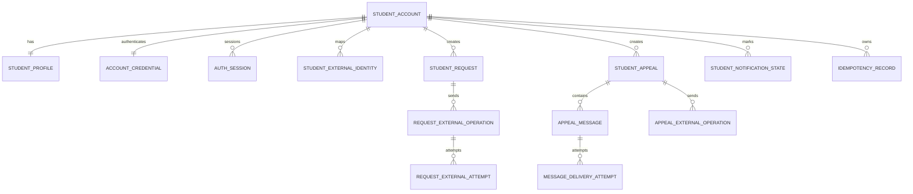
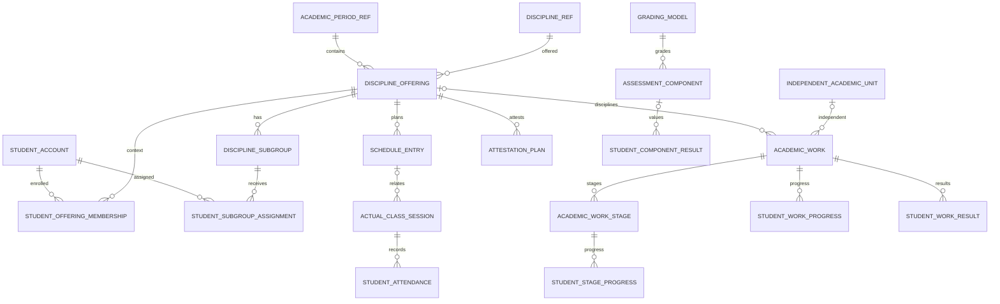
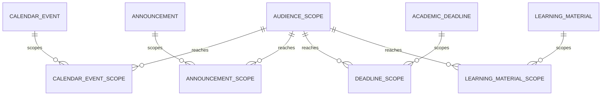

# Модель данных

> **Проект:** «ПУЛЬС» — личный кабинет студента; конкурс «Цифровой деканат будущего»  
> **Документ:** 06 — единая логическая модель данных  
> **Актуализировано:** 11.11.2026  
> **Основание:** предоставленные актуальные документы 02, 03, 04 и обе прежние редакции модели 06  
> **Статус:** содержательная модель для проектирования; **не** готовая физическая схема/проверенный код  
> **Путь в репозитории:** `документация/06_Модель_данных.md`

---
## 1. Назначение, статус и основа модели

Это **единая логическая модель данных** студенческого модуля «ПУЛЬС». Она описывает предметные сущности, атрибуты, ключи и связи, источники истины, доступ, стадии и жизненные циклы, представления данных, ограничения целостности и проверки на вымышленных фикстурах. Документ является основанием для архитектуры 05, схемы Prisma/PostgreSQL, серверных адаптеров тестовых API, безопасности 08, OpenAPI и тестов; сам по себе не является исполняемым SQL и не подтверждает работоспособность приложения.

**Нормативная база:** предоставленные `02_Концепция_продукта.md`, `03_Реестр_функциональных_требований.md` (ФТ-01–ФТ-77, НФТ-01–НФТ-23) и `04_Пользовательские_сценарии.md` (31 сценарий) от 11.11.2026; две ранее расходившиеся модели 06 (0.2, 0.3.0). Новые согласованные решения имеют приоритет перед старыми противоречащими фрагментами.

**Область:** студент входит, читает собственные учебные сведения, взаимодействует с заявками, справками и обращениями, управляет прочтением уведомлений. Кабинетов преподавателя/сотрудника, LMS со сдачей файлов, выставления оценок, самостоятельной смены подгрупп, личного календаря и реальных интеграций университета нет. ИИ только отвечает, помогает с навигацией и текстом для копирования, но не совершает изменяющих операций.

**Главное изменение:** академическая жизнь не сводится к баллам и лабораторным. В конкретном семестре предмет может содержать занятия, посещаемость, задания и конспекты, курсовые проекты с этапами или без, материалы, разные виды текущих результатов и официальную аттестацию. Все эти типы факультативны для отдельных дисциплин и связаны **по явным идентификаторам**, а не сходству названий.

### 1.1. Согласование и техническая ответственность

Предметные правила без подтверждения не создаются: формулы баллов, пороги, допуск, причины пропуска, обязательные стадии курсовой и сроки нельзя выдавать за действующие регламенты. Технический исполнитель самостоятельно выбирает реализацию в пределах уже принятого стека и требований безопасности. Непроверенные поля схемы обозначаются условными; наличие модели R не означает необходимость таблицы PostgreSQL. Другие документы эта редакция не меняет.

### 1.2. Какую редакцию оставлять в проекте

Этот файл — единственный `документация/06_Модель_данных.md`. Вариант `06_Модель_данных_0.2.md` следует удалить из репозитория после замены основного файла; это действие выполняет владелец проекта. Нового реестра версий или отдельного документа-моста не создаётся.

## 2. Соглашения, доступность и происхождение данных

| Класс | Смысл | Физическое хранение |
|---|---|---|
| **P** | Собственные постоянные записи модуля | PostgreSQL; защищённые серверные операции |
| **R** | Внешняя read-model по тестовым API | DTO сервера; первоисточник вне модуля, кэш в MVP не обязателен и исходными решениями исключён |
| **C** | Справочники, тестовые конфигурации и фикстуры | Конфигурация или тестовые данные, не обязательно таблицы |
| **V** | Вычисляемая проекция одного/нескольких разрешённых источников | Не самостоятельная предметная запись |
| **T** | Команда, ответ или временный контекст | В пределах запроса |
| **O** | Возможное расширение, не обязательное для MVP | Только при отдельной необходимости |

| Тип | Значение |
|---|---|
| `ID` | Устойчивый идентификатор; для P — UUID, для R — идентификатор read-model |
| `EXTERNAL_REF` | `(source_code, object_kind, external_id)`, а не один глобальный внешний ID |
| `CODE` | Контролируемое значение со смыслом из контракта |
| `STRING`, `TEXT`, `JSON_OBJECT`, `URI`, `HASH` | Строка, текст, валидируемый структурированный объект, адрес, дайджест |
| `INTEGER`, `DECIMAL`, `BOOLEAN` | Целое, точное десятичное, логическое; баллы не хранить в `float` |
| `DATE` | Только дата, без произвольного часа |
| `DATETIME_TZ` | Момент времени с корректной семантикой зоны |

**Разделение дат:** `issued_on/issued_at` (выдача), `due_on/due_at` (срок), `completed_at` (выполнение), `submitted_at` (сдача), `assessed_at` (оценка), `source_updated_at` (обновление источника), `fetched_at` (получение ответа) и `created_at` локальной записи — **не взаимозаменяемы**. В PostgreSQL моменты хранятся как `timestamptz` (UTC), исходная локальная зона — IANA; дату без времени запрещено переводить в произвольные 00:00/23:59.

### 2.1. Состояния неполноты — разные, а не «0»

| Состояние | Значение | Недопустимый вывод |
|---|---|---|
| `NOT_APPLICABLE` | Данный вид работы **не предусмотрен** по подтверждённым сведениям | «Нет данных», «провал» |
| `UNKNOWN` | Значение/факт не известен | Ноль, пропуск, «не выполнено» |
| `KNOWN_ZERO` | Подтверждённое числовое значение 0 | Пустая запись |
| `PENDING` | Известное событие ожидает результата, если так сообщает источник | «Не сдал», «отклонено» |
| `SOURCE_ERROR` | Источник не дал достоверного ответа из-за ошибки | «Нет работ», «всё выполнено» |
| `FORBIDDEN` | Нет прав на объект | Маскировка под обычную отсутствие данных |

Для списков обязательна метаинформация о полноте от адаптера (§ 17.6). Полная выборка *отметок* посещения сама по себе не доказывает, что учтены *все* проведённые занятия. Числа и знаменатели выводятся только при подтверждённой полноте соответствующих множеств.

### 2.2. Источники истины

| Объект/процесс | Источник | Класс |
|---|---|---|
| Аккаунт, пароль, сессия, заявка, обращение, сообщения, технические попытки, прочтение | Собственная БД | P |
| Профиль, внутренняя связь с внешним идентификатором | БД/серверные вымышленные фикстуры | P/C |
| Группы, дисциплины, периоды, назначения на подгруппы | Тестовый университетский API | R/C |
| Расписание, факты занятий, посещаемость | Тестовый университетский API | R |
| Работы, их этапы, состояние и результаты, оценки, аттестации | Тестовый университетский API | R |
| Календарь, материалы, объявления, подтверждённые сроки | Тестовый университетский API | R |
| Уведомления, главная, хронология, календарная проекция, экспорт | Производные от P и R | V/T |
| ИИ-запрос и разрешённый контекст | Серверная временная команда | T |

Чужой `account_id`/`student_id` из браузера не используется как источник прав; активный аккаунт определяется только серверной сессией. Сведения о студенте для внешнего API разрешаются через собственный `student_external_identity`.

## 3. Сквозные принципы целостности и доступа

1. Сервер получает `account_id` из защищённой сессии, внешние ID — из проверенной серверной карты; проверяет доступ **при каждом чтении и изменении**, в том числе при прямом открытии URL.
2. Одна дисциплина, изучаемая в разных семестрах, имеет разные `discipline_offering` с отдельным `academic_period_id`; не допускается смешивать результаты, задания и посещаемость двух периодов.
3. Подгруппа относится к `offering`, а не к студенту глобально. Официальное назначение извлекается автоматически, для каждой дисциплины отдельно; переключателя чужой подгруппы нет.
4. Период, группа, offering, подгруппа и владелец всех персональных R-записей проверяются как единый контекст. При несогласованных связях адаптер возвращает частичную ошибку, а не искусственный FK.
5. Работа, её статус выполнения, учебный материал и оценка — **различные сущности**; похожий заголовок не является идентификатором связи.
6. Занятие расписания — план; подтверждённое проведение — другой факт; отметка посещаемости — третий персональный факт. Отсутствие второго/третьего не равно отмене или пропуску.
7. Курсовая может входить в дисциплину либо быть отдельной позицией учебного плана; её этапы существуют лишь по данным тестового источника.
8. БРС (балльно-рейтинговая система), экзамен и зачёт могут сосуществовать. Итог, пороги, допуск, среднее и процент освоения **не рассчитываются без официально заданной формулы**.
9. Один учебный срок может иметь несколько **представлений** (страница дисциплины, главная, календарь и три экспорта), но один источник истины.
10. Технические ошибки, неготовность результата, отсутствие типа активности и подтверждённый ноль — разные состояния; неизвестная дата не получает вымышленное время.
11. Актуальная внешняя модель в MVP не копируется в P-таблицы только ради нескольких экранов. Все R-«FK» логические и проверяются адаптерами; для P — физические FK и транзакции.
12. Изменение академических объектов через собственный API студенту недоступно. Собственные операции заявок и обращений отделены от read-only университетских сведений.

### 3.1. Связь конкретного студента и дисциплины

Сервер допускает дисциплину, если её изучение студентом в указанном периоде подтверждено `student_offering_membership` или равноценной авторитетной привязкой профиля/учебной группы к текущему `discipline_offering`. Не следует выводить право только из названия дисциплины и совпадения буквы в коде группы. Для индивидуальных планов принадлежность проверяется напрямую.

## 4. Концептуальная карта сущностей

```text
STUDENT_ACCOUNT → STUDENT_PROFILE → FACULTY / PROGRAM / GROUP
  ├─ ACCOUNT_CREDENTIAL, AUTH_SESSION, STUDENT_EXTERNAL_IDENTITY
  ├─ STUDENT_OFFERING_MEMBERSHIP → DISCIPLINE_OFFERING + ACADEMIC_PERIOD
  │     ├─ DISCIPLINE_SUBGROUP ← STUDENT_SUBGROUP_ASSIGNMENT (официально)
  │     ├─ SCHEDULE_ENTRY → ACTUAL_CLASS_SESSION → STUDENT_ATTENDANCE
  │     ├─ ACADEMIC_WORK → ACADEMIC_WORK_STAGE
  │     │     ├─ STUDENT_WORK_PROGRESS, STUDENT_STAGE_PROGRESS
  │     │     └─ STUDENT_WORK_RESULT / подтверждённая ссылка на оценку компонента
  │     ├─ GRADING_MODEL → ASSESSMENT_COMPONENT → STUDENT_COMPONENT_RESULT
  │     ├─ ATTESTATION_PLAN → STUDENT_COURSE_RESULT (при связи источника)
  │     └─ LEARNING_MATERIAL ↔ WORK / STAGE / CLASS (по подтверждённой связи)
  ├─ INDEPENDENT_ACADEMIC_UNIT → ACADEMIC_WORK (самостоятельная курсовая)
  ├─ STUDENT_REQUEST → REQUEST_EXTERNAL_OPERATION / ATTEMPT
  ├─ STUDENT_APPEAL → APPEAL_MESSAGE / APPEAL_EXTERNAL_OPERATION
  └─ STUDENT_NOTIFICATION_STATE

ACADEMIC_WORK / STAGE / ATTESTATION / ACADEMIC_DEADLINE
  → CANONICAL_LEARNING_DUE_ITEM (V) → CALENDAR_VIEW_ITEM (V) → ICS / PDF / XLSX
SCHEDULE / ACADEMIC_ACTIVITY / RESULT
  → ACADEMIC_ACTIVITY_TIMELINE_ITEM (V) → DISCIPLINE_PROGRESS_VIEW (V)
ANNOUNCEMENT / CHANGED_SCHEDULE / DUE_ITEM / APPEAL_REPLY / REQUEST_CHANGE
  → NOTIFICATION_FEED_ITEM (V) → STUDENT_NOTIFICATION_STATE (P)
```

Схема — **логическая**: R/V не являются обязательными таблицами PostgreSQL. Состав физических P-таблиц определяется отдельной архитектурой 05, а не буквальным копированием этой карты.

## 5. Классы хранения и контракт read-model

### 5.1. Нормализация внешней идентичности

Каждый внешний объект получает устойчивую ссылку `EXTERNAL_REF = (source_code, object_kind, external_id)`; допустимое сопоставление разных источников — только по проверенной карте ID/явному полю источника, **не** по названию, времени или похожей дате. Изменение UI или временный UUID запроса не должно менять фактическую идентичность объекта.

### 5.2. Согласованный ответ сервера

Каждая коллекция read-model возвращается с `availability_code`, `is_complete`, `fetched_at`, `source_updated_at?` и `requested_scope` (подтверждённые аккаунт, период, offering/аудитория). Поле `NULL` у результата не сообщает само по себе, **почему** результата нет. Данные с ошибкой источника не подменяются пустым массивом. Адаптеры валидируют вложенные ссылки на целевую дисциплину/работу/занятие; несовместимое отношение не создаёт права доступа.

### 5.3. Отложенные данные и сохранение

В MVP внешние учебные сведения читаются через серверные адаптеры тестовых API, которые не являются живыми университетскими системами. Собственная БД хранит аккаунты, локальные операции и прочтение; для новых учебных таблиц класса R постоянное копирование не требуется. Если архитектура позже предложит кэш, она отдельно определит разрешения, сроки хранения, актуализацию, откат и защиту. Наличие `fetched_at` не превращает снимок в событие семестра.

## 6. Связи учебной деятельности — логические инварианты

| Сущности | Кратность | Ключевое правило |
|---|---|---|
| Студент → изучение дисциплины | 1:0..N | Подтверждено на конкретный период |
| Период → преподавание дисциплины | 1:0..N | Одинаковое название в другом семестре не объединяется |
| Преподавание → подгруппы | 1:0..N | Подгрупп может быть три и более |
| Студент × предложение → официальное назначение | 0..N по временным интервалам | Конфликт активных назначений явно выявляется |
| Преподавание → расписание → проведение | 1:0..N:0..N | Только подтверждённая связь плана и факта |
| Проведённое занятие → персональные отметки | 1:0..N | Нет отметки ≠ отсутствовал |
| Преподавание/самостоятельная единица → работа | 1:0..N | Для работы ровно **один** вариант контекста (XOR) |
| Работа → этапы | 1:0..N | Этапов может не быть |
| Работа × студент → состояния выполнения | 1:0..N ревизий | Назначение, выполнение, сдача, проверка отдельно |
| Работа ↔ материалы | M:N | Только по явной ID/ссылке источника |
| Работа ↔ оценка | Условно M:N | Не создавать дубли одного первичного результата |
| Предложение → план аттестации | 1:0..N | Не замещает оценивание текущих работ |
| Подтверждённый срок → разные экраны | 1:0..N проекций | Один исходный ключ и актуальная дата |

Для R-сущностей ссылки считаются *логическими*: `FK` в описаниях означает проверяемое отношение, а не требование создать физический ключ в БД. Нельзя формировать перекрёстную ссылку между несопоставленными внешними источниками «по смыслу».

## 7. Логическая модель: учётная запись и профиль

### 7.1. `student_account` — учётная запись студента

**Класс:** P. **Назначение:** собственная учётная запись, с которой студент проходит аутентификацию и получает доступ к модулю.

| Поле | Тип | Обязательность | Ключ/ограничение | Назначение |
|---|---|---|---|---|
| `account_id` | ID | Да | PK | Внутренний идентификатор |
| `account_state_code` | CODE | Да | Контролируемый код | Состояние аккаунта; перечень не определён |
| `created_at` | DATETIME_TZ | Да |  | Дата создания |
| `updated_at` | DATETIME_TZ | Да |  | Дата изменения |
| `last_authenticated_at` | DATETIME_TZ | Нет |  | Последняя успешная аутентификация |
| `is_demo_account` | BOOLEAN | Условно |  | Технический признак демонстрационной записи, если потребуется |

Аккаунт относится к студенту. Роли преподавателя, сотрудника и администратора не создаются. Для конкурса создаются минимум два независимых аккаунта с вымышленными данными. Внешний ID студента не является внутренним PK.

### 7.2. `account_credential` — учётные данные

**Класс:** P. **Назначение:** безопасное хранение сведений выбранного механизма входа.

| Поле | Тип | Обязательность | Ключ/ограничение | Назначение |
|---|---|---|---|---|
| `credential_id` | ID | Да | PK | Идентификатор учётных данных |
| `account_id` | ID | Да | FK → `student_account.account_id` | Владелец |
| `credential_type_code` | CODE | Да | Для MVP — `LOGIN_PASSWORD` | Тип механизма входа |
| `provider_code` | CODE | Условно | Пространство имён провайдера, если механизм входа его использует | Провайдер/пространство учётных данных |
| `login_identifier_normalized` | STRING | Да | UNIQUE после нормализации | Нормализованный логин |
| `password_hash` | HASH | Да | Argon2id; не хранить открытый пароль | Хеш пароля |
| `credential_state_code` | CODE | Да | Контролируемый код | Состояние учётных данных |
| `created_at` | DATETIME_TZ | Да |  | Дата создания |
| `updated_at` | DATETIME_TZ | Да |  | Дата изменения |

Для текущего прототипа используется только логин/пароль: `login_identifier_normalized` и `password_hash` обязательны; логин уникален после нормализации. Пароль хешируется Argon2id. Открытый пароль не сохраняется в БД, логах, репозитории или тестовых дампах. Алгоритм и сессии определены в ТЕХ-003; подробные проверки будут в документе 08.

### 7.3. `auth_session` — серверная сессия

**Класс:** P.

| Поле | Тип | Обязательность | Ключ/ограничение | Назначение |
|---|---|---|---|---|
| `session_id` | ID | Да | PK | Идентификатор сессии |
| `account_id` | ID | Да | FK → `student_account.account_id` | Владелец |
| `token_digest` | HASH | Да | UNIQUE | Дайджест секрета сессии, не исходное значение |
| `issued_at` | DATETIME_TZ | Да |  | Время выдачи |
| `expires_at` | DATETIME_TZ | Да | `expires_at > issued_at` | Окончание действия |
| `last_activity_at` | DATETIME_TZ | Нет |  | Последняя активность |
| `revoked_at` | DATETIME_TZ | Нет |  | Время отзыва |

Защищённый запрос без действующей сессии не возвращает персональные данные. Текущий `account_id` определяется сервером. Сырой токен не хранится. Срок неактивности — 12 часов, абсолютный срок — 7 суток; logout немедленно отзывает сессию. ТЕХ-003.

### 7.4. `student_profile` — профиль студента

**Класс:** P/R в зависимости от окончательно установленного источника полей.

| Поле | Тип | Обязательность | Ключ/ограничение | Назначение |
|---|---|---|---|---|
| `profile_id` | ID | Да | PK | Идентификатор профиля |
| `account_id` | ID | Да | FK → `student_account.account_id`, UNIQUE | Связь 1:1 с аккаунтом |
| `full_name` | STRING | Да для приёмочной фикстуры |  | ФИО |
| `faculty_id` | ID | Да для приёмочной фикстуры | FK → `faculty_ref.faculty_id` | Факультет |
| `study_program_id` | ID | Да для приёмочной фикстуры | FK → `study_program_ref.program_id` | Направление подготовки |
| `course_number` | INTEGER | Да для приёмочной фикстуры | `> 0` | Курс |
| `academic_group_id` | ID | Да для приёмочной фикстуры | FK → `academic_group_ref.group_id` | Учебная группа |
| `profile_source_code` | CODE | Условно |  | Источник профильных сведений |
| `profile_external_id` | STRING | Условно | В контексте источника | Внешний ID профиля |
| `source_updated_at` | DATETIME_TZ | Нет |  | Время обновления источника |
| `updated_at` | DATETIME_TZ | Да |  | Обновление представления |

Для приёмки обязательны ФИО, факультет, направление подготовки, курс и группа. Документы 00–04 не определяют окончательно, какие поля хранятся модулем, а какие поступают из внешнего источника. Это фиксируется в архитектуре и интеграционном контракте. `profile_external_id` идентифицирует внешнюю запись профиля и не обязан совпадать с идентификатором студента во всех интеграционных источниках; для последнего предусмотрена отдельная `student_external_identity`.

### 7.5. Справочные сущности учебного контекста

Справочники являются read-only/reference сущностями; в прототипе они могут быть фикстурами или получаться из тестовых API. Студент их не редактирует.

#### `faculty_ref` — факультет

| Поле | Тип | Обязательность | Ключ/ограничение |
|---|---|---|---|
| `faculty_id` | ID | Да | PK |
| `source_code` | CODE | Условно | Источник |
| `external_id` | STRING | Условно | UNIQUE вместе с `source_code` |
| `faculty_code` | CODE | Условно | Код факультета |
| `name` | STRING | Да | Название |
| `source_updated_at` | DATETIME_TZ | Нет | Время обновления |

#### `study_program_ref` — направление подготовки

| Поле | Тип | Обязательность | Ключ/ограничение |
|---|---|---|---|
| `program_id` | ID | Да | PK |
| `faculty_id` | ID | Условно | FK → `faculty_ref.faculty_id` |
| `source_code` | CODE | Условно | Источник |
| `external_id` | STRING | Условно | UNIQUE вместе с `source_code` |
| `program_code` | CODE | Условно | Код направления |
| `name` | STRING | Да | Название |
| `source_updated_at` | DATETIME_TZ | Нет | Время обновления |

#### `academic_group_ref` — учебная группа

| Поле | Тип | Обязательность | Ключ/ограничение |
|---|---|---|---|
| `group_id` | ID | Да | PK |
| `program_id` | ID | Нет | FK → `study_program_ref.program_id` |
| `source_code` | CODE | Условно | Источник |
| `external_id` | STRING | Условно | UNIQUE вместе с `source_code` |
| `group_code` | CODE | Да | Код группы; уникальность в контексте источника/периода уточняется |
| `display_name` | STRING | Да | Название для интерфейса |
| `source_updated_at` | DATETIME_TZ | Нет | Время обновления |

### 7.6. `academic_period_ref` — учебный период

**Класс:** R/C. Обязателен для разделения предметов и результатов по разным семестрам актуальных фикстур.

| Поле | Тип | Обязательность | Назначение |
|---|---|---|---|
| `academic_period_id` | ID | Да, если используется | Внутренний ID |
| `source_code` | CODE | Условно | Источник |
| `external_id` | STRING | Условно | Внешний ID |
| `academic_year_label` | STRING | Условно | Учебный год |
| `period_label` | STRING | Да, если используется | Название периода по источнику |
| `starts_on` | DATE | Нет | Начало |
| `ends_on` | DATE | Нет | Окончание |
| `source_updated_at` | DATETIME_TZ | Нет | Время обновления |

Понятия семестра, модуля и иного периода не унифицируются без подтверждённого источника.

### 7.7. `student_external_identity` — соответствие аккаунта внешней учётной записи студента

**Класс:** P/C. **Назначение:** серверное сопоставление внутреннего аккаунта с идентификатором студента, который ожидает конкретный тестовый внешний источник. Это не вторая учётная запись и не отдельный пользовательский профиль.

| Поле | Тип | Обязательность | Ключ/ограничение | Назначение |
|---|---|---|---|---|
| `external_identity_id` | ID | Да | PK | Идентификатор соответствия |
| `account_id` | ID | Да | FK → `student_account.account_id` | Внутренний владелец |
| `source_code` | CODE | Да | Часть уникального ключа | Внешний источник |
| `external_student_id` | STRING | Да | UNIQUE вместе с `source_code` | ID студента во внешнем источнике |
| `identity_kind_code` | CODE | Нет |  | Тип внешнего идентификатора, если источник различает типы |
| `valid_from` | DATE | Нет |  | Начало действия соответствия |
| `valid_to` | DATE | Нет |  | Окончание действия соответствия |
| `source_updated_at` | DATETIME_TZ | Нет |  | Время обновления записи соответствия |

Правила:
1. Внешний ID выбирается сервером из соответствия для текущего аккаунта и нужного источника.
2. Клиент не может передать произвольный `external_student_id` для получения чужих данных.
3. Внутренний `account_id` не отправляется во внешний источник как будто это его собственный ID, если контракт явно не предусматривает такое сопоставление.
4. Один внешний ID в рамках одного источника не должен быть привязан к двум разным аккаунтам.
5. Если тестовые API используют общий идентификатор, соответствие может быть реализовано конфигурацией/фикстурой, а не отдельной таблицей. Физическое хранение определяется архитектурой.
6. Если заданы `valid_from` и `valid_to`, дата окончания не должна предшествовать дате начала.

### 7.8. `student_offering_membership` — подтверждённое изучение дисциплины

**Класс R**, логическая запись права академического контекста; не новая физическая таблица собственной БД.

| Поле | Тип | Обязательность | Назначение |
|---|---|---|---|
| `membership_id` | ID | Да для read-model | ID соответствия |
| `account_id` | ID | Да | Студент, определённый сервером |
| `offering_id` | ID | Да | Конкретное изучение дисциплины |
| `academic_period_id` | ID | Да | Период, совпадающий с offering |
| `membership_basis_code` | CODE | Да | Запись источника либо авторитетное сопоставление группа+период |
| `valid_from`, `valid_to` | DATE | Нет | Действие назначения при наличии |
| `source_code`, `external_id` | CODE, STRING | Условно | Проверяемое происхождение |

Сервер получает для своего аккаунта разрешённые offering, а не принимает полномочия через URL. При наличии индивидуальной образовательной траектории правило членства не сводится к одной учебной группе.

## 8. Логическая модель: дисциплины, потоки и подгруппы

### 8.1. `discipline_ref` — дисциплина

**Класс:** R/C. Справочное представление учебной дисциплины.

| Поле | Тип | Обязательность | Назначение |
|---|---|---|---|
| `discipline_id` | ID | Да | Внутренний ID |
| `source_code` | CODE | Условно | Источник |
| `external_id` | STRING | Условно | Внешний ID |
| `discipline_code` | CODE | Условно | Код дисциплины |
| `name` | STRING | Да | Название |
| `source_updated_at` | DATETIME_TZ | Нет | Время обновления источника |

### 8.2. `discipline_offering` — дисциплина в учебном контексте

**Класс:** R/C. Конкретное преподавание дисциплины для группы в учебном периоде. Это справочная связь, а не полноценный объект курса LMS.

| Поле | Тип | Обязательность | Ключ/ограничение |
|---|---|---|---|
| `offering_id` | ID | Да | PK |
| `discipline_id` | ID | Да | FK → `discipline_ref.discipline_id` |
| `group_id` | ID | Да | FK → `academic_group_ref.group_id` |
| `academic_period_id` | ID | Да для актуальных фикстур | FK → `academic_period_ref.academic_period_id` |
| `grading_model_id` | ID | Нет | FK → `grading_model.grading_model_id`, если модель сопоставлена |
| `source_code` | CODE | Условно | Источник |
| `external_id` | STRING | Условно | UNIQUE вместе с `source_code` |
| `offering_code` | CODE | Условно | Код учебного предложения |
| `source_state_code` | CODE | Нет | Состояние в источнике |
| `source_updated_at` | DATETIME_TZ | Нет | Время обновления |

Логическая уникальность сочетания «дисциплина + группа + период» вероятна, но не фиксируется как окончательное физическое ограничение до проверки правил источника. Если источник допускает несколько потоков одной дисциплины, различие сохраняется через внешний ID/код.

### 8.3. `discipline_subgroup` — подгруппа конкретной дисциплины

**Класс:** R/C. Подгруппа существует внутри конкретного `discipline_offering`.

| Поле | Тип | Обязательность | Ключ/ограничение |
|---|---|---|---|
| `subgroup_id` | ID | Да | PK |
| `offering_id` | ID | Да | FK → `discipline_offering.offering_id` |
| `source_code` | CODE | Условно | Источник |
| `external_id` | STRING | Условно | UNIQUE вместе с `source_code` |
| `subgroup_code` | CODE | Условно | UNIQUE в рамках `offering_id`, если источник предоставляет код |
| `name` | STRING | Да | Название для интерфейса |
| `display_order` | INTEGER | Нет | Порядок отображения |
| `source_updated_at` | DATETIME_TZ | Нет | Время обновления |

Число подгрупп не зашивается в схему как два фиксированных поля. Для демонстрации английского языка готовятся минимум три записи `discipline_subgroup`.

### 8.4. `student_subgroup_assignment` — официальное назначение студента

**Класс:** R. Запись об официальном отнесении студента к подгруппе в контексте конкретной дисциплины.

| Поле | Тип | Обязательность | Назначение |
|---|---|---|---|
| `assignment_id` | ID | Да | Внутренний ID |
| `account_id` | ID | Да | Студент; FK → `student_account.account_id` |
| `offering_id` | ID | Да | Дисциплина/поток; FK → `discipline_offering.offering_id` |
| `subgroup_id` | ID | Да | Подгруппа; FK → `discipline_subgroup.subgroup_id` |
| `assignment_source_code` | CODE | Условно | Источник назначения |
| `assignment_external_id` | STRING | Условно | Внешний ID назначения |
| `valid_from` | DATE | Нет | Начало действия, если источник предоставляет |
| `valid_to` | DATE | Нет | Окончание действия, если источник предоставляет |
| `source_state_code` | CODE | Нет | Состояние записи в источнике |
| `source_updated_at` | DATETIME_TZ | Нет | Время обновления источника |

Ограничения:
1. Назначение относится к конкретному студенту и конкретному `discipline_offering`.
2. Подгруппа должна принадлежать тому же `offering_id`, что и назначение.
3. Нельзя хранить одно глобальное поле `student.subgroup_id` для всех предметов.
4. Отсутствие записи не означает назначение в первую подгруппу.
5. Противоречивые записи не должны молча сводиться к случайной подгруппе.
6. Официальное назначение определяется сервером; отсутствие и конфликт не разрешаются случайным выбором подгруппы.

Эта сущность представляет официальное назначение из источника и не предоставляет студенту право менять его.

### 8.5. Официальное разрешение подгруппы без переключателя

Сущность `subgroup_view_selection` **исключена**: студент видит только собственную подгруппу по конкретной дисциплине. Сервер выбирает её из `student_subgroup_assignment`, проверяя `offering_id`, группу, учебный период, интервал действия, совместимость с `discipline_subgroup`. Список чужих подгрупп не выдаётся для выбора; параметр `subgroup_id` клиента не определяет право доступа. Если назначение отсутствует/противоречиво, доступны только подтверждённые групповые пары и ясное сообщение о неполноте.

### 8.6. `independent_academic_unit` — самостоятельная учебная единица

**Класс R/C**, для курсовой/проекта как отдельной позиции учебного плана (ФТ-71). Не обязательная единица для всех курсовых.

| Поле | Тип | Обязательность | Назначение |
|---|---|---|---|
| `independent_unit_id` | ID | Да | Устойчивый ключ |
| `source_code`, `external_id` | CODE, STRING | Да | Внешняя идентичность |
| `academic_period_id` | ID | Да | Учебный период |
| `group_id`, `program_id` | ID | Условно | Группа и программа, если подтверждены |
| `owner_account_id` | ID | Условно | Персональная единица, если источник задаёт владельца |
| `kind_code`, `title` | CODE, STRING | Да | Название и вид единицы из источника |
| `source_updated_at` | DATETIME_TZ | Нет | Время обновления метаданных |

Неизвестная аудитория отдельной единицы не означает доступность всему факультету. Работа внутри самостоятельной единицы должна иметь `independent_unit_id`, а не фиктивную дисциплину.

## 9. Логическая модель: расписание

### 9.1. `schedule_entry` — занятие расписания

**Класс:** R. Внешний read-model конкретного занятия, отражающий актуальное состояние расписания из тестового API.

| Поле | Тип | Обязательность | Назначение |
|---|---|---|---|
| `schedule_entry_id` | ID | Да для внутреннего представления | Внутренний ID read-model |
| `source_code` | CODE | Да | Тестовый источник |
| `external_id` | STRING | Да | Внешний ID занятия |
| `offering_id` | ID | Условно | Связь с `discipline_offering`, если сопоставлена |
| `group_external_ref` | EXTERNAL_REF | Условно | Внешняя ссылка на группу, если `offering_id` не сопоставлен |
| `subgroup_scope_kind` | CODE | Да | `GROUP_WIDE`, `SUBGROUP_SPECIFIC` или `UNRESOLVED` |
| `subgroup_id` | ID | Условно | Сопоставленная подгруппа, если занятие относится к конкретной подгруппе |
| `subgroup_external_ref` | EXTERNAL_REF | Условно | Внешняя ссылка на подгруппу, если локальное сопоставление отсутствует |
| `discipline_name_snapshot` | STRING | Условно | Название из источника, если справочник не сопоставлен |
| `starts_at` | DATETIME_TZ | Да | Начало занятия |
| `ends_at` | DATETIME_TZ | Да | Окончание занятия |
| `room_label` | STRING | Нет | Аудитория |
| `instructor_display_name` | STRING | Нет | Имя преподавателя для отображения |
| `instructor_external_ref` | EXTERNAL_REF | Нет | Внешняя ссылка на преподавателя |
| `class_type_code` | CODE | Нет | Тип занятия, если источник передаёт |
| `schedule_state_code` | CODE | Нет | Состояние занятия, если источник его передаёт; отсутствие значения не означает автоматически активное занятие |
| `replaces_external_id` | STRING | Нет | ID заменяемого/перенесённого занятия, если источник поддерживает |
| `source_updated_at` | DATETIME_TZ | Нет | Время изменения в источнике |
| `fetched_at` | DATETIME_TZ | Да | Время получения модулем |

Правила: дата, время, дисциплина, аудитория и преподаватель показываются, если предоставлены; отсутствующие сведения не заполняются догадкой; подгруппа относится к конкретной дисциплине; отменённое занятие не отображается как обычное действующее; перенос/замена отражаются по данным источника. Отдельный пользовательский раздел истории изменений не создаётся. Полноценное хранение истории версий расписания не утверждено; базовая модель использует актуальное состояние, а уведомление об изменении является отдельным представлением.

### 9.2. Связи расписания

- `discipline_offering` 1 → 0..N `schedule_entry`;
- `discipline_subgroup` 1 → 0..N `schedule_entry`;
- `schedule_entry` 1 → 0..N `schedule_change_notice`;
- если `offering_id` не сопоставлен, группа должна быть представлена через `group_external_ref`; если не сопоставлена подгруппа конкретного занятия, используется `subgroup_external_ref`;
- `subgroup_scope_kind = GROUP_WIDE` означает занятие для всей группы; `SUBGROUP_SPECIFIC` — занятие конкретной подгруппы; `UNRESOLVED` — область подгруппы неизвестна и не должна автоматически трактоваться как занятие для всей группы;
- подгруппа занятия должна относиться к тому же `discipline_offering`, что и занятие;
- связь с преподавателем не создаёт локального аккаунта преподавателя.

### 9.3. `schedule_change_notice` — уведомление об изменении расписания

**Класс:** R/T. Если тестовый источник отдельно передаёт событие об изменении занятия, оно представляется временным read-model со следующими логическими полями:

| Поле | Тип | Обязательность | Назначение |
|---|---|---|---|
| `change_notice_id` | ID | Да для внутреннего представления | Внутренний ID уведомления об изменении |
| `source_code` | CODE | Да | Тестовый источник |
| `external_id` | STRING | Да | Внешний ID события изменения |
| `schedule_entry_id` | ID | Условно | Сопоставленное актуальное занятие |
| `schedule_entry_external_ref` | EXTERNAL_REF | Да | Ссылка на занятие в источнике |
| `change_kind_code` | CODE | Да | Тип изменения по данным источника |
| `change_summary` | TEXT | Нет | Краткое описание изменения, если источник его предоставляет |
| `published_at` | DATETIME_TZ | Нет | Время публикации уведомления |
| `source_updated_at` | DATETIME_TZ | Нет | Время изменения в источнике |
| `fetched_at` | DATETIME_TZ | Да | Время получения модулем |

Объект используется для формирования элемента единого центра и перехода к актуальному занятию. Он не является самостоятельной пользовательской историей изменений и не заменяет `schedule_entry`. В MVP тестовый источник возвращает явное событие изменения; уведомление не создаётся на основании предположения или неподтверждённого сравнения. Для производного события `external_id` должен быть детерминированным для одной версии/изменения, чтобы повторный опрос не создавал дубликаты. Если `schedule_entry_id` не сопоставлен, уведомление нельзя связывать с произвольным занятием по похожему названию или времени.

### 9.4. `schedule_change_detection_state` — техническое состояние обнаружения изменений

**Класс:** O/R. Условная техническая сущность, применяемая только если внешний источник не предоставляет отдельные события изменения расписания, но ФТ-18 необходимо реализовать через сравнение последовательных ответов. Она не является пользовательской историей изменений и не хранит полные версии расписания.

| Поле | Тип | Обязательность | Назначение |
|---|---|---|---|
| `source_code` | CODE | Да | Внешний источник |
| `schedule_entry_external_id` | STRING | Да | Внешний ID занятия |
| `last_observed_revision` | STRING | Нет | Последняя версия/ревизия, если источник её предоставляет |
| `last_observed_payload_hash` | HASH | Да | Хеш нормализованных полей, влияющих на отображение расписания |
| `last_observed_at` | DATETIME_TZ | Да | Время последнего наблюдения |
| `last_notified_revision` | STRING | Нет | Версия, по которой уже сформировано уведомление |
| `last_notified_payload_hash` | HASH | Нет | Хеш состояния, по которому уже сформировано уведомление |
| `last_notified_at` | DATETIME_TZ | Нет | Время последнего уведомления |

Логический ключ: `(source_code, schedule_entry_external_id)`. При первом наблюдении состояние инициализируется без уведомления. При подтверждённом изменении версии или нормализованного хеша формируется `schedule_change_notice`, после чего обновляется состояние уведомления. Повторное получение того же состояния не должно создавать дублирующие уведомления.

В конкурсном прототипе тестовый источник предоставляет актуальное занятие и связанное уведомление об изменении; отдельное обнаружение изменений сравнением снимков не требуется. `schedule_change_detection_state` оставляется условной сущностью для будущей интеграции, но не входит в MVP.

### 9.5. `actual_class_session` — подтверждённое проведение занятия

**Класс R**. Разделяет план `schedule_entry` и действительно проведённое занятие. Его нет, если источник не предоставляет факт проведения.

| Поле | Тип | Обязательность | Назначение |
|---|---|---|---|
| `class_session_id` | ID | Да | Устойчивый ID фактического занятия |
| `source_code`, `external_id` | CODE, STRING | Да | Внешняя ссылка |
| `offering_id` | ID | Да | Семестр изучаемой дисциплины |
| `schedule_entry_id` | ID | Нет | Подтверждённая ссылка на план, если есть |
| `subgroup_id` | ID | Нет | Подгруппа при соответствующем назначении |
| `session_kind_code`, `topic` | CODE, STRING | Нет | Вид и тема источника |
| `held_on` | DATE | Условно | Только календарная дата проведения |
| `started_at`, `ended_at` | DATETIME_TZ | Условно | Фактические времена, если есть |
| `conducted_state_code` | CODE | Нет | Факт проведения/состояние из источника |
| `source_updated_at`, `fetched_at` | DATETIME_TZ | Нет/Да | Не заменяют `held_on` |

Связь расписание↔факт не устанавливается по сходству названия/даты. При предоставленном `ended_at` он позже `started_at`. Плановое занятие само по себе не подтверждает, что оно проведено.

### 9.6. `student_attendance` — персональная официальная посещаемость

**Класс R**. Сведения только для чтения студентом. Отсутствие записи **не означает отсутствие студента на занятии**.

| Поле | Тип | Обязательность | Назначение |
|---|---|---|---|
| `attendance_id` | ID | Да | Устойчивый ID отметки |
| `source_code`, `external_id` | CODE, STRING | Да | Внешняя ссылка |
| `account_id`, `offering_id` | ID | Да | Студент и конкретное изучение дисциплины |
| `class_session_id` | ID | Да | Запись учтённого занятия **того же offering** |
| `attendance_code` | CODE | Да | Исходный код (присутствие/отсутствие/иной), без догадки |
| `reason_label` | STRING | Нет | Причина, только если сообщена |
| `recorded_at` | DATETIME_TZ | Нет | Время внесения отметки, не время занятия |
| `source_updated_at`, `fetched_at` | DATETIME_TZ | Нет/Да | Технические метаданные |

Сервер проверяет `account_id`, принадлежность конкретному семестру и совпадение `offering_id` с занятием, а при подгруппе — с официальным назначением. Уникальность актуальной отметки определяется ID источника/его ревизией; исторические исправления не превращаются в два одновременных прогула. Количество и процент посещений выводятся только когда известны полный состав занятий, полнота отметок и смысл кодов.

### 9.7. Матрица различий планового занятия и посещаемости

| Известный факт | Что показывать | Чего не выводить |
|---|---|---|
| Есть `schedule_entry`, нет факта проведения | План занятия | «Проведено», «Посетил» |
| Есть проведение, нет отметки | Занятие состоялось, отметка неизвестна | «Пропуск» |
| Есть подтверждённое присутствие | Код источника о присутствии | Самостоятельно придуманный допуск |
| Есть подтверждённое отсутствие | Код источника об отсутствии | Причину и последствия без источника |
| Пара отменена, факта проведения нет | Отмена | «Отсутствовал» |
| Ошибка ответа источника | Ошибка/частичная загрузка | «0 занятий» |

## 10. Логическая модель: учебная деятельность, оценивание и официальная аттестация

### 10.1. Общий принцип

Баллы и оценки являются **одной из частей** учебной деятельности. Модуль поддерживает дисциплины без балльной модели и дисциплины, где текущие баллы сочетаются с экзаменом или зачётом. Ни шкала, ни итог, ни допуск не рассчитываются из разнородных значений без подтверждённой формулы.

**Существующие 10.2–10.6 сохранены:** `grading_model`, `assessment_component`, `student_component_result`, `student_course_result` и запрет выдуманных расчётов. Ниже добавлены модели хода семестра, не подменяющие прежнее оценивание.

### 10.2. `grading_model` — модель оценивания

**Класс:** R/C. Описание модели, используемой для конкретной дисциплины/учебного предложения.

| Поле | Тип | Обязательность | Назначение |
|---|---|---|---|
| `grading_model_id` | ID | Да | Внутренний ID |
| `source_code` | CODE | Условно | Источник |
| `external_id` | STRING | Условно | Внешний ID |
| `model_code` | CODE | Условно | Код модели |
| `name` | STRING | Да | Название модели |
| `scale_type_code` | CODE | Нет | Тип шкалы по источнику |
| `description` | TEXT | Нет | Описание модели |
| `source_metadata` | JSON_OBJECT | Нет | Дополнительные метаданные источника |
| `source_updated_at` | DATETIME_TZ | Нет | Время обновления |

`discipline_offering` может ссылаться на `grading_model_id`, если источник явно сообщает модель для данного учебного предложения.

### 10.3. `assessment_component` — компонент оценивания

**Класс:** R/C. Компонент, по которому источник предоставляет отдельный результат.

| Поле | Тип | Обязательность | Назначение |
|---|---|---|---|
| `component_id` | ID | Да | Внутренний ID |
| `grading_model_id` | ID | Да | FK → `grading_model.grading_model_id` |
| `component_code` | CODE | Условно | Код компонента |
| `name` | STRING | Да | Название компонента |
| `component_type_code` | CODE | Нет | Тип компонента по источнику |
| `max_value` | DECIMAL | Нет | Максимальное значение, если предоставлено |
| `weight_value` | DECIMAL | Нет | Вес, если предоставлен источником |
| `display_order` | INTEGER | Нет | Порядок отображения |
| `source_updated_at` | DATETIME_TZ | Нет | Время обновления |

Наличие `weight_value` не даёт права автоматически рассчитывать итог. Формулы, нормализация и округление должны быть утверждены отдельно.

### 10.4. `student_component_result` — результат по компоненту

**Класс:** R. Результат конкретного студента по компоненту оценивания.

| Поле | Тип | Обязательность | Назначение |
|---|---|---|---|
| `component_result_id` | ID | Да | Внутренний ID |
| `account_id` | ID | Да | Студент; FK → `student_account.account_id` |
| `offering_id` | ID | Да | Учебное предложение; FK → `discipline_offering.offering_id` |
| `component_id` | ID | Нет | FK → `assessment_component.component_id`, если сопоставлен |
| `component_name_snapshot` | STRING | Условно | Название из источника, если справочник не сопоставлен |
| `source_code` | CODE | Да | Источник результата |
| `external_result_id` | STRING | Условно | Внешний ID результата |
| `result_value_kind` | CODE | Да | Тип значения |
| `numeric_value` | DECIMAL | Условно | Числовое значение |
| `text_value` | STRING | Условно | Текстовое значение |
| `code_value` | CODE | Условно | Кодовое значение |
| `raw_value_text` | STRING | Условно | Исходное представление, если нормализация невозможна |
| `max_value_snapshot` | DECIMAL | Нет | Максимум, если предоставлен |
| `assessed_at` | DATETIME_TZ | Нет | Дата выставления |
| `source_updated_at` | DATETIME_TZ | Нет | Время обновления источника |
| `fetched_at` | DATETIME_TZ | Да | Время получения |

Если компонент отсутствует, строка не создаётся искусственно. Если максимум не предоставлен, он не придумывается. Значение сохраняет исходный тип и точность. Нулевой результат и отсутствие результата — разные состояния. Нельзя применять модель другой дисциплины.

### 10.5. `student_course_result` — итоговый/сводный результат

**Класс:** R. Результат по дисциплине, непосредственно предоставленный внешним источником.

| Поле | Тип | Обязательность | Назначение |
|---|---|---|---|
| `course_result_id` | ID | Да | Внутренний ID |
| `account_id` | ID | Да | Студент |
| `offering_id` | ID | Да | Учебное предложение |
| `grading_model_id` | ID | Нет | Модель оценивания, если сопоставлена |
| `source_code` | CODE | Да | Источник |
| `external_result_id` | STRING | Условно | Внешний ID |
| `result_kind_code` | CODE | Да | Вид результата по источнику |
| `result_value_kind` | CODE | Да | Тип значения |
| `numeric_value` | DECIMAL | Условно | Числовое значение |
| `text_value` | STRING | Условно | Текстовое значение |
| `code_value` | CODE | Условно | Кодовое значение |
| `raw_value_text` | STRING | Условно | Исходное представление, если нормализация невозможна |
| `result_state_code` | CODE | Нет | Состояние результата |
| `awarded_at` | DATETIME_TZ | Нет | Дата фиксации |
| `source_updated_at` | DATETIME_TZ | Нет | Время обновления источника |
| `fetched_at` | DATETIME_TZ | Да | Время получения |

Примеры семантики — итоговая оценка, зачёт, экзаменационный результат — допустимы только если такой тип предоставлен источником. Они не утверждают конкретные значения шкал и статусов.

### 10.6. Запрет неподтверждённых расчётов

Модель не содержит обязательных вычисляемых полей для среднего балла, процента освоения, рассчитанной модулем итоговой оценки, динамики или прогноза. Такие показатели допустимы только при наличии подтверждённых правил, формул, порогов, округления и достаточных исходных данных. Уже согласовано, что текущий балльный учёт не заменяет официальную аттестацию.

### 10.7. `academic_work` — универсальная учебная работа

**Класс R**. Одна структура для лабораторных, индивидуальных заданий, конспектов как заданий, рефератов, эссе, контрольных, нормативов, курсовых работ и иных реальных типов. Тип задаёт источник, не название дисциплины и не расширение файла.

| Поле | Тип | Обязательность | Назначение/ограничение |
|---|---|---|---|
| `work_id` | ID | Да | Устойчивый ключ read-model |
| `source_code`, `external_id` | CODE, STRING | Да | Уникально по источнику и виду объекта |
| `offering_id` | ID | Условно | Контекст дисциплины и периода |
| `independent_unit_id` | ID | Условно | Отдельная учебная единица, **XOR** с `offering_id` |
| `title` | STRING | Да | Точное название из источника |
| `work_type_code`, `work_type_label` | CODE, STRING | Код — условно, название — да | Исходное название вида работы сохраняется; классификация не подменяет наименование источника |
| `description`, `topic_label` | TEXT, STRING | Нет | Описание и тема, если представлены |
| `issued_on`, `issued_at` | DATE, DATETIME_TZ | Нет | Дата или момент выдачи; сохранять точность |
| `due_on`, `due_at` | DATE, DATETIME_TZ | Нет | Дата или момент срока; без искусственного времени |
| `assigned_scope_ref` | EXTERNAL_REF | Условно | Проверяемая аудитория/персональное назначение |
| `source_state_code` | CODE | Нет | Состояние самой работы, не сдачи студентом |
| `source_updated_at`, `fetched_at` | DATETIME_TZ | Нет/Да | Технические отметки |

Ровно один первичный контекст `offering_id`/`independent_unit_id` должен быть подтверждён. Работа без подтверждённой принадлежности не прикрепляется к чужой дисциплине. Работа **может не иметь** срока, этапов, числовой оценки и истории проверки. Выдача сама по себе не подтверждает невыполнение или просрочку.

### 10.8. `student_work_progress` — персональные сведения о выполнении

**Класс R**. Сам факт существования работы и её состояние для конкретного студента разделены.

| Поле | Тип | Обязательность | Назначение |
|---|---|---|---|
| `work_progress_id` | ID | Да | Ссылка/ID состояния |
| `account_id`, `work_id` | ID | Да | Студент и работа, проверяемые на сервере |
| `source_code`, `external_id` | CODE, STRING | Да | Внешняя идентичность и ревизия при наличии |
| `assignment_status_code` | CODE | Нет | Назначение студенту, если фиксируется |
| `completion_status_code` | CODE | Нет | Подтверждённое выполнение/невыполнение |
| `submission_status_code` | CODE | Нет | Сдача, если учитывается |
| `review_status_code` | CODE | Нет | Проверка/приёмка, если учитывается |
| `completed_at`, `submitted_at`, `reviewed_at` | DATETIME_TZ | Нет | Разные предметные моменты |
| `source_updated_at`, `fetched_at` | DATETIME_TZ | Нет/Да | Метаданные, не предметные даты |

Статусы **не обязаны образовывать линейную последовательность**. Сдача не означает принятие, принятие не означает баллы; возможна официальная оценка без переданной истории сдачи. Отсутствие `student_work_progress` — `UNKNOWN`, не «не выполнено». Несовместимые актуальные версии не выбираются произвольно, а возвращаются как конфликт.

### 10.9. `academic_work_stage` — этап длительной работы

**Класс R**, `academic_work` 1:0..N `academic_work_stage`.

| Поле | Тип | Обязательность | Назначение |
|---|---|---|---|
| `stage_id` | ID | Да | Устойчивый ID этапа |
| `work_id` | ID | Да | Подтверждённая родительская работа |
| `source_code`, `external_id` | CODE, STRING | Да | Внешняя идентичность |
| `title`, `description` | STRING, TEXT | Название обязательно, описание — нет | Наименование источника |
| `display_order` | INTEGER | Нет | Исходный порядок, не выдуманная дата |
| `due_on`, `due_at` | DATE, DATETIME_TZ | Нет | Подтверждённый срок, с сохранением точности |
| `source_updated_at` | DATETIME_TZ | Нет | Обновление источника |

Если источник не передал этапы, интерфейс не создаёт «теоретическая часть → практика → защита» автоматически.

### 10.10. `student_stage_progress` — подтверждённое выполнение этапа

**Класс R**.

| Поле | Тип | Обязательность | Назначение |
|---|---|---|---|
| `stage_progress_id` | ID | Да | Устойчивый ID |
| `account_id`, `stage_id` | ID | Да | Студент и разрешённый этап |
| `source_code`, `external_id` | CODE, STRING | Да | Устойчивый идентификатор/ревизия |
| `completion_status_code`, `submission_status_code`, `review_status_code` | CODE | Нет | Только известные из источника состояния |
| `completed_at`, `submitted_at`, `reviewed_at` | DATETIME_TZ | Нет | Разные учебные даты |
| `source_updated_at`, `fetched_at` | DATETIME_TZ | Нет/Да | Метаданные |

Этап принадлежит конкретной работе, а работа — соответствующему студенту/периоду. Официальное состояние этапа не изменяется студентом.

### 10.11. Длительная или курсовая работа в дисциплине и отдельно

Курсовой проект — вид `academic_work`, а не обязательный модуль со своей фиксированной схемой. Если источник связывает его с дисциплиной, `offering_id` обязателен; если курсовая — самостоятельная позиция учебного плана, используется `independent_academic_unit`. Для одной работы два первичных контекста не создаются одновременно. Тема, руководитель, сроки и этапы показываются **только если переданы**, без выдумывания этапов/защиты/среднего процента. Самостоятельная учебная единица привязана к периоду и проверенной аудитории.


### 10.12. Оценка работы и компонент оценивания — один факт без дубликатов

**Класс R.** Два различных способа связи результатов:

| Логический объект | Ключевые поля | Правило |
|---|---|---|
| `student_work_result` | `work_result_id`, `account_id`, `work_id`, `stage_id?`, `source_code`, `external_id`, `result_value_kind`, `numeric_value?`, `text_value?`, `code_value?`, `raw_value_text?`, `assessed_at?`, `fetched_at` | Результат работы, **если не является тем же самым первичным фактом**, что и `student_component_result` |
| `assessment_result_work_link` | `component_result_id`, `work_id`, `stage_id?`, `link_evidence_code`, `source_code`, `external_link_id?` | Подтверждённая связь уже существующего балльного компонента с работой/этапом; не копирует оценку |

Если источник возвращает один исходный результат через два раздела API, адаптер использует один канонический факт с несколькими ссылками/представлениями. Равенство оценок, дат и названий **не доказывает идентичность**. Если сопоставления нет, нельзя считать результат работы баллом компонента модели. Тип значения строго соответствует заполненному числовому/текстовому/кодированному полю; никакой максимум не выводится по умолчанию.

### 10.13. `attestation_plan` — план официальной аттестации

**Класс R.** Не зависит от наличия БРС и отделён от уже полученного официального результата.

| Поле | Тип | Обязательность | Назначение |
|---|---|---|---|
| `attestation_id` | ID | Да | Устойчивый ID |
| `offering_id` | ID | Да | Контекст семестра |
| `source_code`, `external_id` | CODE, STRING | Да | Внешняя ссылка |
| `attestation_kind_code`, `attestation_kind_label` | CODE, STRING | По источнику | Экзамен/зачёт/иная форма, без догадки |
| `planned_on`, `planned_at` | DATE, DATETIME_TZ | Нет | Известная дата или момент, не оба |
| `location_label`, `source_state_code` | STRING, CODE | Нет | Место и состояние, только по источнику |
| `source_updated_at`, `fetched_at` | DATETIME_TZ | Нет/Да | Не дата получения оценки |

У `student_course_result` допускается условное поле `attestation_id`, если результат явно относится к конкретному мероприятию. Баллы не заменяют экзамен, а отсутствие результата до его проведения не доказывает, что студент не сдал экзамен. Пересдачи и редакции результатов не сводятся к «лучшему» значению без официального правила.

### 10.14. `academic_activity_timeline_item` — хронология по датам

**Класс V/T**, не постоянная таблица. Одно задание может порождать **несколько** датированных событий: выдано, срок, сдано, проверено, оценено; это не новая запись самого задания.

| Поле | Значение |
|---|---|
| `timeline_key` | Устойчивый ключ `(source_ref, event_kind, occurrence/revision)` |
| `account_id`, `offering_id/independent_unit_id` | Проверенный персональный и семестровый контекст |
| `event_kind_code` | План/проведение занятия, выдача/срок/сдача/проверка работы, оценка, аттестация |
| `date_precision_code` | `DATE_ONLY` или `DATE_TIME` |
| `event_on`, `event_at`, `time_zone_code?` | **Предметная** дата/момент, а не `fetched_at` |
| `source_kind_code`, `source_ref` | Тип и разрешённая ссылка на исходный объект |
| `title` | Человекочитаемый заголовок, без подмены исходного типа |

Без предметной даты объект остаётся в блоке «Дата не указана», а не занимает придуманное место на временной шкале. Сортировка — по предметной дате и стабильному вторичному ключу. Временные метки изменения источника **не** становятся датами учебной активности.

### 10.15. `discipline_progress_view` — три разные линии учебного прогресса

**Класс V.** Сервер собирает доступные данные текущего студента по `offering_id`: (1) занятия и подтверждённая посещаемость, (2) работы, задания и факты выполнения, (3) оценки, баллы и официальная аттестация. Одна линия может отсутствовать, быть неполной или не применяться; это **не** равно нулевому прогрессу. Конкретная дисциплина сама определяет состав разделов через данные, а не через жёсткий тип «математика/история/физкультура».

Показатель `issued_work_count`, `attended_count`, `completed_count` допускается только если соответствующая выборка **полная**, известны коды/знаменатель и определён смысл подсчёта. Универсальный `total_progress_percent`, прогноз экзамена, рейтинг и средний балл **отсутствуют** без согласованной формулы. Отдельные исходные оценки показываются, даже когда итог неизвестен.

### 10.16. Переназначения, редакции и конфликтующие результаты

- Ключ семестра включает `academic_period_id`; повторное изучение не меняет прошлый итог.
- Переоформление работы или исправление отметки допускается только через подтверждённые версии источника. Несовместимые текущие версии дают ошибку согласованности, а не произвольный выбор.
- Нормализованная шкала и исходное значение хранятся без утраты точности; неизвестная модель не интерпретируется через шкалу другой дисциплины.
- Для внешних данных `source_updated_at` и `fetched_at` остаются техническими отметками; они не заменяют `issued_at`, `held_on`, `completed_at` и `assessed_at`.

## 11. Логическая модель: учебные сроки и материалы

### 11.1. `academic_deadline` — учебный срок

**Класс:** R/V. Внешний самостоятельный срок (R) либо представление подтверждённой даты работы, этапа или аттестации (V). **Один предметный срок не хранится как две независимые записи.**

| Поле | Тип | Обязательность | Назначение |
|---|---|---|---|
| `deadline_id` | ID | Да для read-model | Внутренний ID представления |
| `source_code` | CODE | Да | Источник |
| `external_id` | STRING | Да | Внешний ID |
| `offering_id` | ID | Нет | Дисциплина/поток, если срок к ней относится |
| `title` | STRING | Да | Название срока |
| `description` | TEXT | Нет | Описание |
| `deadline_kind_code` | CODE | Нет | Тип срока по источнику |
| `due_precision_code` | CODE | Да | `DATE_ONLY` или `DATE_TIME` |
| `due_on` | DATE | Условно | Календарная дата, если источник задаёт срок без времени |
| `due_at` | DATETIME_TZ | Условно | Точный момент, если источник задаёт срок со временем |
| `time_zone_code` | STRING | Нет | Часовой пояс, если он нужен для интерпретации локального времени |
| `source_state_code` | CODE | Нет | Состояние срока |
| `source_updated_at` | DATETIME_TZ | Нет | Время обновления |
| `fetched_at` | DATETIME_TZ | Да | Время получения |

`academic_deadline` может связываться с `audience_scope` через `deadline_scope` (N:M), если источник предоставляет область действия. Для `DATE_ONLY` обязателен `due_on`, а `due_at` не заполняется; для `DATE_TIME` обязателен `due_at`, а `due_on` не заполняется. Если точное время не предоставлено, система не должна придумывать его.

#### `deadline_scope` — связь учебного срока с аудиторией

| Поле | Тип | Обязательность | Ключ/ограничение |
|---|---|---|---|
| `deadline_id` | ID | Да | PK-часть, FK → `academic_deadline` |
| `audience_scope_id` | ID | Да | PK-часть, FK → `audience_scope` |

Учебный срок не превращает модуль в LMS. Модель не содержит преподавательских функций создания заданий, сдачи и проверки работ.

### 11.2. `learning_material` — учебный материал

**Класс:** R. Внешний материал, доступный студенту в рамках дисциплины и его прав.

| Поле | Тип | Обязательность | Назначение |
|---|---|---|---|
| `material_id` | ID | Да для read-model | Внутренний ID представления |
| `source_code` | CODE | Да | Источник |
| `external_id` | STRING | Да | Внешний ID |
| `offering_id` | ID | Нет | Дисциплина/поток, если материал привязан к нему |
| `title` | STRING | Да, если предоставлено | Название |
| `description` | TEXT | Нет | Описание |
| `material_type_code` | CODE | Нет | Тип материала по источнику |
| `resource_kind_code` | CODE | Нет | Файл, ссылка или иной тип ресурса |
| `resource_uri` | URI | Нет | Ссылка на ресурс |
| `author_label` | STRING | Нет | Автор/преподаватель, если предоставлен |
| `published_at` | DATETIME_TZ | Нет | Дата публикации |
| `available_from` | DATETIME_TZ | Нет | Начало доступности |
| `available_until` | DATETIME_TZ | Нет | Окончание доступности |
| `source_state_code` | CODE | Нет | Состояние ресурса в источнике |
| `source_updated_at` | DATETIME_TZ | Нет | Время обновления |
| `fetched_at` | DATETIME_TZ | Да | Время получения |

#### `learning_material_scope` — связь материала с аудиторией

| Поле | Тип | Обязательность | Ключ/ограничение |
|---|---|---|---|
| `material_id` | ID | Да | PK-часть, FK → `learning_material` |
| `audience_scope_id` | ID | Да | PK-часть, FK → `audience_scope` |

Правила: отображаются только предоставленные метаданные; отсутствующие поля не выдумываются; недоступный материал не получает фиктивную ссылку; права проверяются сервером; подмена ID не открывает чужой ресурс; наличие материалов не превращает продукт в LMS. Конкретные допустимые типы материалов и способ безопасного открытия уточняются в контракте тестового источника и проектировании интерфейса; отсутствие этих деталей не отменяет согласованный доступ к материалам.

### 11.3. `learning_material_relation` — подтверждённая M:N связь

**Класс R**, только по исходному идентификатору/ссылке, а не похожему названию.

| Поле | Тип | Обязательность | Назначение |
|---|---|---|---|
| `relation_id` | ID | Да | Устойчивый ID или композитный ключ |
| `material_id` | ID | Да | Целевой доступный материал |
| `target_kind_code` | CODE | Да | `OFFERING`, `CLASS_SESSION`, `WORK`, `WORK_STAGE` |
| `target_ref` | EXTERNAL_REF/ID | Да | Подтверждённый исходный объект |
| `source_code`, `external_link_id` | CODE, STRING | Условно | Происхождение доказанной связи |

Один материал может относиться к нескольким работам, одна работа — иметь несколько методичек. «Конспект.pdf» как материал не становится выданной работой «Подготовить конспект». Если источник не передал связь, интерфейс не выводит её по совпадению текста. Права проверяются на целевом объекте и материале независимо.

### 11.4. `canonical_learning_due_item` — единая проекция сроков

**Класс V/T**, не вторая запись о работе или событии календаря. Поля: `due_key`, `account_id`, `source_kind_code`, `source_ref`, `offering_id?`, `independent_unit_id?`, `due_kind_code`, `due_on?`, `due_at?`, `time_zone_code?`, `title`, `source_updated_at?`. Источник срока — `academic_work`, `academic_work_stage`, `attestation_plan` либо самостоятельный `academic_deadline`. Дедупликация допустима **только** по подтверждённой внешней идентичности. Изменение одного исходного срока меняет страницу дисциплины, главную, календарь и ICS/PDF/XLSX; другой независимый срок с той же датой не сливается.

Если нет даты, календарная запись не создаётся. Если есть дата без времени — не появляется фиктивный час. Из UI нельзя изменять дату официального срока.

### 11.5. Защита скачивания учебного материала

Ссылка на файл не является доказательством права. Метаданные и скачивание/открытие проверяются сервером по текущему аккаунту, offering, подгруппе, аудитории и целевому объекту; приватные ресурсы должны предоставляться через контролируемый маршрут или временную разрешённую ссылку. Чужой материал по подменённому URL не отдаётся. Поддерживаются предусмотренные концепцией PDF, DOCX, PPTX, XLSX и ссылки без функций загрузки решений/публикации преподавателем.

## 12. Логическая модель: заявления, справки и внешняя обработка

### 12.1. Общая сущность

Заявление и запрос справки являются разными видами пользовательской операции, но имеют общие признаки: владелец, тип, заполненные данные, факт локального сохранения и возможная внешняя обработка. Для логической модели используется общая сущность `student_request` с типом операции. Это не утверждает, что формы должны быть одинаковыми.

### 12.2. `request_type_catalog` — каталог типов запросов

**Класс:** C/R. Перечень доступных типов заявлений и справок.

| Поле | Тип | Обязательность | Назначение |
|---|---|---|---|
| `request_type_id` | ID | Да | Внутренний ID типа |
| `request_kind_code` | CODE | Да | Категория: заявление или запрос справки |
| `request_type_code` | CODE | Да | Устойчивый код типа |
| `display_name` | STRING | Да | Название для интерфейса |
| `description` | TEXT | Нет | Описание |
| `form_schema_version` | STRING | Условно | Версия формы/схемы |
| `source_code` | CODE | Условно | Источник каталога |
| `external_id` | STRING | Условно | Внешний ID |
| `is_available` | BOOLEAN | Да | Доступность типа для демонстрации |

Каталог может быть конфигурацией/фикстурой или read-model из тестового источника. Документы 00–04 не определяют, где именно он должен физически храниться.

### 12.3. `student_request` — собственная заявка студента

**Класс:** P. Локально сохранённый запрос студента на заявление или справку.

| Поле | Тип | Обязательность | Ключ/ограничение | Назначение |
|---|---|---|---|---|
| `request_id` | ID | Да | PK | Идентификатор заявки |
| `owner_account_id` | ID | Да | FK → `student_account.account_id` | Автор/владелец |
| `request_type_id` | ID | Да | FK → `request_type_catalog.request_type_id` | Выбранный тип |
| `form_schema_version` | STRING | Да, если форма версионируется |  | Версия правил формы при отправке |
| `submitted_data` | JSON_OBJECT | Да | Серверная проверка по схеме | Снимок отправленных значений |
| `local_state_code` | CODE | Да | Контролируемый код | Локальное техническое состояние записи |
| `business_status_code` | CODE | Да после принятия | `SUBMITTED / IN_PROGRESS / READY / REJECTED` | «Отправлена», «Принята в работу», «Готова», «Отклонена» |
| `rejection_reason` | STRING | Нет | Только источник | Причина административного отказа, если возвращена |
| `created_at` | DATETIME_TZ | Да |  | Время локального создания |
| `submitted_at` | DATETIME_TZ | Нет |  | Время успешного локального принятия сервером, не внешнего подтверждения |
| `updated_at` | DATETIME_TZ | Да |  | Последнее изменение |

Правила: запись принадлежит одному аккаунту; сервер проверяет форму независимо от клиента; `submitted_data` — валидированный снимок; неутверждённые поля не добавляются; после повторного входа автор видит заявку; чужая заявка недоступна; статус показывается внутри заявки, отдельный раздел не создаётся.

`submitted_data` — структурированный объект, а не произвольная невалидируемая строка. Поля, типы, обязательность и взаимозависимости определяются конкретной версией формы, выбранной для демонстрационного каталога услуг; нельзя выдавать тестовую форму за официальный регламент вуза.

### 12.4. `request_external_operation` — внешняя обработка заявки

**Класс:** P. Отдельно фиксирует взаимодействие собственной заявки с тестовой внешней системой.

| Поле | Тип | Обязательность | Назначение |
|---|---|---|---|
| `operation_id` | ID | Да | Идентификатор внешней операции |
| `request_id` | ID | Да | FK → `student_request.request_id` |
| `source_code` | CODE | Да | Тестовый внешний источник |
| `operation_kind_code` | CODE | Да | Тип внешней операции; каталог операций определяется интеграционным контрактом |
| `external_operation_id` | STRING | Нет | ID операции во внешнем источнике |
| `correlation_id` | STRING | Да | Связывание запроса и ответа |
| `external_state_code` | CODE | Да | Состояние внешней обработки |
| `started_at` | DATETIME_TZ | Нет | Начало взаимодействия |
| `updated_at` | DATETIME_TZ | Да | Последнее обновление состояния |
| `completed_at` | DATETIME_TZ | Нет | Завершение обработки |
| `last_error_code` | CODE | Нет | Безопасный код последней ошибки |
| `last_error_summary` | STRING | Нет | Безопасное резюме без секретов |

Локальное состояние заявки и внешнее состояние обработки — независимые измерения. Внешняя ошибка не удаляет локально сохранённую заявку и не превращает её в неподтверждённую локальную запись.

### 12.5. `request_external_attempt` — попытка внешней обработки

**Класс:** P. При необходимости сохраняет результат каждой попытки взаимодействия с тестовым API.

| Поле | Тип | Обязательность | Назначение |
|---|---|---|---|
| `attempt_id` | ID | Да | Идентификатор попытки |
| `operation_id` | ID | Да | FK → `request_external_operation.operation_id` |
| `attempt_number` | INTEGER | Да | Порядковый номер попытки |
| `started_at` | DATETIME_TZ | Да | Время начала |
| `completed_at` | DATETIME_TZ | Нет | Время окончания |
| `outcome_code` | CODE | Да | Результат попытки |
| `external_response_code` | CODE | Нет | Код ответа источника |
| `error_code` | CODE | Нет | Код ошибки |
| `safe_error_summary` | STRING | Нет | Безопасное резюме |
| `request_payload_hash` | HASH | Нет | Контрольный хеш отправленных данных |
| `response_payload_hash` | HASH | Нет | Контрольный хеш ответа |

Сохранение каждой попытки — рекомендуемый способ диагностики, но окончательный объём журналирования определяется архитектурой. Полные сырые payload с персональными данными не сохраняются без отдельной необходимости и правил защиты.

### 12.6. `request_state_transition` — история переходов состояния

**Класс:** O. Техническая история изменений состояния конкретной заявки.

| Поле | Тип | Обязательность | Назначение |
|---|---|---|---|
| `transition_id` | ID | Да | Идентификатор перехода |
| `request_id` | ID | Да | FK → `student_request.request_id` |
| `state_dimension_code` | CODE | Да | Локальная запись или внешняя обработка |
| `from_state_code` | CODE | Нет | Предыдущее состояние |
| `to_state_code` | CODE | Да | Новое состояние |
| `changed_at` | DATETIME_TZ | Да | Время изменения |
| `change_source_code` | CODE | Да | Источник перехода |
| `reason_code` | CODE | Нет | Причина, если известна |

Эта таблица не создаёт отдельный пользовательский раздел статусов. Четыре предметных статуса уже утверждены; история переходов — техническая детализация, а не отдельный пользовательский раздел.

### 12.7. Вложения в заявках

Вложения в заявлениях и справках не входят в утверждённое обязательное ядро. Если отдельные типы услуг впоследствии потребуют загрузки файлов и это будет согласовано, понадобятся `file_asset` и `request_attachment` с ограничениями формата, размера, доступа, проверки файлов и срока хранения. Для MVP такие сущности не создаются и обязательная подача файлов не имитируется.

### 12.8. Предметные и технические статусы заявки — разные оси

- **Предметный статус** (`business_status_code`): `SUBMITTED` / `IN_PROGRESS` / `READY` / `REJECTED`. Не путать «Отклонена» с сетевой ошибкой.
- **Локальное сохранение** — успешная транзакция записи заявки и ключа идемпотентности. После неё заявка остаётся доступной, даже если внешний мок не ответил.
- **Внешняя операция** (`request_external_operation`): техническое ожидание/успех/ошибка передачи и корреляция с ответом; это не официальный статус по существу.
- **Повтор:** тот же идемпотентный ключ и тот же payload не создают новую заявку. Новая самостоятельная подача — только новое явное действие пользователя. Причина отказа берётся исключительно из подтверждённого ответа мока.
- **Секреты/данные:** `submitted_data` проходит серверную валидацию по форме; логирование полных payload и чужих заявок запрещено.

## 13. Логическая модель: обращения и переписка

### 13.1. `student_appeal` — обращение студента

**Класс:** P. Собственное обращение студента, являющееся контейнером для переписки.

| Поле | Тип | Обязательность | Ключ/ограничение | Назначение |
|---|---|---|---|---|
| `appeal_id` | ID | Да | PK | Идентификатор обращения |
| `owner_account_id` | ID | Да | FK → `student_account.account_id` | Автор/владелец |
| `category_code` | CODE | Да | `QUESTION / PROBLEM / OTHER` | «Вопрос», «Проблема», «Другое» |
| `subject` | STRING | Условно |  | Тема, если предусмотрена формой |
| `form_schema_version` | STRING | Условно |  | Версия схемы формы, если форма версионируется |
| `submitted_data` | JSON_OBJECT | Да | Серверная проверка по согласованной схеме | Снимок проверенных значений формы |
| `local_state_code` | CODE | Да | Контролируемый код | Локальное техническое состояние |
| `business_status_code` | CODE | Да | `OPEN` | Предметное состояние «Открыто» |
| `created_at` | DATETIME_TZ | Да |  | Время создания локальной записи |
| `submitted_at` | DATETIME_TZ | Нет |  | Время отправки формы в модуль |
| `updated_at` | DATETIME_TZ | Да |  | Последнее изменение |

`submitted_data` хранит фактически отправленные и прошедшие серверную проверку значения. Категории и предметный статус MVP утверждены. Конкретные поля демонстрационной формы валидируются сервером по версии схемы. Текст первого обращения хранится как первое `appeal_message`; иные реквизиты — в `submitted_data`, без независимой второй копии текста. Состояние локальной записи отделено от внешней передачи.

### 13.2. `appeal_external_operation` — передача обращения во внешний тестовый канал

**Класс:** P. Отдельно фиксирует локально сохранённое обращение и факт его передачи/обработки тестовым внешним источником. Наличие этой записи не означает, что внешний источник принял обращение.

| Поле | Тип | Обязательность | Назначение |
|---|---|---|---|
| `operation_id` | ID | Да | Идентификатор внешней операции |
| `appeal_id` | ID | Да | FK → `student_appeal.appeal_id` |
| `source_code` | CODE | Да | Тестовый внешний источник |
| `operation_kind_code` | CODE | Да | Тип операции; каталог определяется интеграционным контрактом |
| `external_operation_id` | STRING | Нет | ID операции во внешнем источнике |
| `external_appeal_id` | STRING | Нет | ID обращения во внешнем источнике после сопоставления |
| `correlation_id` | STRING | Да | Связь запроса и ответа |
| `external_state_code` | CODE | Да | Состояние внешней обработки |
| `started_at` | DATETIME_TZ | Нет | Начало взаимодействия |
| `updated_at` | DATETIME_TZ | Да | Последнее обновление |
| `completed_at` | DATETIME_TZ | Нет | Завершение обработки |
| `last_error_code` | CODE | Нет | Безопасный код ошибки |
| `last_error_summary` | STRING | Нет | Безопасное резюме без секретов |

Локальное сохранение обращения и внешняя передача — независимые события. Недоступность внешнего канала не удаляет обращение и не подтверждает его приём.

### 13.3. `appeal_external_attempt` — попытка внешней передачи обращения

**Класс:** P. Фиксирует отдельные попытки в рамках одной логической внешней операции.

| Поле | Тип | Обязательность | Назначение |
|---|---|---|---|
| `attempt_id` | ID | Да | Идентификатор попытки |
| `operation_id` | ID | Да | FK → `appeal_external_operation.operation_id` |
| `attempt_number` | INTEGER | Да | Порядковый номер |
| `started_at` | DATETIME_TZ | Да | Время начала |
| `completed_at` | DATETIME_TZ | Нет | Время завершения |
| `outcome_code` | CODE | Да | Результат попытки |
| `external_response_code` | CODE | Нет | Код ответа источника |
| `error_code` | CODE | Нет | Код ошибки |
| `safe_error_summary` | STRING | Нет | Безопасное резюме |
| `request_payload_hash` | HASH | Нет | Хеш отправленных данных |
| `response_payload_hash` | HASH | Нет | Хеш ответа |

Повторные сетевые попытки одной операции не создают новые локальные обращения: используется устойчивый идентификатор операции и серверная идемпотентность. Новое самостоятельное обращение создаётся только по отдельному действию студента. Конкретный формат ключа и срок его хранения определяются архитектурой.

### 13.4. `appeal_message` — сообщение внутри обращения

**Класс:** P. Сообщение студента или ответной стороны в рамках одного обращения.

| Поле | Тип | Обязательность | Ключ/ограничение | Назначение |
|---|---|---|---|---|
| `message_id` | ID | Да | PK | Идентификатор сообщения |
| `appeal_id` | ID | Да | FK → `student_appeal.appeal_id` | Родительское обращение |
| `sender_kind_code` | CODE | Да | `STUDENT` или `EXTERNAL_PARTY` в базовой модели | Тип отправителя |
| `sender_account_id` | ID | Условно | FK → `student_account.account_id` | Заполняется для сообщения студента |
| `external_sender_ref` | EXTERNAL_REF | Условно |  | Заполняется для ответной стороны из тестового источника |
| `sequence_number` | INTEGER | Да | UNIQUE вместе с `appeal_id` | Стабильный порядок сообщения в обращении; при отсутствии надёжной временной метки используется порядок источника или получения |
| `body` | TEXT | Да | Серверная проверка | Содержание сообщения |
| `created_at` | DATETIME_TZ | Да |  | Время записи сообщения в модуле; для внешнего ответа — время получения |
| `source_created_at` | DATETIME_TZ | Нет |  | Исходное время создания внешнего сообщения, если источник его передаёт |
| `external_message_id` | STRING | Нет | Уникальность в контексте источника | Внешний ID сообщения |
| `source_code` | CODE | Условно |  | Источник ответного сообщения |

Ограничения: сообщение всегда связано с одним обращением; для `sender_kind_code = STUDENT` поле `sender_account_id` совпадает с `student_appeal.owner_account_id`, а `external_sender_ref` не заполняется; для внешнего ответа `sender_account_id` не заполняется, а `external_sender_ref` и `source_code` обязательны. Тем самым у сообщения ровно один отправитель. Время `created_at` не подменяет исходное время внешнего сообщения: если источник передаёт надёжное `source_created_at`, оно используется для отображения времени; иначе применяется локальное время получения. `sequence_number` сохраняет устойчивый порядок сообщений и служит резервным порядком при отсутствии или совпадении временных меток. История доступна автору после повторного входа; отдельный общий чат не создаётся.

### 13.5. `message_delivery_attempt` — попытка передачи сообщения

**Класс:** P. Отделяет локально сохранённое сообщение от передачи в тестовый внешний канал.

| Поле | Тип | Обязательность | Назначение |
|---|---|---|---|
| `delivery_attempt_id` | ID | Да | Идентификатор попытки |
| `message_id` | ID | Да | FK → `appeal_message.message_id` |
| `source_code` | CODE | Да | Тестовый внешний канал |
| `attempt_number` | INTEGER | Да | Номер попытки |
| `delivery_state_code` | CODE | Да | Состояние передачи |
| `attempted_at` | DATETIME_TZ | Да | Время попытки |
| `completed_at` | DATETIME_TZ | Нет | Время завершения |
| `external_message_id` | STRING | Нет | Внешний ID после приёма |
| `error_code` | CODE | Нет | Код ошибки |
| `safe_error_summary` | STRING | Нет | Безопасное резюме |

Состояния доставки и правила повторной отправки не утверждены окончательно. Попытка внешней доставки создаётся только для исходящего сообщения студента; входящий ответ внешней стороны не получает фиктивную запись об исходящей доставке. Нельзя считать локально сохранённое сообщение доставленным только потому, что оно присутствует в истории.

### 13.6. Вложения и ответная сторона

**Согласованная граница MVP:** вложения в обращениях и сообщениях **не поддерживаются**. Таблицы `appeal_attachment` и `message_attachment` не создаются. Возможное расширение за пределами MVP потребует самостоятельного решения, серверного контроля прав, проверки формата и размера, защиты файлов и определения сроков хранения.

В модели нет `employee_account`, `dean_user`, `teacher_account` или `staff_role`. Ответы поступают из тестового внешнего API. В сообщении может храниться внешний идентификатор/тип ответчика и отображаемое обозначение, если они предоставлены источником. Нельзя придумывать ФИО сотрудника или создавать его локальный профиль ради переписки.

### 13.7. Утверждённые правила переписки MVP

Категории только **«Вопрос», «Проблема», «Другое»**; состояние обращения **«Открыто»**, без обязательного процесса закрытия. Ответ тестового источника подписан **«Деканат (демо-ответ)»** и не создаёт учётную запись сотрудника. Вложения в обращениях и сообщениях не поддерживаются. Ответное сообщение поступает по сценарию внешнего мока после обращения и/или сообщения студента.

Для входящего ответа сервер проверяет сопоставление `external_appeal_id` с конкретным родительским обращением и дедуплицирует `(source_code, external_message_id)`. Для исходящего — отдельно фиксируются локальное сохранение и внешняя доставка. Временные метки `sent_at`, `received_at` и `source_created_at` не подменяют друг друга; хронологический порядок поддерживается стабильным `sequence_number` при равных/отсутствующих временах. Клиент не может подделать отправителя «Деканат».

## 14. Логическая модель: общий календарь

### 14.1. `calendar_event` — событие общего календаря

**Класс:** R. Событие общего календаря университета или его подразделений.

| Поле | Тип | Обязательность | Назначение |
|---|---|---|---|
| `calendar_event_id` | ID | Да для read-model | Внутренний ID представления |
| `source_code` | CODE | Да | Источник |
| `external_id` | STRING | Да | Внешний ID |
| `event_type_code` | CODE | Нет | Тип события по источнику |
| `title` | STRING | Да | Название |
| `description` | TEXT | Нет | Описание |
| `event_time_kind_code` | CODE | Да | `TIMED` или `ALL_DAY` |
| `starts_at` | DATETIME_TZ | Условно | Начало события с точным временем |
| `ends_at` | DATETIME_TZ | Условно | Окончание события с точным временем |
| `starts_on` | DATE | Условно | Дата начала события на весь день |
| `ends_on` | DATE | Условно | Дата окончания события на весь день |
| `time_zone_code` | STRING | Условно | Часовой пояс для локального времени, если нужен источнику/экспорту |
| `location_label` | STRING | Нет | Место проведения |
| `source_state_code` | CODE | Нет | Состояние в источнике |
| `source_updated_at` | DATETIME_TZ | Нет | Время изменения |
| `fetched_at` | DATETIME_TZ | Да | Время получения |

Для `event_time_kind_code = TIMED` обязательно `starts_at`, а `starts_on` не заполняется; для `ALL_DAY` обязательно `starts_on`, а `starts_at` не заполняется. Поля окончания заполняются только при наличии соответствующего значения у источника. Если источник не позволяет надёжно определить временной тип или дату, система не должна придумывать время/дату. Это общий календарь университета, а не личный календарь студента; студент не создаёт произвольные личные события в текущей модели.

### 14.2. `audience_scope` — область действия/аудитория

**Класс:** R/C. Представляет аудиторию, которой предназначено событие, объявление, срок или материал.

| Поле | Тип | Обязательность | Назначение |
|---|---|---|---|
| `audience_scope_id` | ID | Да | Внутренний ID |
| `source_code` | CODE | Условно | Источник |
| `scope_type_code` | CODE | Да | Тип аудитории |
| `external_scope_id` | STRING | Условно | Внешний ID аудитории |
| `display_label` | STRING | Нет | Подпись для интерфейса |
| `source_updated_at` | DATETIME_TZ | Нет | Время обновления |

Согласованные категории аудитории: университет, факультет, направление/курс, группа, официальная подгруппа по дисциплине и дисциплина. Сервер сопоставляет их только с подтверждённым учебным контекстом студента; наличие нескольких областей интерпретируется по явно определённым правилам источника. `scope_type_code` остаётся расширяемым. Неизвестная область действия не считается автоматически общедоступной.

### 14.3. `calendar_event_scope` — связь события с аудиторией

| Поле | Тип | Обязательность | Ключ/ограничение |
|---|---|---|---|
| `calendar_event_id` | ID | Да | PK-часть, FK → `calendar_event` |
| `audience_scope_id` | ID | Да | PK-часть, FK → `audience_scope` |

Связь многие-ко-многим: одно событие может иметь несколько областей действия, одна область может относиться к нескольким событиям.

### 14.4. Согласование аудитории

Сервер сопоставляет области действия с профилем и учебным контекстом текущего студента. Сервер проверяет пересечение области действия и персонального контекста: университет, факультет, программа/курс, группа, официальная подгруппа, дисциплина. Неизвестная область **не** считается публичной.

### 14.5. Экспорт календаря

Экспорт ICS, PDF и XLSX входит в утверждённый объём. Отдельная постоянная сущность для экспорта не требуется в базовой модели. Экспорт рассматривается как временная команда:

`CalendarExportRequest = selected_period + selected_filters + resolved_event_set + output_format`

Правила:

1. Все три формата формируются из одного выбранного набора событий.
2. Название, дата, время и доступные основные сведения согласованы между форматами.
3. Различия допустимы только в представлении, обусловленном форматом.
4. В экспорт не включаются события, недоступные текущему студенту.
5. Пустой набор не превращается в фиктивный файл с вымышленными событиями.
6. В базовой модели нет истории экспортов и постоянного хранилища экспортированных файлов.
7. Все три формата получают один и тот же `resolved_event_set`, уже включая подтверждённые учебные сроки как представления без дублирования.

В MVP экспорт формируется синхронно на сервере; `calendar_export_job` и постоянное хранение файлов не создаются. Асинхронный экспорт не нужен для ожидаемого демонстрационного объёма.

### 14.6. `CalendarViewItem` — единое представление календаря

**Класс V**. Источник — разрешённые для студента `calendar_event` **и** `canonical_learning_due_item` из работ/этапов/аттестаций/самостоятельных дедлайнов. Поля: `event_key`, `origin_kind`, `origin_ref`, `title`, `starts_on?/starts_at?`, `ends_on?/ends_at?`, `date_precision_code`, `time_zone_code?`, `location?`, `access_context`. Срок из дисциплины не превращается в новую независимую `calendar_event`. При явной дублирующей связи источников одно событие не выводится дважды; по одинаковому заголовку/дате события не склеиваются.

В `CalendarExportRequest` после серверной фильтрации формируется **один `resolved_event_set`**, который используется для ICS, PDF, XLSX. Дату без времени экспортировать как дату (`VALUE=DATE` в ICS), событие с временем — с корректной зоной. Подмена периода/фильтров не открывает данные другой аудитории. Асинхронная постоянная таблица заданий экспорта не нужна для MVP.

## 15. Логическая модель: объявления, сроки и единый центр уведомлений

### 15.1. `announcement` — объявление

**Класс:** R. Информационный материал, опубликованный образовательной организацией или её подразделением.

| Поле | Тип | Обязательность | Назначение |
|---|---|---|---|
| `announcement_id` | ID | Да для read-model | Внутренний ID представления |
| `source_code` | CODE | Да | Источник |
| `external_id` | STRING | Да | Внешний ID |
| `title` | STRING | Да | Заголовок |
| `body` | TEXT | Да, если источник предоставляет | Текст объявления |
| `published_at` | DATETIME_TZ | Нет, если источник не предоставляет | Время публикации; отсутствующее время не выдумывается |
| `valid_until` | DATETIME_TZ | Нет | Срок актуальности |
| `author_label` | STRING | Нет | Источник/автор для отображения |
| `source_state_code` | CODE | Нет | Состояние в источнике |
| `source_updated_at` | DATETIME_TZ | Нет | Время обновления |
| `fetched_at` | DATETIME_TZ | Да | Время получения |

### 15.2. `announcement_scope` — аудитория объявления

| Поле | Тип | Обязательность | Ключ/ограничение |
|---|---|---|---|
| `announcement_id` | ID | Да | PK-часть, FK → `announcement` |
| `audience_scope_id` | ID | Да | PK-часть, FK → `audience_scope` |

### 15.3. `notification_feed_item` — единый центр уведомлений

**Класс:** V. Вычисляемое представление сообщений, относящихся к текущему студенту и требующих внимания. В базовой модели это read-model/представление, а не обязательная отдельная таблица.

Обязательное объединение **пяти утверждённых категорий**: объявления, учебные сроки, изменения собственного расписания, новые ответы в собственных обращениях, изменения собственных заявок. Индивидуальное прочтение и «Прочитать всё» уже подтверждены.

| Поле | Тип | Назначение |
|---|---|---|
| `feed_item_key` | STRING/ID | Стабильный ключ элемента в рамках источника |
| `recipient_account_id` | ID | Текущий получатель |
| `category_code` | CODE | Объявление, учебный срок, изменение расписания, ответ в обращении, изменение заявки |
| `title` | STRING | Краткий заголовок |
| `summary` | TEXT | Краткое содержание |
| `source_kind_code` | CODE | Тип исходного объекта |
| `source_ref` | EXTERNAL_REF или внутренний ID | Ссылка на исходный объект |
| `published_at` | DATETIME_TZ | Время события/публикации |
| `priority_code` | CODE | Приоритет, если определён |
| `read_state` | CODE | Проекция сохранённого индивидуального прочтения |

Правила:

1. Один исходный объект не создаёт несколько независимых бизнес-сущностей только из-за отображения в разных блоках.
2. Полное объявление открывается как объявление; событие — в календаре; занятие — в расписании; заявка — внутри заявки; переписка — внутри обращения.
3. Главная показывает краткую сводку и ведёт в единый центр.
4. Все пять категорий утверждены; фильтры/сортировка — UX; приоритет только при подтверждённой срочности источником.
5. Уведомление об изменении занятия не должно противоречить актуальному состоянию `schedule_entry`.
6. Для одного получателя и одного исходного события формируется не более одного логического элемента ленты на одну категорию/тип события; технический ключ дедупликации детерминирован и не зависит от отображения в нескольких блоках.

### 15.4. `student_notification_state` — состояние прочтения

**Класс:** **P**. Обязательная собственная таблица персонального прочтения; действие «Прочитать всё» утверждено.

| Поле | Тип | Обязательность | Назначение |
|---|---|---|---|
| `account_id` | ID | Да | FK → `student_account.account_id` |
| `source_kind_code` | CODE | Да | Тип источника уведомления |
| `source_ref` | EXTERNAL_REF/внутренний ID | Да | Стабильная ссылка на источник |
| `category_code` | CODE | Да | Категория элемента ленты, если один источник может порождать разные категории |
| `event_occurrence_key` | STRING | Да | ID конкретного изменения/ответа, не одного исходного объекта вообще |
| `read_at` | DATETIME_TZ | Да при существующей записи | Момент прочтения |

Логический составной ключ: `(account_id, source_kind_code, source_ref, category_code, event_occurrence_key)`. Отсутствие строки означает непрочитанное событие; существующая строка с `read_at` — прочитанное. «Прочитать всё» выполняет идемпотентный серверный upsert по доступным для текущего аккаунта ключам. Скрытие и архивирование — вне объёма.

### 15.5. Переход к исходному объекту

Переход из уведомления к объекту соответствует обязательному проектному решению ФТ-51/РП-001. Модель предусматривает логическую ссылку на источник; переход доступен только если категория уведомления связана с объектом. Сервер повторно проверяет право текущего студента на исходный объект.

### 15.6. Стабильный ключ события и прочтение

`feed_item_key` включает категорию, тип и ссылку на исходный объект **и** `event_occurrence_key`. Новый ответ в одном обращении или новое изменение одной заявки не наследует статус прочтения предыдущего события. Повторная доставка того же ответа/изменения не создаёт новую запись. Если источник не предоставляет устойчивую идентичность события, время загрузки API **не** используется как мнимый ID нового уведомления. «Прочитать всё» не раскрывает чужие объекты и не изменяет предметные записи.

## 16. Логическая модель: ИИ-помощник

### 16.1. Принцип

Наличие ИИ-помощника утверждено. Провайдер — GigaChat через серверный адаптер с детерминированным mock-provider для тестов (ТЕХ-010). Точный перечень демонстрационных интентов и ответы на неподдерживаемые запросы определяются контрактом помощника; его права остаются только читательскими. Помощник работает в режиме чтения и навигации; постоянная история и изменяющие действия исключены из MVP согласно РП-003.

### 16.2. `assistant_request` — запрос к ИИ

**Класс:** T. Временный контекст обработки одного пользовательского запроса.

| Поле | Тип | Назначение |
|---|---|---|
| `assistant_request_id` | ID | Идентификатор обработки |
| `account_id` | ID | Текущий аккаунт, определённый сервером |
| `request_text` | TEXT | Текст запроса |
| `received_at` | DATETIME_TZ | Время получения |
| `correlation_id` | STRING | Связь запроса с серверной обработкой |
| `intent_code` | CODE | Определённая тема, если каталог интентов утверждён |
| `context_references` | JSON_OBJECT/список ссылок | Только разрешённые ссылки на данные текущего аккаунта |
| `provider_state_code` | CODE | Результат вызова ИИ-провайдера |
| `response_text` | TEXT | Ответ, если получен |

Это логическая структура запроса, а не требование сохранять весь объект в БД.

### 16.3. Ограничения контекста

1. Контекст определяется сервером из действующей сессии.
2. ИИ не получает данные другого аккаунта.
3. Клиент не может передать чужой `account_id` и расширить контекст.
4. В контекст включаются только данные, необходимые для запроса и разрешённые функцией.
5. ИИ не обращается к БД напрямую и не обходит собственный API.
6. Секреты, пароли и ключи не передаются в контекст.
7. Ответ при недоступности источника/провайдера не маскируется под успешный содержательный ответ.

Минимизация контекста является обязательным ограничением НФТ-20; сервер передаёт только необходимые поля текущего аккаунта.

### 16.4. История диалога и изменяющие действия

**Класс:** ВНЕ ОБЪЁМА MVP согласно РП-003.

Постоянные сущности `assistant_conversation`, `assistant_message` и `assistant_action_proposal` не создаются. Текущий диалог живёт только в памяти открытого интерфейса. ИИ не отправляет заявки, не меняет официальные назначения и не изменяет данные. В будущем любое изменяющее действие потребует отдельного требования, предварительного просмотра, явного подтверждения студента и выполнения через собственный API.

## 17. Технические сущности и интеграционные метаданные

### 17.1. Источник данных как конфигурация

Перечень тестовых внешних источников должен быть известен интеграционному слою, но документы 00–04 не требуют отдельной пользовательской таблицы `integration_source`. Базово источник может задаваться конфигурацией приложения: `source_code`, домен/область данных, режим тестового источника, адрес, технические параметры и признак включения. Секреты подключения не включаются в клиентскую сборку и не хранятся в исходном коде.

### 17.2. `external_object_reference` — внешний объект

**Класс:** O/R. Техническая запись о соответствии внешнего объекта внутреннему read-model, если понадобится при кэшировании или связывании операций.

Возможные поля: `external_reference_id`, `source_code`, `entity_type_code`, `external_id`, `source_updated_at`, `fetched_at`, `payload_hash`. Логическая уникальность: `(source_code, entity_type_code, external_id)`. Таблица не обязательна, если внешний ID и источник достаточно хранить непосредственно в read-model. Решение зависит от архитектуры и ТЕХ-005.

### 17.3. Кэш внешних данных

Постоянная таблица сырых ответов внешних систем не входит в базовую модель. Если кэш будет утверждён, отдельно определяются домены, срок актуальности, обновление, поведение при недоступности источника, удаление устаревших снимков и состав сохраняемого payload. Полные ответы внешнего API не сохраняются без оценки необходимости и состава персональных данных.

### 17.4. `security_audit_event` — технический аудит безопасности

**Класс:** ПРЕДЛОЖЕНО. Минимальная фиксация важных событий безопасности и операций для диагностики.

Возможные поля: `audit_event_id`, `actor_account_id` (nullable для неаутентифицированных событий), `event_code`, `target_type_code`, `target_id`, `outcome_code`, `correlation_id`, `occurred_at`, `safe_metadata`.

Примеры: успешная/неуспешная аутентификация, отказ в доступе к чужому объекту, создание заявки/обращения, отправка сообщения, отказ внешнего источника. Не записывать открытые пароли, токены, ключи, полный текст переписки или ИИ-запросов без отдельного обоснования. Состав аудита и сроки хранения определяются документом 08.

### 17.5. `idempotency_record` — защита от повторной операции

**Класс:** P. Обязательная техническая сущность для операций создания заявки, обращения и сообщения (ТЕХ-006).

Возможные поля: `idempotency_record_id`, `account_id`, `operation_scope_code`, `key_digest`, `request_payload_hash`, `result_object_type`, `result_object_id`, `created_at`, `expires_at`. Логическая уникальность: `(account_id, operation_scope_code, key_digest)`. Срок хранения ключа после завершения операции — 24 часа; после истечения срока запись может быть удалена.

Идемпотентность обязательна по ТЕХ-006: повтор с тем же ключом и тем же хешем тела возвращает результат исходной операции; тот же ключ с другим телом отклоняется; ключ ограничен аккаунтом и типом операции.

### 17.6. `external_read_envelope` — состояние и полнота внешнего набора

**Класс T/R**. Каждый read-ответ содержит `source_code`, `requested_scope` (проверенные аккаунт/период/дисциплина), `availability_code` (`OK`, `PARTIAL`, `NO_DATA`, `NOT_APPLICABLE`, `ERROR`), `is_complete` (`true/false/unknown`), `fetched_at`, `source_updated_at?`, `source_revision?`, `safe_error_code?`, `items`. Пустой список может означать отсутствие записей, но **не обязательно** отсутствие предусмотренного типа учебной деятельности. Ошибка источника не представляется как пустота.

Полнота определяется для **каждого класса фактов и периода отдельно**. Для подсчёта посещённых занятий должны быть достоверны множества проведённых занятий и посещений; полнота одного не гарантирует полноту другого. Это не новая таблица PostgreSQL.

### 17.7. Серверный адаптер и контроль доказанных связей

Адаптер нормализует внешние ID, типы, версии, временную точность и разрешённые связи. При конфликте `offering_id`, `academic_period_id`, `work_id`, `subgroup_id` не подставляет «подходящий» объект, а возвращает безопасную диагностическую/частичную ошибку. `raw_value_text` сохраняет значение оценки без неподтверждённого перевода в другую шкалу.

## 18. Связи и кратность отношений

| Родитель | Дочерний объект | Кратность | Ограничение |
|---|---|---|---|
| `student_account` | `account_credential`, `student_profile` | 1:1 для MVP | Уникальный аккаунт и профиль |
| `student_account` | `auth_session`, `student_external_identity` | 1:0..N | Серверный контекст, не браузерный ID |
| `faculty_ref` → `study_program_ref` → `academic_group_ref` | `student_profile` и `discipline_offering` | 1:0..N | Сопоставленные справочники |
| `academic_period_ref` | `discipline_offering` | 1:0..N | Семестровая граница обязательна в новых фикстурах |
| `student_account`, `discipline_offering` | `student_offering_membership` | 1:0..N | Подтверждено изучение дисциплины |
| `discipline_offering` | `discipline_subgroup` | 1:0..N | Три и более без ограничения |
| `student_account`, `discipline_subgroup` | `student_subgroup_assignment` | 1:0..N | Назначение принадлежит тому же offering и периоду |
| `discipline_offering` | `schedule_entry` | 1:0..N | Плановые занятия |
| `schedule_entry` | `actual_class_session` | 0..1:0..N | Только по явной связи; факт может быть не сопоставлен с планом |
| `actual_class_session` | `student_attendance` | 1:0..N | Одна официальная отметка на студента и событие/версию |
| `discipline_offering` **или** `independent_academic_unit` | `academic_work` | 1:0..N | Ровно один первичный контекст (XOR) |
| `academic_work` | `academic_work_stage`, `student_work_progress` | 1:0..N | Этапы условны, статусы персональны |
| `academic_work_stage` | `student_stage_progress` | 1:0..N | Студент совпадает с контекстом работы |
| `academic_work` | `student_work_result` | 1:0..N | Действительные самостоятельные оценки без дублей |
| `grading_model` | `assessment_component` | 1:0..N | Компоненты только соответствующей модели |
| `assessment_component` | `student_component_result` | 1:0..N | Результат конкретного студента и offering |
| `student_component_result` | `assessment_result_work_link` | 1:0..N | Доказанная связь оценки с работой |
| `discipline_offering` | `attestation_plan`, `student_course_result` | 1:0..N | План и итоговая оценка самостоятельны |
| `learning_material` | `learning_material_relation` | 1:0..N | Связь с работой/этапом/занятием только по данным источника |
| `student_account` | `student_request`, `student_appeal` | 1:0..N | Собственные записи P |
| `student_request` | `request_external_operation`, `request_state_transition` | 1:0..N | Предметный статус отдельно от технической передачи |
| `request_external_operation` | `request_external_attempt` | 1:0..N | Попытки внешнего вызова |
| `student_appeal` | `appeal_message`, `appeal_external_operation` | 1:0..N | Переписка только внутри обращения |
| `appeal_message` | `message_delivery_attempt` | 1:0..N | Попытки доставки только исходящих |
| `calendar_event`, `announcement`, `academic_deadline`, `learning_material` | соответствующие `*_scope` | M:N через `audience_scope` | По проверенной аудитории |
| `student_account` | `student_notification_state` | 1:0..N | Персональное прочтение события |

### 18.1. ER — собственные сущности



### 18.2. ER — учебный семестр, работа и посещаемость



### 18.3. ER — календарь, объявления и аудитория



ER описывает логические связи для R и физически обязательные для P. В диаграмме связь `academic_work → offering / independent_unit` показана как две факультативные дуги; действительное требование — **ровно одна**, что проверяется XOR-ограничением адаптера.

## 19. Ограничения целостности и бизнес-правила

### 19.1. Учётная запись и профиль

1. `student_profile.account_id` уникален: один аккаунт — один профиль.
2. У каждой сессии есть ровно один владелец.
3. Сессия не действует после истечения срока или отзыва.
4. Хеш учётных данных и дайджест сессии не могут быть пустыми, если механизм используется.
5. Пароли и секреты в открытом виде запрещены.
6. Все тестовые аккаунты содержат только вымышленные сведения.
7. Если справочники связаны между собой, факультет профиля, направление и учебная группа должны быть согласованы по данным источника. Если источник не позволяет подтвердить связь, модуль не выводит её самостоятельно из похожих названий.
8. Один и тот же внешний идентификатор в рамках одного источника не связывается с двумя разными внутренними аккаунтами.
9. Если у `student_external_identity` заданы `valid_from` и `valid_to`, дата окончания не предшествует дате начала.

### 19.2. Изоляция данных

1. Любая собственная операция имеет `owner_account_id` или однозначную связь с владельцем через родительскую сущность.
2. `student_request.owner_account_id` и `student_appeal.owner_account_id` определяются сервером.
3. Доступ к `appeal_message` проверяется через право доступа к родительскому обращению.
4. Доступ к профилю, результатам, материалам и уведомлениям проверяется сервером.
5. Нельзя использовать переданный клиентом ID как основание владения.
6. Внешний ID студента выбирается сервером по `student_external_identity`/утверждённой серверной фикстуре; клиент не задаёт его произвольно.
7. Подмена ID в URL, query-параметрах или теле запроса не должна раскрывать чужой объект.
8. Негативные проверки выполняются не только через интерфейс, но и прямыми запросами к собственному API.

### 19.3. Подгруппы

1. `discipline_subgroup` принадлежит одному `discipline_offering`.
2. `student_subgroup_assignment` связывает студента с подгруппой только в рамках соответствующего `discipline_offering`.
3. Нельзя назначить студенту подгруппу другой дисциплины через подмену ID.
4. Нельзя ограничивать число подгрупп двумя.
5. Ручной выбор чужой подгруппы исключён; официальный контекст определяется только сервером.
6. Отсутствующее или конфликтующее назначение не превращается в случайный выбор.
7. Если у `student_subgroup_assignment` заданы `valid_from` и `valid_to`, дата окончания не предшествует дате начала.
8. Перекрывающиеся несовместимые официальные назначения выявляются как конфликт; не выбирается случайная запись.

### 19.4. Расписание

1. `ends_at` позже `starts_at`.
2. Если `schedule_state_code` не предоставлен, отсутствие значения не трактуется автоматически как активное занятие; состояние считается неизвестным, если источник не даёт иного подтверждённого признака.
3. Занятие относится к конкретной дисциплине/потоку, если сопоставление доступно.
4. Подгруппа занятия принадлежит тому же потоку, что и занятие.
5. Отмена/перенос отображаются только по данным источника.
6. Отсутствующие аудитория, преподаватель или тип занятия не заполняются догадкой.
7. Уведомление об изменении не противоречит актуальному состоянию занятия.
8. Отдельная пользовательская история изменений не создаётся.
9. Если у учебного периода заданы `starts_on` и `ends_on`, окончание не предшествует началу.
10. Если `offering_id` не сопоставлен, для группового расписания должна быть доступна проверяемая внешняя ссылка на группу; если область подгруппы `SUBGROUP_SPECIFIC`, должна быть сопоставлена `subgroup_id` или предоставлена `subgroup_external_ref`.
11. `GROUP_WIDE` означает занятие для всей группы; `SUBGROUP_SPECIFIC` — только для указанной подгруппы; `UNRESOLVED` не трактуется как `GROUP_WIDE` и не назначается студенту автоматически.
12. Если одновременно указаны `offering_id` и `group_external_ref`, они должны относиться к одной группе.
13. Для `GROUP_WIDE` поля `subgroup_id` и `subgroup_external_ref` пусты; для `SUBGROUP_SPECIFIC` заполнено одно из этих полей; для `UNRESOLVED` система не выводит принадлежность к группе/подгруппе из догадки.

### 19.5. Успеваемость

1. Результат относится к конкретному студенту и учебному предложению/дисциплине.
2. Модель оценивания относится к конкретному учебному контексту.
3. Компоненты принадлежат модели оценивания.
4. Числовой результат хранится с точной десятичной семантикой.
5. Отсутствующий компонент не превращается в ноль.
6. Отсутствующий максимум не рассчитывается.
7. Вес компонента не применяется автоматически.
8. Итоговое значение отображается как официальный результат только если получено из источника или рассчитано по отдельно утверждённой формуле.
9. Неизвестная модель не интерпретируется по шкале другой дисциплины.
10. Для типизированного результата `result_value_kind` должен соответствовать заполненному полю значения; одновременно не заполняются несколько взаимоисключающих полей (`numeric_value`, `text_value`, `code_value`). `raw_value_text` используется только для сохранения исходного представления, которое нельзя безопасно нормализовать.
11. Компонент результата должен относиться к модели оценивания, назначенной соответствующему `discipline_offering`, если такое сопоставление присутствует; если модель предложения и модель компонента различаются, результат не связывается с этим компонентом.
12. Если `component_id` отсутствует, `component_name_snapshot` сохраняет предоставленное источником название компонента; модуль не создаёт фиктивную связь со справочником.
13. Если в `student_course_result` заполнен `grading_model_id` и у `discipline_offering` задана модель, значения должны совпадать.
14. Если модель оценивания или компонент не сопоставлены, сервер сохраняет исходные сведения и не выводит неподтверждённую связь.
15. `raw_value_text` используется вместо нормализованных полей значения, если источник возвращает значение, которое нельзя безопасно привести к поддерживаемому типу; при заполненном `raw_value_text` нормализованные поля значения не заполняются.

### 19.6. Заявки

1. Заявка принадлежит одному аккаунту.
2. Тип заявки соответствует типу из каталога.
3. Данные формы валидируются сервером по версии схемы.
4. Локальное сохранение и внешняя обработка разделены.
5. Ошибка внешнего API не удаляет локальную заявку.
6. Внешний отказ не отображается как успешное принятие.
7. Текущее состояние отображается внутри заявки.
8. Отдельный раздел статусов не создаётся.
9. Если у `request_external_attempt` заданы `started_at` и `completed_at`, время завершения не предшествует времени начала.
10. Идемпотентность повтора сети обязательна, повторный результат относится к исходной заявке; новая заявка требует явного нового действия.

### 19.7. Обращения и сообщения

1. Обращение принадлежит одному студенту.
2. Сообщение принадлежит одному обращению.
3. Сообщение студента связано с текущим аккаунтом.
4. Ответная сторона связана с внешним участником/источником, а не с локальным аккаунтом сотрудника.
5. У каждого сообщения есть порядок внутри обращения.
6. Для сообщения студента `sender_account_id` обязателен и совпадает с владельцем обращения, а `external_sender_ref` пуст; для внешнего ответа `sender_account_id` пуст, а `external_sender_ref` и `source_code` обязательны. Эти условия образуют взаимоисключающую проверку типа отправителя.
7. Хронологический порядок сохраняется по надёжной временной метке; при её отсутствии или совпадении используется `sequence_number`, без выдумывания времени.
8. Локальное сохранение сообщения отделено от внешней доставки.
9. Чужое обращение и его сообщения недоступны.
10. Переписка не выносится в отдельный общий чат.
11. `student_appeal.submitted_data` валидируется сервером по схеме выбранной формы; локальное сохранение обращения и его внешняя передача разделены.
12. Внешнее состояние обращения хранится в `appeal_external_operation`, а не подменяет `local_state_code`.
13. `message_delivery_attempt` относится только к исходящим сообщениям студента.
14. Внешнее исходное время сообщения хранится отдельно от времени его получения модулем.
15. Если у `appeal_external_attempt` или `message_delivery_attempt` заданы время начала/попытки и время завершения, завершение не предшествует началу/попытке.

### 19.8. Календарь, учебные сроки и аудитория

1. Календарь общий, а не личный.
2. Событие может иметь несколько областей действия.
3. Событие для другой аудитории не считается общедоступным.
4. Неизвестная область действия не означает «весь университет».
5. Для `TIMED` обязательно `starts_at`; если заполнено `ends_at`, оно не предшествует `starts_at`. Для `ALL_DAY` обязательно `starts_on`; если заполнено `ends_on`, дата окончания не предшествует дате начала. Даты на весь день не преобразуются в произвольное время.
6. Экспорт ICS/PDF/XLSX строится на одном выбранном наборе событий.
7. В трёх форматах совпадают ключевые данные.
8. Экспорт не включает объекты, недоступные текущему студенту.
9. Для `academic_deadline.due_precision_code = DATE_ONLY` заполнено только `due_on`; для `DATE_TIME` заполнено только `due_at`. Точное время не выводится из одной календарной даты.

### 19.9. Уведомления

1. Единый центр — агрегированное представление, а не дублирующее хранилище исходных объектов.
2. Уведомление имеет получателя/контекст текущего студента.
3. Уведомление об изменении расписания согласуется с расписанием.
4. Новый ответ обязан вести в собственное обращение, изменение статуса — в собственную заявку.
5. Прочтение и «Прочитать всё» обязательны; данные чтения изолированы по аккаунтам и отдельным событиям.

### 19.10. Материалы

1. Доступ к материалу проверяется сервером.
2. Материал связан с дисциплиной/учебным контекстом или областью аудитории.
3. Отсутствующий ресурс не получает фиктивную ссылку.
4. Подмена ID не открывает закрытый материал.
5. Наличие материалов не превращает продукт в LMS.
6. Если заданы `available_from` и `available_until`, окончание доступности не предшествует началу.

### 19.11. ИИ

1. Контекст ИИ привязан к текущей серверной сессии.
2. ИИ не получает данные другого аккаунта.
3. ИИ не изменяет БД напрямую и не обходит собственный API.
4. Изменяющее действие, если оно будет утверждено, требует явного подтверждения пользователя.
5. История диалога не хранится постоянно в текущем прототипе согласно РП-003.
6. Секреты и внутренние технические сведения не передаются в ответ пользователю.

### 19.12. Инварианты учебных занятий, работ и аттестации

1. Все академические сведения проверяются по `account_id` и конкретному семестру/учебному контексту; чужие данные недоступны даже через прямой API.
2. `student_attendance.offering_id` совпадает с `actual_class_session.offering_id`; проведение/посещение **не выводится** из записи расписания.
3. Отсутствующая отметка ≠ отсутствие студента, отсутствие результата ≠ ноль/задолженность, отсутствие типа работы ≠ сбой источника.
4. Работа относится к **одному** из `discipline_offering` и `independent_academic_unit`; для курсовой без этапов не создаются фиктивные стадии.
5. Прогресс работы имеет отдельные независимые статусы назначения, выполнения, сдачи и проверки; **оценка не выводится** из статуса «принята».
6. `student_work_progress.account_id` и `student_stage_progress.account_id` должны иметь разрешённый доступ к исходным работе/этапу.
7. Материал и работа не идентифицируются одним именем или расширением файла; связь подтверждается источником.
8. Результат компонента проверяется по модели оценивания своего `offering_id`; нельзя применить модель другой дисциплины.
9. Баллы и официальный экзамен/зачёт существуют параллельно; итог из баллов не вычисляется без формулы.
10. Даты выдачи, выполнения, проверки и оценки отличаются от `fetched_at` и `source_updated_at`.
11. Одна внешняя оценка, показанная как «оценка работы» и как компонент, не создаёт два независимых результата.
12. Счётчик/процент возможен лишь при подтверждённой полноте всех необходимых множеств и известном правиле расчёта.
13. Только подтверждённый срок попадает в `canonical_learning_due_item`, без самостоятельной копии в календарной БД.
14. Официальные read-only данные не меняются через POST/PATCH/DELETE студенческого API.

### 19.13. Инварианты календаря и уведомлений

1. Один `due_key` объединяет проекции срока; одинаковая дата у двух объектов не делает их одним событием.
2. `event_occurrence_key` идентифицирует **конкретное** изменение/ответ; новый ответ не наследует прочтение старого.
3. Прочтение хранится по аккаунту и устойчивому ключу события. Массовое действие ограничено текущим аккаунтом.
4. Неизвестная аудитория не является публичной; экспорт проверяет права даже при изменённых параметрах запроса.
5. ICS/PDF/XLSX строятся из одного серверного набора объектов и сохраняют корректную точность времени.

## 20. Логика статусов и жизненных циклов

Четыре предметных статуса заявки, статус «Открыто» для обращений и индивидуальное прочтение **уже утверждены**; технические коды внешних API не подменяют эти статусы.

### 20.1. Заявка: два независимых измерения

| Измерение | Где хранится | Значение |
|---|---|---|
| Локальное состояние | `student_request.local_state_code` | Состояние собственной записи в модуле |
| Внешняя обработка | `request_external_operation.external_state_code` | Состояние передачи/принятия/обработки внешним тестовым источником |

Пример семантической последовательности (не утверждённый перечень кодов):

```text
Локальная операция:
форма проверена сервером
        ↓
запись сохранена в собственной БД
        ↓
автор может открыть заявку после повторного входа

Внешняя операция:
не инициирована / ожидает передачи
        ↓
передана во внешний тестовый API
        ↓
получен ответ / ошибка / результат обработки
```

Локальная запись может быть сохранена при недоступности внешнего API; внешний источник может принять запрос или отказать; результат может оставаться неизвестным. Эти ситуации не сводятся к одному общему «успеху/ошибке».

### 20.2. Сообщение: локальное сохранение и доставка

| Измерение | Где отражается | Значение |
|---|---|---|
| Локальное сообщение | `appeal_message` | Сообщение сохранено в истории обращения |
| Внешняя доставка | `message_delivery_attempt` | Результат передачи во внешний тестовый канал |

Наличие сообщения в истории не означает подтверждённую доставку ответной стороне.

### 20.3. Внешние read-запросы

Для любого внешнего чтения различаются: успешный ответ с данными; успешный ответ без записей; ошибка источника; недоступность/тайм-аут; частичная доступность независимых источников; отсутствие прав на объект. Это разные результаты, а не разные варианты пустого списка.

### 20.4. Обращение и уведомление

Локальное состояние обращения хранится в `student_appeal.local_state_code`, а состояние его передачи/обработки во внешнем тестовом канале — в `appeal_external_operation.external_state_code`. Точные значения и переходы не определены. Сообщения и ответы хранятся в `appeal_message`; состояние прочтения уведомления является предложенной функцией ФТ-50.

### 20.5. Нелинейные состояния учебной работы

Выдано, выполнено, сдано, принято на проверку, проверено и оценено — различимые сведения, не одна обязательная машина статусов. Если тестовый источник не передаёт стадий, их не следует придумывать. Один подтверждённый срок не означает, что работа просрочена или не выполнена.

### 20.6. Жизненный цикл прочтения

Непрочитанное событие не имеет строки `student_notification_state` для текущего аккаунта и ключа; прочитанное имеет `read_at`. Повторный upsert идемпотентен. Новое изменение той же заявки/новый ответ в том же обращении — новый `event_occurrence_key`, поэтому снова непрочитан.

## 21. Индексы и ограничения уникальности

Ниже приведены логические рекомендации для последующего физического проектирования, а не SQL-индексы конкретной СУБД.

| Сущность | Рекомендуемый ключ/индекс | Цель |
|---|---|---|
| `account_credential` | UNIQUE по `credential_type_code`, `provider_code` (если используется) и нормализованному идентификатору | Исключить неоднозначный вход |
| `auth_session` | UNIQUE по `token_digest`; индекс по `account_id`, `expires_at` | Проверка сессии |
| `student_profile` | UNIQUE по `account_id` | Один профиль на аккаунт |
| `student_external_identity` | UNIQUE по `source_code`, `external_student_id`; индекс по `account_id`, `source_code` | Однозначное серверное сопоставление студента для внешнего источника |
| `faculty_ref`, `study_program_ref`, `academic_group_ref`, `discipline_ref`, `academic_period_ref` | UNIQUE по `source_code`, `external_id`, если оба поля предоставлены | Сопоставление справочников |
| `discipline_offering` | UNIQUE по `source_code`, `external_id`; индексы по группе, дисциплине и периоду | Поиск учебного контекста |
| `discipline_subgroup` | UNIQUE по `offering_id`, `subgroup_code`; UNIQUE по `source_code`, `external_id`, если предоставлены | Подгруппы внутри дисциплины |
| `student_subgroup_assignment` | UNIQUE по `assignment_source_code`, `assignment_external_id`, если внешний ID предоставлен; индекс по аккаунту, потоку и срокам действия | Сопоставление официальных назначений |
| `schedule_entry` | UNIQUE по `source_code`, `external_id`; индекс по времени и `offering_id` | Получение расписания |
| `schedule_change_notice` | UNIQUE по `source_code`, `external_id`; индекс по `schedule_entry_id`, `published_at` | Связь уведомления с актуальным занятием |
| `schedule_change_detection_state` | UNIQUE по `source_code`, `schedule_entry_external_id` | Сравнение последовательных состояний без хранения полной истории, если утверждено |
| `grading_model` | UNIQUE по `source_code`, `external_id`, если внешний ID предоставлен | Сопоставление моделей оценивания |
| `assessment_component` | UNIQUE по `grading_model_id`, `component_code`, если код предоставлен; UNIQUE по внешней ссылке при наличии | Сопоставление компонентов модели |
| `student_component_result` | Индекс по аккаунту, потоку и компоненту; UNIQUE по `source_code`, `external_result_id`, если внешний ID предоставлен | Получение и дедупликация результатов компонентов |
| `student_course_result` | Индекс по аккаунту и потоку; UNIQUE по `source_code`, `external_result_id`, если внешний ID предоставлен | Получение и дедупликация итогов дисциплины |
| `academic_deadline` | UNIQUE по `source_code`, `external_id`; индекс по `due_on`/`due_at`, `offering_id` | Ближайшие сроки и дедупликация |
| `calendar_event` | UNIQUE по `source_code`, `external_id`; индекс по диапазону дат | Календарь и экспорт |
| `announcement` | UNIQUE по `source_code`, `external_id` | Дедупликация объявлений |
| `learning_material` | UNIQUE по `source_code`, `external_id` | Дедупликация учебных материалов |
| `audience_scope` | UNIQUE по `source_code`, `scope_type_code`, `external_scope_id`, если внешний ID предоставлен | Сопоставление областей действия |
| `calendar_event_scope`, `announcement_scope`, `deadline_scope`, `learning_material_scope` | UNIQUE по паре ID исходного объекта и аудитории | Исключение дублей связи |
| `request_type_catalog` | UNIQUE по `request_type_code` в рамках `request_kind_code`/источника | Однозначный тип формы |
| `student_request` | Индекс по владельцу и `created_at`; по типу/локальному состоянию | Список заявок |
| `request_external_operation` | Индекс по заявке и внешнему состоянию; UNIQUE по источнику и correlation ID | Трассировка обработки |
| `request_external_attempt` | UNIQUE по операции и номеру попытки | Порядок попыток |
| `student_appeal` | Индекс по владельцу и `created_at` | Список обращений |
| `appeal_external_operation` | Индекс по `appeal_id`, внешнему состоянию; UNIQUE по источнику и `correlation_id` | Трассировка внешней передачи обращения |
| `appeal_external_attempt` | UNIQUE по операции и номеру попытки | Порядок попыток передачи обращения |
| `appeal_message` | UNIQUE по обращению и номеру; UNIQUE по источнику и внешнему ID при их наличии; индекс по обращению и времени | Хронология переписки |
| `message_delivery_attempt` | UNIQUE по сообщению и номеру попытки | Трассировка доставки |
| `student_notification_state` | UNIQUE по аккаунту, типу источника, ссылке, категории **и ключу отдельного события** | Прочтение каждого изменения/ответа независимо, без наследования отметки предыдущего уведомления |
| `security_audit_event` | Индексы по аккаунту, событию и времени | Аудит, если утверждён |
| `idempotency_record` | UNIQUE по аккаунту, области операции и дайджесту ключа | Обязательная защита от повторов по ТЕХ-006 |

### 21.1. Политика удаления

Документы 00–04 не определяют сроки хранения, порядок удаления аккаунта и юридические основания удаления/архивирования. Поэтому нельзя заранее назначать каскадное физическое удаление всех связанных записей. Политика `CASCADE`, архивирования, обезличивания и хранения определяется документом 08 «Безопасность» и отдельным решением о жизненном цикле данных.

### 21.2. Дополнительные ключи учебной активности и прочтения

| Объект R/P | Логический ключ / индекс | Правило |
|---|---|---|
| `student_offering_membership` | `(account_id, offering_id, academic_period_id)` | Защита границ семестра |
| `actual_class_session` | `EXTERNAL_REF`; `(offering_id, held_on)` | Факты занятий |
| `student_attendance` | `EXTERNAL_REF`; `(account_id, offering_id, class_session_id)` | Персональная отметка, актуальная ревизия |
| `academic_work` | `EXTERNAL_REF`; `(offering_id, due_on/due_at)` | Работа в одном семестре либо самостоятельная единица |
| `academic_work_stage` | `EXTERNAL_REF`; `(work_id, display_order)` | Действительные этапы |
| `student_work_progress` | `EXTERNAL_REF`; `(account_id, work_id, revision?)` | Персональные состояния и их актуальность |
| `student_stage_progress` | `EXTERNAL_REF`; `(account_id, stage_id, revision?)` | Персональные этапы |
| `student_work_result` | `EXTERNAL_REF`; `(account_id, work_id, assessed_at)` | Не копия того же компонентного результата |
| `attestation_plan` | `EXTERNAL_REF`; `(offering_id, planned_on/planned_at)` | Независимая аттестация |
| `learning_material_relation` | `(material_id, target_kind_code, target_ref)` | Связи по доказанным ID |
| `student_notification_state` **P** | `(account_id, source_kind_code, source_ref, category_code, event_occurrence_key)` UNIQUE | Персональное прочтение изменения |

Для R-сущностей «индекс» — логический поисковый ключ адаптера/фикстуры, **не требование создавать физическую таблицу**. `academic_activity_timeline_item`, `discipline_progress_view`, `canonical_learning_due_item` и `CalendarViewItem` — вычисляемые представления; в собственной БД им не нужны отдельные индексы.

## 22. Правила транзакций и согласованности

### 22.1. Создание заявки

1. Сервер определяет текущего студента.
2. Сервер проверяет тип заявки и версию формы.
3. Сервер валидирует отправленные поля.
4. Собственная запись заявки сохраняется в БД.
5. Локальное сохранение подтверждается только после успешной фиксации транзакции.
6. Внешняя обработка выполняется отдельно.
7. Результат внешней обработки записывается отдельно от локальной записи.

Нельзя считать транзакцию собственной БД и вызов внешнего API одной атомарной транзакцией. При ошибке внешнего вызова локальная заявка остаётся доступной, если её сохранение уже подтверждено.

### 22.2. Создание обращения

1. Сервер определяет текущего студента.
2. Проверяет тип/схему формы и отправленные значения.
3. Сохраняет `student_appeal` и снимок `submitted_data` в собственной БД.
4. После подтверждения локальной транзакции отдельно инициирует `appeal_external_operation`.
5. Каждая попытка фиксируется в `appeal_external_attempt`.
6. Ошибка внешнего канала не удаляет локальное обращение; локальное состояние и внешняя обработка показываются раздельно.

### 22.3. Отправка сообщения

1. Сервер определяет текущего студента.
2. Проверяет владение обращением.
3. Проверяет содержимое сообщения.
4. Сохраняет сообщение в собственной БД.
5. Отдельно выполняет/регистрирует внешнюю передачу исходящего сообщения.
6. Показывает локальное сохранение и состояние доставки раздельно.

### 22.4. Чтение расписания, оценок и календаря

Клиент обращается к собственному API; сервер определяет текущего пользователя; получает внешний ответ через адаптер; проверяет контекст и область действия; возвращает нормализованное представление и состояние получения. Ошибка и пустой ответ не смешиваются.

### 22.5. Главная сводка

Главная строится как агрегированное представление из профильных источников. Она не сохраняет независимые копии заявок, уведомлений, событий и переписки.

### 22.6. Экспорт календаря

Для ICS, PDF и XLSX используется один выбранный набор событий. Три генератора не должны самостоятельно повторять фильтрацию по разным правилам. Сначала определяется набор событий и доступность, затем данные сериализуются в выбранный формат.

### 22.7. Массовое прочтение и устойчивость повторов

Сервер вычисляет разрешённый для аккаунта набор `feed_item_key` на момент «Прочитать всё» и идемпотентно сохраняет `student_notification_state` в одной/серии безопасных транзакций. Никаких строк для чужих аккаунтов; повтор вызова не меняет предметное событие. Ответ внешнего мока по обращению получает дедупликационный ID, чтобы повтор API не создавал второй `appeal_message` и уведомление.

### 22.8. Согласованное чтение учебной деятельности

При запросе конкретного `offering_id` сервер проверяет аккаунт и период, затем собирает независимые части учебной read-model. Если один тестовый источник недоступен, остальные блоки могут быть показаны с `PARTIAL` и точным обозначением отсутствующего раздела; подсчёт неполных данных запрещён. Поскольку академические сведения — R, **межсервисной ACID-транзакции нет**; гарантии достигаются устойчивыми ссылками, версиями/датами и проверками связей.

## 23. Проверочные фикстуры ТД-01–ТД-20 и негативные случаи

Наборы соответствуют документам 03 и 04. Все ФИО, оценки, номера и данные университета **вымышленные**. Таблица — требования к будущим фикстурам, а не утверждение о созданных тестах.

| ТД | Подготовить | Что проверяет модель |
|---|---|---|
| ТД-01 | Студенты А и Б с различными профилями, оценками, заявками, обращениями | Изоляция всех P/R объектов и сессий |
| ТД-02 | Разные официальные подгруппы у А по двум дисциплинам | Не глобальная подгруппа студента |
| ТД-03 | Три подгруппы английского, занятия только своей и общей группы | Нет просмотра чужих подгрупп и смены назначения |
| ТД-04 | Дневное и недельное расписания, преподаватели, виды занятий | Корректные `schedule_entry` |
| ТД-05 | Перенос, отмена и подтверждённые связанные изменения | Не создавать второй независимый план/уведомление |
| ТД-06 | Матанализ: лабораторные, баллы, экзамен; история: семинары, конспекты, индивидуальные задания, курсовой проект и зачёт без баллов | Одна модель для неодинаковых дисциплин |
| ТД-07 | Справка с успешным сохранением и ошибкой внешней передачи | Собственный статус не подменяется техническим |
| ТД-08 | Заявление с четырьмя предметными статусами, известная причина отказа | Отдельный `business_status_code`, корректные переходы |
| ТД-09 | Обращение с двумя демо-ответами, сообщение при сетевом сбое | История, авторство, дедупликация, доставка |
| ТД-10 | Календарные события для А и для иной аудитории | Серверный фильтр по области действия |
| ТД-11 | События `ALL_DAY` и `TIMED`, общий период экспорта | Согласованные ICS/PDF/XLSX |
| ТД-12 | Пять категорий уведомлений и прочтение А/Б, новый ответ | Индивидуальные ключи событий, «Прочитать всё» |
| ТД-13 | Доступный и недоступный материал, чужой файл | Проверка открытия/скачивания |
| ТД-14 | ИИ по своим сведениям, недоступный провайдер, чужой вопрос | Только разрешённый контекст, явная ошибка |
| ТД-15 | Прямой запрос на чужой профиль/заявку/занятие и POST оценки | Серверное отклонение и read-only академических данных |
| ТД-16 | Одна дисциплина в двух семестрах | Не смешивать работы, занятия, аттестации |
| ТД-17 | Пара без факта, проведение без отметки, присутствие, отсутствие | План ≠ факт ≠ посещаемость |
| ТД-18 | Работа с неизвестным выполнением, другая со сдачей/оценкой; курсовая с двумя этапами и без | Статусы/этапы не выдумываются |
| ТД-19 | «Конспект.pdf» и отдельное задание «Подготовить конспект», две методички к одной работе | Работа, материал и результат раздельны, M:N по ID |
| ТД-20 | Перенос срока, изменение хронологии и всех экспортов, частичная ошибка | Один `due_key`, согласованность, `PARTIAL` |

### 23.1. Дополнительные отрицательные проверки

1. Отсутствие назначений и конфликт двух действующих подгрупп → только безопасные общегрупповые занятия.
2. Работа без даты → нет фиктивной записи в календаре/хронологии. Срок только с `DATE` → никакого вымышленного часа.
3. Фактическая оценка `0` ≠ отсутствие оценки; отсутствующий результат экзамена ≠ задолженность.
4. Запланированное занятие без отметки → не «пропустил». Курсовая без этапов → не «0 из 4 этапов».
5. Неизвестное выполнение выданной работы → не «не сдано» и не «просрочено» только по текущему времени.
6. Материал с совпадающим названием задания не связывается без ID, чужой материал недоступен через прямой URL.
7. Новый ответ в обращении не наследует старое прочтение; массовое прочтение А не изменяет Б.
8. Сбой одного источника не обнуляет другие блоки и не даёт ложный процент выполнения.
9. Внешняя ошибка передачи заявки не превращается в административное «Отклонена».
10. Изменение официальных результатов, посещаемости и подгруппы любым клиентским запросом запрещено.

## 24. Полная трассируемость ФТ-01–ФТ-77 к модели и сценариям

Ниже все функциональные требования актуального документа 03 и связи из документа 04. **Ссылка означает содержательное покрытие, не готовность кода или факт тестирования.** Для чисто UX-требований не создаются фиктивные таблицы.

| Требование | Наименование из 03 | Объекты/ограничения модели | Сценарии 04 |
|---|---|---|---|
| **ФТ-01** | Вход студента в личный кабинет | Аккаунт, сессии, профиль, проверка владельца (7, 17, 19) | СЦ-01 |
| **ФТ-02** | Просмотр собственного профиля | Аккаунт, сессии, профиль, проверка владельца (7, 17, 19) | СЦ-02, СЦ-15 |
| **ФТ-03** | Краткая сводка занятий на главной | Сводка из разрешённых исходных объектов (3, 10, 11, 14, 15) | СЦ-03 |
| **ФТ-04** | Краткая сводка учебных действий и подтверждённых сроков на главной | `canonical_learning_due_item`, сводка, календарь (11, 14) | СЦ-03, СЦ-23 |
| **ФТ-05** | Краткая сводка объявлений и событий на главной | Сводка из разрешённых исходных объектов (3, 10, 11, 14, 15) | СЦ-03, СЦ-10А |
| **ФТ-06** | Точка входа к материалам по дисциплинам на главной | Учебный материал и подтверждённый доступ (11) | СЦ-03, СЦ-12 |
| **ФТ-07** | Точка входа к ИИ-помощнику на главной | Временный контекст ИИ и серверные ограничения (16, 19) | СЦ-03, СЦ-14 |
| **ФТ-08** | Просмотр расписания на сегодня и неделю | Расписание, подгруппы, назначение и изменения (8, 9) | СЦ-05, СЦ-20 |
| **ФТ-09** | Учёт подгрупп отдельно по каждой дисциплине | Расписание, подгруппы, назначение и изменения (8, 9) | СЦ-04, СЦ-05 |
| **ФТ-10** | Отражение изменений, переносов и отмен занятий | Расписание, подгруппы, назначение и изменения (8, 9) | СЦ-05, СЦ-10А |
| **ФТ-11** | Обзор успеваемости и учебной деятельности за семестр | Учебный семестр и персональная дисциплина (7, 8, 10) | СЦ-06, СЦ-07, СЦ-19 |
| **ФТ-12** | Поддержка различных способов учёта результатов и форм аттестации | Оценивание и официальная аттестация (10) | СЦ-07, СЦ-19 |
| **ФТ-13** | Заказ справки | Заявки, типизированные формы, доставка и идемпотентность (12, 17, 20) | СЦ-08 |
| **ФТ-14** | Подача заявления | Заявки, типизированные формы, доставка и идемпотентность (12, 17, 20) | СЦ-09 |
| **ФТ-15** | Отображение статуса внутри соответствующей заявки | Заявки, типизированные формы, доставка и идемпотентность (12, 17, 20) | СЦ-10 |
| **ФТ-16** | Просмотр общего календаря университета | Общий календарь, аудитории, экспорт (14) | СЦ-11, СЦ-23 |
| **ФТ-17** | Просмотр уведомлений студента | Центр уведомлений и состояние прочтения (15) | СЦ-10А |
| **ФТ-18** | Уведомление об изменении расписания | Расписание, подгруппы, назначение и изменения (8, 9) | СЦ-05, СЦ-10А |
| **ФТ-19** | Создание обращения в деканат | Обращения и сообщения (13) | СЦ-13 |
| **ФТ-20** | Переписка внутри обращения | Обращения и сообщения (13) | СЦ-13, СЦ-13А, СЦ-13Б |
| **ФТ-21** | Взаимодействие студента с ИИ-помощником | Временный контекст ИИ и серверные ограничения (16, 19) | СЦ-14 |
| **ФТ-22** | Получение доступного учебного материала | Учебный материал и подтверждённый доступ (11) | СЦ-12 |
| **ФТ-23** | Сохранение пользовательских операций в настоящей базе данных | Аккаунт, сессии, профиль, проверка владельца (7, 17, 19) | СЦ-08, СЦ-09, СЦ-13 |
| **ФТ-24** | Наличие собственного серверного API студенческого модуля | Аккаунт, сессии, профиль, проверка владельца (7, 17, 19) | СЦ-01, СЦ-15 |
| **ФТ-25** | Изоляция данных и операций разных аккаунтов | Аккаунт, сессии, профиль, проверка владельца (7, 17, 19) | СЦ-15 |
| **ФТ-26** | Адаптивность основных пользовательских сценариев | UI и адаптивность: отдельная P-сущность не требуется | СЦ-17 |
| **ФТ-27** | Единая главная сводка без дублирования самостоятельных разделов | Сводка из разрешённых исходных объектов (3, 10, 11, 14, 15) | СЦ-03, СЦ-23 |
| **ФТ-28** | Автоматическое отображение официальной подгруппы в дисциплине | Расписание, подгруппы, назначение и изменения (8, 9) | СЦ-04 |
| **ФТ-29** | Неизменность официального назначения при просмотре | Расписание, подгруппы, назначение и изменения (8, 9) | СЦ-04, СЦ-15 |
| **ФТ-30** | Поддержка трёх и более подгрупп по одной дисциплине | Расписание, подгруппы, назначение и изменения (8, 9) | СЦ-04 |
| **ФТ-31** | Обработка отсутствующего или противоречивого назначения на подгруппу | Расписание, подгруппы, назначение и изменения (8, 9) | СЦ-04 |
| **ФТ-32** | Детализация результата по компонентам оценивания | Оценивание и официальная аттестация (10) | СЦ-07 |
| **ФТ-33** | Официальная форма аттестации и результаты сессии | Оценивание и официальная аттестация (10) | СЦ-07 |
| **ФТ-34** | Запрет неподтверждённых расчётов и универсального процента прогресса | Оценивание и официальная аттестация (10) | СЦ-07, СЦ-19, СЦ-24 |
| **ФТ-35** | Просмотр списка собственных заявок и запросов справок | Заявки, типизированные формы, доставка и идемпотентность (12, 17, 20) | СЦ-10 |
| **ФТ-36** | Отображение формы для выбранного типа заявления или справки | Заявки, типизированные формы, доставка и идемпотентность (12, 17, 20) | СЦ-08, СЦ-09 |
| **ФТ-37** | Проверка заполнения формы перед отправкой | Заявки, типизированные формы, доставка и идемпотентность (12, 17, 20) | СЦ-08, СЦ-09 |
| **ФТ-38** | Разделение локального сохранения заявки и её обработки внешней системой | Заявки, типизированные формы, доставка и идемпотентность (12, 17, 20) | СЦ-08, СЦ-09, СЦ-10 |
| **ФТ-39** | Защита от дублирования повторных операций | Заявки, типизированные формы, доставка и идемпотентность (12, 17, 20) | СЦ-08, СЦ-09, СЦ-13Б |
| **ФТ-40** | Отображение ошибок обработки заявок | Заявки, типизированные формы, доставка и идемпотентность (12, 17, 20) | СЦ-08, СЦ-09, СЦ-10 |
| **ФТ-41** | Просмотр списка и подробностей собственных обращений | Обращения и сообщения (13) | СЦ-13, СЦ-13А |
| **ФТ-42** | Сохранение и упорядоченное отображение сообщений обращения | Обращения и сообщения (13) | СЦ-13А, СЦ-13Б |
| **ФТ-43** | Отображение ответных сообщений в переписке | Обращения и сообщения (13) | СЦ-13А, СЦ-13Б |
| **ФТ-44** | Учёт области действия календарного события | Общий календарь, аудитории, экспорт (14) | СЦ-11 |
| **ФТ-45** | Экспорт календаря в ICS | Общий календарь, аудитории, экспорт (14) | СЦ-11.1 |
| **ФТ-46** | Экспорт календаря в PDF | Общий календарь, аудитории, экспорт (14) | СЦ-11.2 |
| **ФТ-47** | Экспорт календаря в XLSX | Общий календарь, аудитории, экспорт (14) | СЦ-11.3 |
| **ФТ-48** | Согласованность данных календаря во всех форматах экспорта | Общий календарь, аудитории, экспорт (14) | СЦ-11.1, СЦ-11.2, СЦ-11.3, СЦ-23 |
| **ФТ-49** | Единый раздел уведомлений | Центр уведомлений и состояние прочтения (15) | СЦ-10А |
| **ФТ-50** | Индивидуальные состояния прочтения и действие «Прочитать всё» | Центр уведомлений и состояние прочтения (15) | СЦ-10А |
| **ФТ-51** | Переход от уведомления к исходному объекту | Центр уведомлений и состояние прочтения (15) | СЦ-10А |
| **ФТ-52** | Просмотр списка материалов по дисциплине | Учебный материал и подтверждённый доступ (11) | СЦ-12 |
| **ФТ-53** | Отображение основных сведений об учебном материале | Учебный материал и подтверждённый доступ (11) | СЦ-12 |
| **ФТ-54** | Обработка недоступного или отсутствующего учебного материала | Учебный материал и подтверждённый доступ (11) | СЦ-12, СЦ-16 |
| **ФТ-55** | Обработка пользовательского запроса и возврат ответа ИИ-помощника | Временный контекст ИИ и серверные ограничения (16, 19) | СЦ-14 |
| **ФТ-56** | Каталог поддерживаемых тем и интентов ИИ-помощника | Временный контекст ИИ и серверные ограничения (16, 19) | СЦ-14 |
| **ФТ-57** | Использование персонального учебного контекста текущего студента | Временный контекст ИИ и серверные ограничения (16, 19) | СЦ-14, СЦ-15 |
| **ФТ-58** | Достоверность и обозначение неопределённости ответа ИИ | Временный контекст ИИ и серверные ограничения (16, 19) | СЦ-14 |
| **ФТ-59** | Выполнение изменяющих действий ИИ только через разрешённые серверные операции | Временный контекст ИИ и серверные ограничения (16, 19) | СЦ-14А (**вне объёма**; запрет изменяющих действий) |
| **ФТ-60** | Обработка неподдерживаемых запросов и ошибок ИИ-помощника | Временный контекст ИИ и серверные ограничения (16, 19) | СЦ-14 |
| **ФТ-61** | Постоянная история диалогов с ИИ-помощником | Временный контекст ИИ и серверные ограничения (16, 19) | СЦ-14 (постоянная история не ведётся) |
| **ФТ-62** | Выполнение бизнес-правил на серверной стороне | Серверные адаптеры, источники и частичные ошибки (17, 22) | СЦ-08, СЦ-09, СЦ-13, СЦ-13Б |
| **ФТ-63** | Запрет прямого обращения браузерного клиента к мокам внешних систем | Серверные адаптеры, источники и частичные ошибки (17, 22) | СЦ-01, СЦ-15 |
| **ФТ-64** | Использование тестовых API/моков вместо реальных университетских систем | Серверные адаптеры, источники и частичные ошибки (17, 22) | СЦ-03, СЦ-16 |
| **ФТ-65** | Разделение внешних учебных сведений и собственных пользовательских операций | Серверные адаптеры, источники и частичные ошибки (17, 22) | СЦ-08, СЦ-09, СЦ-10 |
| **ФТ-66** | Корректная обработка частичной недоступности внешних источников | Серверные адаптеры, источники и частичные ошибки (17, 22) | СЦ-16 |
| **ФТ-67** | Семестровый контекст дисциплины и её страница | Учебный семестр и персональная дисциплина (7, 8, 10) | СЦ-06, СЦ-07, СЦ-19 |
| **ФТ-68** | Разнородный состав учебной деятельности без жёсткого шаблона | Учебный семестр и персональная дисциплина (7, 8, 10) | СЦ-07, СЦ-19 |
| **ФТ-69** | Учебные занятия и подтверждённая посещаемость | Подтверждённое проведение/посещаемость (9) | СЦ-05, СЦ-20 |
| **ФТ-70** | Выданные учебные задания, обязательства и состояния выполнения | Работы, состояния выполнения и этапы (10) | СЦ-07, СЦ-21 |
| **ФТ-71** | Длительные работы и подтверждённые этапы | Работы, состояния выполнения и этапы (10) | СЦ-07, СЦ-22 |
| **ФТ-72** | Разграничение задания, учебного материала и результата и подтверждённые связи | Связи материалов, работ и оценок (10, 11) | СЦ-12, СЦ-21 |
| **ФТ-73** | Хронология учебных событий с сохранением смысла даты | Вычисляемая хронология (10) | СЦ-07, СЦ-23 |
| **ФТ-74** | Три независимых измерения учебного прогресса | Учебный семестр и персональная дисциплина (7, 8, 10) | СЦ-07, СЦ-19, СЦ-20, СЦ-21 |
| **ФТ-75** | Единая проекция учебных сроков для главной, дисциплины, календаря и экспорта | `canonical_learning_due_item`, сводка, календарь (11, 14) | СЦ-03, СЦ-11, СЦ-23 |
| **ФТ-76** | Достоверное отображение неполных и недоступных учебных сведений | Неполнота данных и полнота источника (2, 17) | СЦ-16, СЦ-24 |
| **ФТ-77** | Только просмотр официальной академической информации студентом | Только просмотр официальных учебных сведений (3, 19) | СЦ-15, СЦ-24 |

### 24.1. Нефункциональные требования (НФТ-01–НФТ-23)

| НФТ | Обеспечение/проверка |
|---|---|
| НФТ-01–03 | Русский интерфейс, адаптивность 360 px, мобильные сценарии — UX и тесты, не отдельные таблицы |
| НФТ-04–08 | Парольный хеш Argon2id, серверные сессии, проверка прав, два изолированных аккаунта — 7, 19 |
| НФТ-09–13 | Только вымышленные данные и моки, маркировка концепта, лицензии — ограничения разработки/развёртывания |
| НФТ-14–15 | Доступность из России до 28.11.2026, фактический инфраструктурный контроль; не свойство логической БД |
| НФТ-16–19 | Различение ошибок/пустоты/недоступности, доступность UI, скорость и браузеры — `external_read_envelope`, тесты |
| НФТ-20–21 | Минимизация ИИ-контекста, защита секретов, отсутствие чужих записей и технических утечек — 16, 19 |
| НФТ-22–23 | Масштабирование и качество UX — детализируются в 05 и 07, не считаются достигнутыми только из модели |

### 24.2. Сценарии, для которых это основание

СЦ-01–СЦ-05 — аккаунт, профиль, сводка, официальная подгруппа и расписание; СЦ-06–СЦ-07 и СЦ-19–СЦ-24 — семестр, дисциплина, занятия, посещения, задания, курсовая, хронология, ограничения; СЦ-08–СЦ-10 — заявки; СЦ-10А — уведомления; СЦ-11/11.1–11.3 — календарь/экспорт; СЦ-12 — материалы; СЦ-13/13А/13Б — обращения; СЦ-14/14А — ИИ и запрет изменяющих действий; СЦ-15–СЦ-18 — изоляция, ошибки, мобильность и демонстрация.

## 25. Предметные детали, не утверждённые университетским регламентом

У заказчика не требуется спрашивать выбор стека/ORM/идентификаторов/хостинга/сессий/архитектуры API: техническая ответственность делегирована исполнителю. Остались только факты предметной области, которые **нельзя выдавать за реальные правила вуза**, если они не поступили из источника.

| Область | Что подтверждено | Что остаётся неизвестным и не выдумывается |
|---|---|---|
| Учебная деятельность | Разные занятия, работы, этапы, результаты; просмотр | Состав и обязательность конкретных работ, правила выполнения |
| Посещаемость | План, проведение и личная отметка различаются | Полнота журнала, смысл всех кодов причин, критерии допуска |
| Курсовые | В дисциплине или отдельная учебная единица; этапы по источнику | Обязательные этапы, руководители, правило защиты и последствия просрочки |
| Оценивание | Баллы совместимы с экзаменом/зачётом | Формулы, шкалы, веса, пороги, прогнозы, пересдачи |
| Заявления/справки | Типизированные формы, четыре предметных статуса | Полный каталог и реквизиты отдельных услуг, юридические сроки и вложения |
| Обращения | Три категории, «Открыто», демо-ответ, сообщения без вложений | Дополнительная служебная маршрутизация |
| Уведомления/календарь | Пять категорий, прочтение, общий календарь, сроки и три экспорта | Универсальные правила срочности, дополнительные типы |
| ИИ | Ответ, навигация, подготовка текста, без записи | Не вводить обещаний официальной консультации |

**Закрытые решения не открывать заново:** ручное переключение чужих подгрупп исключено; сохранение переключателя не требуется; уведомления и «Прочитать всё» утверждены; статус заявки и категории обращений утверждены; БРС не отменяет зачёта и экзамена; календарные учебные сроки — разрешённая проекция. Исполнитель вправе выбирать вымышленные демонстрационные значения, явно обозначая их как тестовые, но не объявляя фактическим порядком университета.

## 26. Анти-модель — чего нельзя создавать или выводить

| Неправильная сущность/приём | Почему | Правильный способ |
|---|---|---|
| `student.subgroup_id` глобально или `subgroup_view_selection` | Подгруппа зависит от дисциплины, ручной просмотр чужой запрещён | `student_subgroup_assignment` по offering и периоду |
| Фиксированные `subgroup_1`, `subgroup_2` | Подгрупп может быть три и больше | `discipline_subgroup` 1:N |
| `math_lab_1`, `history_essay` как отдельные схемы | Неуниверсально для разных дисциплин | `academic_work` с исходным типом |
| `schedule_entry.attended` по наличию пары | План не доказывает факт посещения | `actual_class_session`, `student_attendance` |
| `work_status = grade` | Состояние работы не равно результату | Персональный прогресс и отдельная оценка |
| «Файл конспекта = выданное задание» | Учебный материал и работа — разные сущности | `learning_material_relation` по явной ссылке |
| Обязательные этапы курсовой | Этапов может не быть | `academic_work_stage` 0..N |
| Общий процент успеваемости | Нет единой формулы и полного набора | Три независимых измерения `discipline_progress_view` |
| Нулевая оценка вместо отсутствующей | Ноль — действительный факт | `UNKNOWN`, `PENDING`, `NOT_APPLICABLE` отдельно |
| `fetched_at` как дата учёбы | Время API не предметная дата | `issued_at`, `due_*`, `assessed_at` |
| Дубли работ/сроков в календарной таблице | Непредсказуемые расхождения | `canonical_learning_due_item`, `CalendarViewItem` |
| Глобальная галочка `announcement.is_read` | Разное прочтение каждым студентом | `student_notification_state` по событию и аккаунту |
| Техническая ошибка как статус «Отклонена» | Не отказ по существу | `business_status_code` отдельно от внешней операции |
| Общий чат или локальный сотрудник для ответа | Только студенческий кабинет | Сообщения внутри `student_appeal`, «Деканат (демо-ответ)» |
| Физический кэш всей университетской БД | Внешние данные из моков и минимизация данных | Read-model, без постоянного кэша MVP |
| Постоянная история ИИ | Не предусмотрена MVP | Временный `assistant_request` |
| POST/PATCH для официальных оценок и посещения | Студент видит академические сведения только для чтения | Только серверный просмотр разрешённых записей |

## 27. Условия содержательной приёмки документа

Документ предназначен для дальнейшего физического проектирования, **не** свидетельствует о выполненных SQL-миграциях или работающей безопасности. Контрольный перечень:

1. Существующие P-сущности профиля, учётных данных, сессий, заявок, обращений, сообщений и попыток внешних операций сохранены.
2. Дисциплина имеет семестровый контекст и проверенную принадлежность текущему студенту.
3. Официальные подгруппы назначаются по дисциплинам, без ручного выбора чужих и случайного разрешения конфликтов.
4. Расписание, проведение занятия и официальная посещаемость — три разных слоя данных.
5. Лабораторная, конспект как задание, индивидуальная работа, норматив и курсовой проект представлены одной универсальной моделью работы.
6. Выдача, выполнение, сдача, проверка, оценка и срок не объединены в один статус.
7. Курсовая может иметь собственную учебную единицу и ноль или несколько реальных этапов.
8. Материалы и работы различаются, M:N связь основана на ID источника.
9. Балльная система и экзамен/зачёт могут одновременно присутствовать, официальный результат не вычисляется произвольно.
10. Различаются известный ноль, неприменимость, неизвестность, ожидаемый результат, ошибка и запрет доступа.
11. Все датированные представления используют предметные даты, а не время получения тестового API.
12. Подтверждённые сроки имеют единый источник для дисциплины, главной, календаря и ICS/PDF/XLSX.
13. Четыре статуса заявки отделены от технических состояний передачи; повторные запросы идемпотентны.
14. Обращения имеют категории, статус «Открыто», хронологию сообщений и демо-ответ, без кабинета сотрудника.
15. Уведомления включают пять категорий, собственное прочтение, «Прочитать всё» и устойчивые ID отдельных событий.
16. Аудитории событий и материалов проверяются до отображения, скачивания и экспорта.
17. Постоянной истории ИИ и изменяющих действий нет; контекст минимален и безопасен.
18. Фикстуры ТД-01–ТД-20 и негативные проверки построены без настоящих персональных данных.
19. Все 77 ФТ и 23 НФТ связаны с логической областью или обоснованным нетабличным требованием.
20. Нет заявления о готовности работы или о физических миграциях до их реальной проверки.

## 28. Результат объединения двух прежних редакций 06

За основу уже проработанных административных, защитных и интеграционных сущностей взята предоставленная 06 (0.3.0); более ранняя 06 (0.2) сопоставлена, но не сохраняется как параллельная действующая модель. Устаревшие предметные формулировки о переключении чужих подгрупп, условности прочтения уведомлений и противопоставлении баллов аттестации исключены. Добавлены универсальные академические R-модели, проекции сроков, матрица полноты данных и трассируемость требований/тестовых наборов. **Не создан отдельный реестр версий:** это объяснение единой замены, а не новый процесс учёта документации.

## 29. Границы дальнейших работ и проверки

- `02_Концепция_продукта.md`, `03_Реестр_функциональных_требований.md`, `04_Пользовательские_сценарии.md` использованы как актуальные источники, но **не изменены**.
- В документах 01 и 09 могут сохраняться устаревшие вопросы о ручных подгруппах, моделях оценивания и прочтении; их нужно синхронизировать отдельно при следующей запланированной работе.
- Документ 05 выбирает физический минимум таблиц PostgreSQL/Prisma (прежде всего класса P), API, транзакции, интеграционные адаптеры и развёртывание. Не создавать физическую таблицу для каждого R/V/T по одному лишь списку 06.
- Документ 08 обосновывает модель угроз, доступ к файлам, хранение сессий, секретов, безопасные ошибки, минимизацию данных и контекста ИИ.
- OpenAPI и тестовые внешние фикстуры должны проверить подтверждённые ссылки, точность дат, неполноту, изоляцию A/B, состояния отправки, прочтение и корректность трёх экспортов.
- В папке проекта следует оставить **только один** `06_Модель_данных.md`; удаление старого дубликата выполняется после замены основного файла пользователем.
